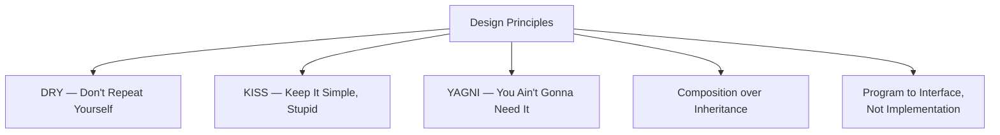

# Design Principles

## Introduction

**Design principles** are guidelines that help developers create better software. Unlike SOLID (which is more specific), these principles are **general rules of thumb** that apply across paradigms and languages.

---

## The Principles



---

## DRY — Don't Repeat Yourself

> **Every piece of knowledge must have a single, unambiguous, authoritative representation within a system.**

### Problem — Duplicated Code
```javascript
function validateUser(name, email, age) {
  if (!name || name.length < 2) throw new Error("Invalid name");
  if (!email || !email.includes("@")) throw new Error("Invalid email");
}
function validateProduct(name, price, quantity) {
  if (!name || name.length < 2) throw new Error("Invalid name");
}
```

### Solution — Extract Reusable Code
```javascript
function required(value, message) { if (!value) throw new Error(message); }
function minLength(value, min, message) { if (value.length < min) throw new Error(message); }
```

---

## KISS — Keep It Simple, Stupid

> **Most systems work best if they are kept simple rather than made complex.**

- Choose the simplest solution that works
- Don't add patterns/frameworks until needed
- Favor readability over cleverness

---

## YAGNI — You Ain't Gonna Need It

> **Always implement things when you actually need them, never when you just foresee that you might need them.**

```javascript
// ❌ Building for future that may never come
class User {
  constructor(name) {
    this.theme = "light";          // Might be needed later?
    this.locale = "en-US";         // Might be needed later?
  }
}

// ✅ Only what's needed now
class User {
  constructor(name, email) {
    this.name = name;
    this.email = email;
  }
}
```

---

## Composition over Inheritance

> **Prefer composing objects from smaller parts over inheriting from large base classes.**

```javascript
// ❌ Deep inheritance — fragile
class Bird { fly() { /* ... */ } }
class Penguin extends Bird { fly() { throw "Can't fly"; } } // LSP violation!

// ✅ Composition — flexible
class FlyBehavior { fly() { /* flying logic */ } }
class Bird {
  constructor(flyBehavior) { this.flyBehavior = flyBehavior; }
  fly() { this.flyBehavior.fly(); }
}
```

---

## Program to an Interface, Not an Implementation

> **Depend on abstract interfaces rather than concrete classes.**

```javascript
// ❌ Tight coupling
class PaymentService {
  process(amount) { const stripe = new StripeAPI(); stripe.charge(amount); }
}

// ✅ Programming to interface
class PaymentService {
  constructor(paymentGateway) { this.paymentGateway = paymentGateway; }
  process(amount) { this.paymentGateway.charge(amount); }
}
```

---

## Summary

| Principle | One-Liner |
|-----------|-----------|
| **DRY** | Don't repeat yourself — extract duplication |
| **KISS** | Keep it simple — simplest solution works |
| **YAGNI** | Don't build for the unknown future |
| **Composition** | Prefer has-a over is-a |
| **Program to Interface** | Depend on abstractions |

---

**Previous Topic:** [SOLID Principles →](/DSA-Notes-Problems/oops/06-design-principles/solid-principles)
**Next Topic:** [Practice →](/DSA-Notes-Problems/oops/07-practice/)
