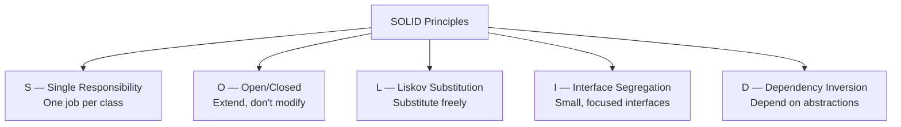

# SOLID Principles

## Introduction

**SOLID** is an acronym for five fundamental principles of object-oriented design. These principles guide developers to create code that is **maintainable**, **scalable**, and **flexible**.

The term was coined by **Robert C. Martin (Uncle Bob)** in the early 2000s.

| Letter | Principle | Core Idea |
|--------|-----------|-----------|
| **S** | **Single Responsibility** | A class should have one reason to change |
| **O** | **Open/Closed** | Open for extension, closed for modification |
| **L** | **Liskov Substitution** | Subtypes must be substitutable for their base types |
| **I** | **Interface Segregation** | Many specific interfaces are better than one general interface |
| **D** | **Dependency Inversion** | Depend on abstractions, not concrete implementations |

---

## Visual Overview



---

## S — Single Responsibility Principle (SRP)

> **A class should have only one reason to change.**

### Problem
```javascript
// ❌ Violates SRP — three responsibilities
class ReportManager {
  generateReport(data) { /* ... */ }
  printReport(report) { /* ... */ }
  emailReport(report) { /* ... */ }
}
```

### Solution
```javascript
// ✅ Follows SRP
class ReportGenerator { generate(data) { /* ... */ } }
class ReportPrinter { print(report) { /* ... */ } }
class EmailService { send(to, report) { /* ... */ } }
```

---

## O — Open/Closed Principle (OCP)

> **Classes should be open for extension but closed for modification.**

### Problem
```javascript
// ❌ Violates OCP — adding new shape requires modification
class AreaCalculator {
  calculate(shape) {
    if (shape.type === "circle") { return Math.PI * shape.radius ** 2; }
    else if (shape.type === "rectangle") { return shape.width * shape.height; }
    // Need to add more 'else if' for new shapes!
  }
}
```

### Solution
```javascript
// ✅ Follows OCP
class Shape { area() { return 0; } }
class Circle extends Shape { area() { return Math.PI * this.radius ** 2; } }
class Rectangle extends Shape { area() { return this.w * this.h; } }
// New shape — no existing code modified!
class Triangle extends Shape { area() { return (this.b * this.h) / 2; } }
```

---

## L — Liskov Substitution Principle (LSP)

> **Subtypes must be substitutable for their base types.**

### Problem
```javascript
class Rectangle {
  setWidth(w) { this.width = w; }
  setHeight(h) { this.height = h; }
  area() { return this.width * this.height; }
}

class Square extends Rectangle {
  setWidth(w) { this.width = w; this.height = w; } // Changes behavior!
  setHeight(h) { this.width = h; this.height = h; } // Changes behavior!
}
```

### Solution
Separate interfaces for different shapes — don't force Square to inherit from Rectangle.

---

## I — Interface Segregation Principle (ISP)

> **Many specific interfaces are better than one general interface.**

### Problem
```javascript
class MultiFunctionDevice {
  print() { throw "Not implemented"; }
  scan() { throw "Not implemented"; }
  fax() { throw "Not implemented"; }
}
```

### Solution
```javascript
class Printer { print() { /* ... */ } }
class Scanner { scan() { /* ... */ } }
class SimplePrinter extends Printer { print() { /* works */ } }
```

---

## D — Dependency Inversion Principle (DIP)

> **Depend on abstractions, not concrete implementations.**

### Problem
```javascript
class UserService {
  constructor() {
    this.db = new MySQLDatabase(); // Direct dependency!
  }
}
```

### Solution
```javascript
class UserService {
  constructor(database) {
    this.db = database; // Depends on abstraction
  }
}
```

---

## Benefits of SOLID

| Principle | Benefit |
|-----------|---------|
| **SRP** | Easier to understand, test, and maintain |
| **OCP** | Add features without breaking existing code |
| **LSP** | Inheritance hierarchies are reliable |
| **ISP** | Classes aren't forced to implement unused methods |
| **DIP** | Loose coupling, easy to swap implementations |

---

## Summary

| Principle | One-Liner |
|-----------|-----------|
| **S** | One class = one job |
| **O** | Extend without modifying |
| **L** | Don't break parent contracts |
| **I** | Small, focused interfaces |
| **D** | Depend on abstractions |

---

**Previous Topic:** [Design Principles →](/DSA-Notes-Problems/oops/06-design-principles/)
**Next Topic:** [Design Principles (DRY, KISS, YAGNI) →](/DSA-Notes-Problems/oops/06-design-principles/design-principles)
