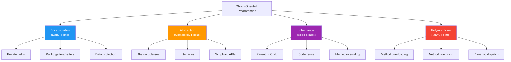
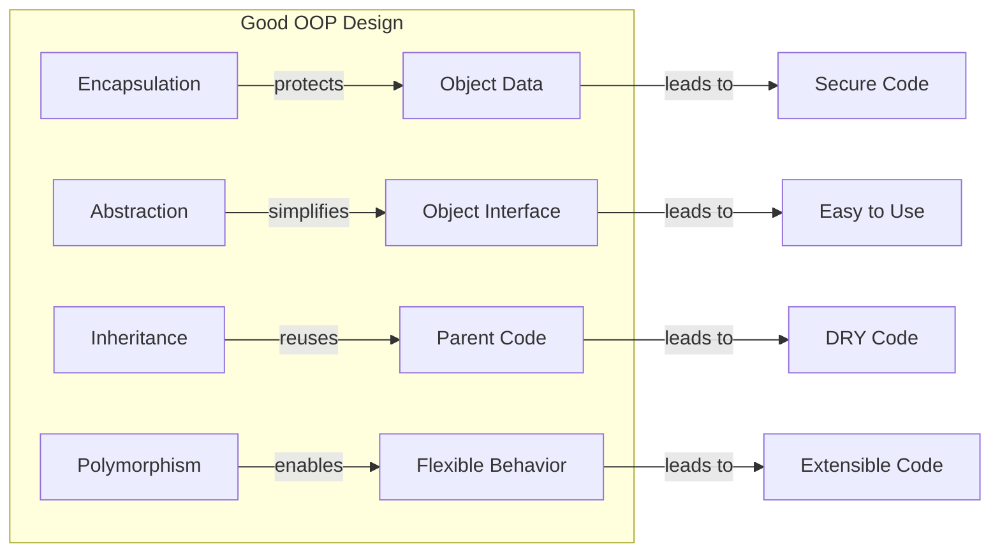

# Four Pillars of OOP

## Introduction

Object-Oriented Programming is built on **four fundamental principles** — often called the "four pillars." These pillars are the foundation of good OOP design. Understanding them is essential for writing maintainable, scalable, and reusable code.

### The Four Pillars

| Pillar | Purpose | Real-World Analogy |
|--------|---------|-------------------|
| **Encapsulation** | Bundle data + methods; hide internal state | An ATM — you interact with the screen, not the internal mechanics |
| **Abstraction** | Hide complexity, show only essentials | A car steering wheel — you turn it without understanding the engine |
| **Inheritance** | Reuse code from parent classes | Children inherit traits from parents |
| **Polymorphism** | Same interface, different behavior | A universal remote works differently with different devices |

---

## Visual Overview



---

## 1. Encapsulation 🫖

**Definition:** Bundling data (properties) and methods that operate on that data within a single unit (class/object), while restricting direct access to internal details.

```javascript
class BankAccount {
  #balance = 0; // Private field

  deposit(amount) {
    if (amount > 0) this.#balance += amount;
  }

  getBalance() {
    return this.#balance;
  }
}
```

**Key idea:** Hide internal data, expose only what's needed.

---

## 2. Abstraction 🎛️

**Definition:** Hiding complex implementation details and showing only the essential features of an object.

```javascript
class CoffeeMachine {
  makeCoffee(type) {
    this.#heatWater();
    this.#grindBeans();
    return `☕ ${type} ready!`;
  }

  #heatWater() { /* complex heating */ }
  #grindBeans() { /* complex grinding */ }
}
```

**Key idea:** Users interact with a simple interface, not complex internals.

---

## 3. Inheritance 👪

**Definition:** Creating new classes based on existing classes, reusing their properties and methods while adding new features.

```javascript
class Animal {
  constructor(name) { this.name = name; }
  speak() { return `${this.name} makes a sound`; }
}

class Dog extends Animal {
  speak() { return `${this.name} barks!`; }
}
```

**Key idea:** Child classes inherit from parent classes (IS-A relationship).

---

## 4. Polymorphism 🎭

**Definition:** The ability of objects of different types to respond to the same method call in different ways.

```javascript
const animals = [new Dog("Rex"), new Cat("Whiskers")];
animals.forEach(a => console.log(a.speak()));
// "Rex barks!"
// "Whiskers meows!"
```

**Key idea:** Same method name, different implementations.

---

## Quick Comparison

| Aspect | Encapsulation | Abstraction | Inheritance | Polymorphism |
|--------|---------------|-------------|-------------|--------------|
| **Focus** | Data hiding | Complexity hiding | Code reuse | Many forms |
| **How** | Private fields | Interfaces/abstract classes | `extends`/`inherits` | Override/overload |
| **Benefit** | Security | Simplicity | Reusability | Flexibility |
| **Real World** | ATM machine | Car steering wheel | Family traits | Universal remote |

---

## How They Work Together



In a well-designed OOP system:
- **Encapsulation** keeps data safe
- **Abstraction** makes the system easy to use
- **Inheritance** avoids code duplication
- **Polymorphism** makes the system flexible and extensible

---

## Summary

| Pillar | One-Liner |
|--------|-----------|
| **Encapsulation** | Bundle data + methods; protect internal state |
| **Abstraction** | Hide complexity; show essential features |
| **Inheritance** | Reuse and extend existing code |
| **Polymorphism** | Same interface, different behaviors |

---

**Previous Topic:** [this Keyword →](/DSA-Notes-Problems/oops/06-this-keyword)
**Next Topic:** [Encapsulation →](/DSA-Notes-Problems/oops/08-encapsulation)
**Related Topics:** [All Four Pillars](/DSA-Notes-Problems/oops/08-encapsulation), [SOLID](/DSA-Notes-Problems/oops/17-solid-principles)
