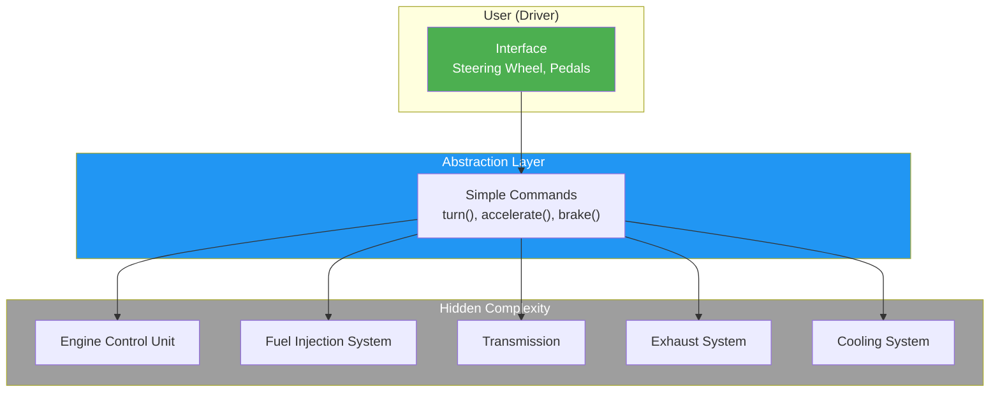
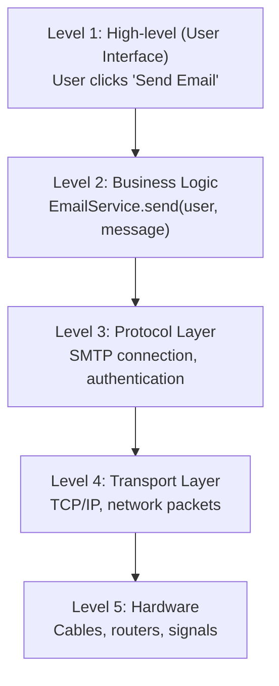

# Abstraction

## Introduction

**Abstraction** is the concept of hiding complex implementation details and showing only the essential features of an object. It's about **what** an object does, not **how** it does it.

Abstraction is often confused with encapsulation, but they're different:
- **Encapsulation** = Hiding **data** (internal state)
- **Abstraction** = Hiding **implementation** (how things work)

### Why Does It Exist?
- To **reduce complexity** — users interact with simple interfaces, not complex internals
- To **separate concerns** — what vs how
- To **manage change** — implementations can change without affecting users
- To **focus on essentials** — ignore irrelevant details

### Why Do Developers Use It?
- To build layered architectures (each layer abstracts the one below)
- To create reusable libraries and frameworks
- To simplify API design for consumers

---

## Real-World Analogy: Car Driving

When you drive a car:
- You use the **steering wheel**, **pedals**, and **dashboard** (interface)
- You **don't** need to understand the engine, transmission, fuel injection, or exhaust system
- You can drive any car because the interface is standardized
- The manufacturer can change the engine design; you still drive the same way

This is abstraction: the car provides a simple interface while hiding enormous complexity.

---

## Definition

**Abstraction** is the concept of exposing only the essential, high-level features of an object while hiding the underlying implementation details. It's about creating a simplified model of a complex reality.

---

## Why Do We Need It?

Without abstraction:

```javascript
// ❌ No abstraction — caller must understand internals
function sendEmail(user, message) {
  const smtpServer = "smtp.gmail.com";
  const port = 587;
  const connection = net.createConnection(smtpServer, port);
  connection.send(`EHLO ${smtpServer}`);
  connection.send("AUTH LOGIN");
  connection.send(Buffer.from(user.email).toString("base64"));
  connection.send(Buffer.from(user.password).toString("base64"));
  connection.send(`FROM: ${user.email}`);
  connection.send(`TO: ${message.to}`);
  connection.send(`SUBJECT: ${message.subject}`);
  connection.send(message.body);
  connection.close();
}
```

With abstraction:

```javascript
// ✅ Abstraction — simple interface hides complexity
class EmailService {
  send(user, message) {
    this.#connect();
    this.#authenticate(user);
    this.#sendMessage(user, message);
    this.#disconnect();
  }

  #connect() { /* Complex SMTP connection logic */ }
  #authenticate(user) { /* Auth logic */ }
  #sendMessage(user, message) { /* Sending logic */ }
  #disconnect() { /* Cleanup */ }
}

const emailService = new EmailService();
emailService.send(user, message); // Simple!
```

---

## Visual Explanation



---

## Code Examples

### JavaScript

```javascript
// Abstraction using private methods
class MusicPlayer {
  play(track) {
    this.#loadTrack(track);
    this.#decodeAudio();
    this.#outputToSpeakers();
    console.log(`Playing: ${track.title}`);
  }

  pause() {
    this.#pauseAudio();
  }

  // Private implementation — hidden from users
  #loadTrack(track) {
    // Read file, check format, load into buffer
  }

  #decodeAudio() {
    // MP3/AAC/FLAC decoding
  }

  #outputToSpeakers() {
    // DAC conversion, amplification
  }

  #pauseAudio() {
    // Stop output, save position
  }
}

const player = new MusicPlayer();
player.play({ title: "Bohemian Rhapsody", artist: "Queen" });
// User doesn't need to know about audio decoding!
```

### TypeScript (Abstract Classes)

```typescript
// Abstract class defines WHAT, not HOW
abstract class ReportGenerator {
  // Template method — defines the algorithm structure
  generate(data: any[]): string {
    const header = this.createHeader();
    const body = this.createBody(data);
    const footer = this.createFooter();
    return header + body + footer;
  }

  // Abstract methods — subclasses provide implementation
  protected abstract createHeader(): string;
  protected abstract createBody(data: any[]): string;
  protected abstract createFooter(): string;
}

// Concrete implementation
class HTMLReport extends ReportGenerator {
  protected createHeader(): string {
    return "<html><body><h1>Report</h1>";
  }
  protected createBody(data: any[]): string {
    return "<table>" + data.map(d => `<tr><td>${d}</td></tr>`).join("") + "</table>";
  }
  protected createFooter(): string {
    return "</body></html>";
  }
}

// Another implementation
class JSONReport extends ReportGenerator {
  protected createHeader(): string { return "["; }
  protected createBody(data: any[]): string {
    return JSON.stringify(data);
  }
  protected createFooter(): string { return "]"; }
}

function generateReport(report: ReportGenerator, data: any[]) {
  console.log(report.generate(data));
  // Works with any ReportGenerator!
}
```

### Python

```python
from abc import ABC, abstractmethod

class Database(ABC):
    """Abstract base class — defines the interface."""

    @abstractmethod
    def connect(self) -> None:
        pass

    @abstractmethod
    def query(self, sql: str) -> list:
        pass

    @abstractmethod
    def disconnect(self) -> None:
        pass

    # Concrete method that uses abstract methods
    def find_user(self, user_id: int) -> dict:
        """High-level operation using abstract primitives."""
        self.connect()
        result = self.query(f"SELECT * FROM users WHERE id = {user_id}")
        self.disconnect()
        return result[0] if result else None

class PostgreSQL(Database):
    def connect(self) -> None:
        print("Connecting to PostgreSQL...")

    def query(self, sql: str) -> list:
        print(f"Executing: {sql}")
        return [{"id": 1, "name": "Alice"}]

    def disconnect(self) -> None:
        print("Disconnecting...")

class MySQL(Database):
    def connect(self) -> None:
        print("Connecting to MySQL...")

    def query(self, sql: str) -> list:
        print(f"Executing: {sql}")
        return [{"id": 1, "name": "Alice"}]

    def disconnect(self) -> None:
        print("Disconnecting...")
```

### Java

```java
// Interface — pure abstraction
interface PaymentProcessor {
    void processPayment(double amount);
    void refund(String transactionId);
}

// Concrete implementation 1
class CreditCardProcessor implements PaymentProcessor {
    @Override
    public void processPayment(double amount) {
        // Connect to credit card network
        // Validate card details
        // Process transaction
        System.out.println("Processing credit card payment: $" + amount);
    }

    @Override
    public void refund(String transactionId) {
        System.out.println("Refunding transaction: " + transactionId);
    }
}

// Concrete implementation 2
class PayPalProcessor implements PaymentProcessor {
    @Override
    public void processPayment(double amount) {
        // Connect to PayPal API
        // Handle OAuth
        // Process transaction
        System.out.println("Processing PayPal payment: $" + amount);
    }

    @Override
    public void refund(String transactionId) {
        System.out.println("Refunding via PayPal: " + transactionId);
    }
}

// Client code works with abstraction, not implementation
class CheckoutService {
    private PaymentProcessor processor;

    public CheckoutService(PaymentProcessor processor) {
        this.processor = processor;
    }

    public void checkout(double amount) {
        processor.processPayment(amount);
    }
}
```

---

## Abstraction vs Encapsulation

| Aspect | Encapsulation | Abstraction |
|--------|---------------|-------------|
| **Focus** | Hiding **data** | Hiding **implementation** |
| **Goal** | Protect internal state | Simplify interaction |
| **How** | Private fields, getters/setters | Abstract classes, interfaces |
| **Answers** | "How is data protected?" | "What does this object do?" |
| **Implementation** | Access modifiers | Abstract methods, interfaces |

---

## Levels of Abstraction



---

## Best Practices

- **Program to interfaces**, not implementations
- **Use abstract classes** for shared state + behavior
- **Use interfaces** for contracts (pure abstraction)
- **Keep abstractions stable** — changes to abstractions are expensive
- **Don't over-abstract** — too many layers make code hard to follow
- **Follow the dependency inversion principle** — depend on abstractions

---

## Common Mistakes

- **Over-abstraction** — creating interfaces and abstract classes for everything
- **Leaky abstractions** — implementation details that bleed through the interface
- **Inconsistent abstraction levels** — mixing high-level and low-level in the same class
- **Abstract classes with no concrete implementations**
- **Interfaces that are too large** (Interface Segregation Principle violation)

---

## Interview Questions

**Easy:**
1. What is abstraction in OOP?
2. How is abstraction different from encapsulation?
3. Give a real-world example of abstraction.

**Medium:**
4. How do abstract classes and interfaces achieve abstraction?
5. What's the difference between abstract class and interface?
6. How does abstraction improve code maintainability?

**Advanced:**
7. Explain the concept of "leaky abstractions" with examples.
8. How do you determine the right level of abstraction?
9. How does dependency inversion depend on abstraction?

---

## Summary

| Concept | Key Point |
|---------|-----------|
| **Abstraction** | Hide complexity, show essentials |
| **How** | Abstract classes, interfaces, private methods |
| **Purpose** | Simplify interaction, manage complexity |
| **vs Encapsulation** | Abstraction hides *how*, Encapsulation hides *data* |
| **Rule of Thumb** | Code to interfaces, not implementations |

---

**Previous Topic:** [Encapsulation →](/DSA-Notes-Problems/oops/08-encapsulation)
**Next Topic:** [Inheritance →](/DSA-Notes-Problems/oops/10-inheritance)
**Related Topics:** [Interfaces](/DSA-Notes-Problems/oops/22-interfaces), [Abstract Classes](/DSA-Notes-Problems/oops/23-abstract-classes)
