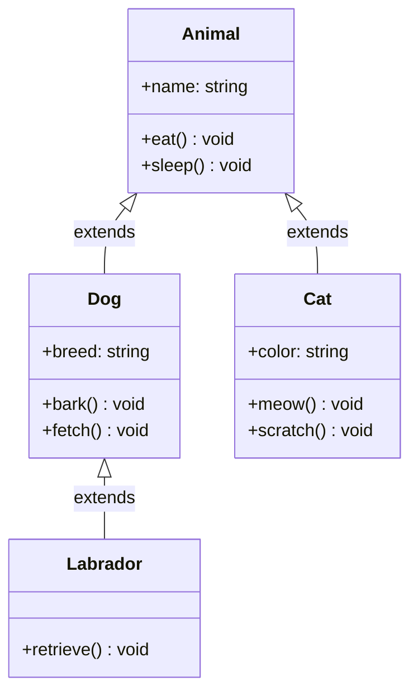
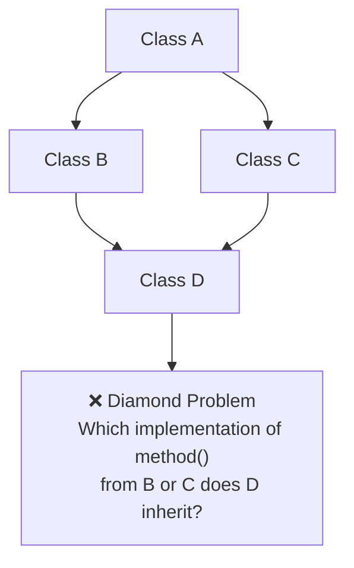

# Inheritance

## Introduction

**Inheritance** is a mechanism that allows a class (child/derived class) to inherit properties and methods from another class (parent/base class). It's one of the four pillars of OOP and enables **code reuse** and **hierarchical relationships**.

### Why Does It Exist?
- To **reuse code** without duplication
- To create **hierarchical relationships** between classes (IS-A relationship)
- To enable **polymorphism** through shared interfaces
- To create **specialized versions** of general concepts

### Why Do Developers Use It?
- To avoid rewriting common code in multiple classes
- To model real-world hierarchical relationships (Dog IS-A Animal)
- To create extensible frameworks and libraries
- To implement the Open/Closed Principle (open for extension, closed for modification)

---

## Real-World Analogy: Family Traits

Children inherit traits from their parents:
- **Parents** provide a genetic blueprint (eye color, height, certain behaviors)
- **Children** get all these traits automatically
- **Children** can also have their own unique traits
- **Children** can override inherited traits (e.g., dye their hair a different color)

A child IS-A descendant of their parent — the same type of relationship exists with class inheritance.

---

## Definition

**Inheritance** is the mechanism where a new class is derived from an existing class. The derived class automatically contains all non-private properties and methods of the base class, and can add new members or override existing ones.

---

## Why Do We Need It?

Without inheritance:

```javascript
// ❌ Without inheritance — duplicated code
class Dog {
  constructor(name) { this.name = name; }
  eat() { console.log(`${this.name} is eating`); }
  sleep() { console.log(`${this.name} is sleeping`); }
  bark() { console.log(`${this.name} barks`); }
}

class Cat {
  constructor(name) { this.name = name; }
  eat() { console.log(`${this.name} is eating`); } // Duplicate!
  sleep() { console.log(`${this.name} is sleeping`); } // Duplicate!
  meow() { console.log(`${this.name} meows`); }
}
```

With inheritance:

```javascript
// ✅ With inheritance — shared code in parent
class Animal {
  constructor(name) { this.name = name; }
  eat() { console.log(`${this.name} is eating`); }
  sleep() { console.log(`${this.name} is sleeping`); }
}

class Dog extends Animal {
  bark() { console.log(`${this.name} barks`); }
}

class Cat extends Animal {
  meow() { console.log(`${this.name} meows`); }
}
```

---

## Visual Explanation



---

## Types of Inheritance

### 1. Single Inheritance

One child inherits from one parent.

```javascript
class Parent { /* ... */ }
class Child extends Parent { /* ... */ }
```

**Supported by:** JavaScript, TypeScript, Python, Java, C#

### 2. Multilevel Inheritance

A chain of inheritance — A → B → C.

```javascript
class Animal { /* ... */ }
class Mammal extends Animal { /* ... */ }
class Dog extends Mammal { /* ... */ }
```

### 3. Hierarchical Inheritance

One parent, multiple children.

```javascript
class Animal { /* ... */ }
class Dog extends Animal { /* ... */ }
class Cat extends Animal { /* ... */ }
class Bird extends Animal { /* ... */ }
```

### 4. Multiple Inheritance (NOT supported in most languages)

A child inherits from multiple parents.

```javascript
// ❌ Not supported in JavaScript, TypeScript, Java, C#
// Supported in Python, C++
class Child extends Parent1, Parent2 { /* ... */ }
```

**The Diamond Problem:**



### 5. Hybrid Inheritance

Combination of multiple types — problematic due to diamond problem.

---

## Code Examples

### JavaScript

```javascript
class Vehicle {
  constructor(make, model, year) {
    this.make = make;
    this.model = model;
    this.year = year;
  }

  start() {
    console.log(`${this.make} ${this.model} is starting...`);
  }

  stop() {
    console.log(`${this.make} ${this.model} is stopping...`);
  }

  getInfo() {
    return `${this.year} ${this.make} ${this.model}`;
  }
}

// Single inheritance
class Car extends Vehicle {
  constructor(make, model, year, doors) {
    super(make, model, year); // Call parent constructor
    this.doors = doors;
  }

  honk() {
    console.log("Beep beep!");
  }

  // Override parent method
  getInfo() {
    return `${super.getInfo()} — ${this.doors} doors`;
  }
}

// Multilevel inheritance
class ElectricCar extends Car {
  constructor(make, model, year, doors, batteryRange) {
    super(make, model, year, doors);
    this.batteryRange = batteryRange;
  }

  // Override again
  start() {
    console.log(`⚡ ${this.make} ${this.model} is starting silently...`);
  }

  charge() {
    console.log("Charging battery...");
  }
}

const tesla = new ElectricCar("Tesla", "Model 3", 2024, 4, 358);
console.log(tesla.getInfo()); // "2024 Tesla Model 3 — 4 doors"
tesla.start();                // "⚡ Tesla Model 3 is starting silently..."
tesla.charge();               // "Charging battery..."
tesla.stop();                 // "Tesla Model 3 is stopping..."
```

### TypeScript

```typescript
abstract class Shape {
  constructor(protected color: string) {}

  abstract calculateArea(): number;

  getColor(): string {
    return this.color;
  }
}

class Circle extends Shape {
  constructor(color: string, private radius: number) {
    super(color);
  }

  calculateArea(): number {
    return Math.PI * this.radius ** 2;
  }
}

class Rectangle extends Shape {
  constructor(
    color: string,
    private width: number,
    private height: number
  ) {
    super(color);
  }

  calculateArea(): number {
    return this.width * this.height;
  }
}

const shapes: Shape[] = [
  new Circle("red", 5),
  new Rectangle("blue", 4, 6)
];

shapes.forEach(s => {
  console.log(`${s.getColor()} area: ${s.calculateArea()}`);
});
```

### Python

```python
class Employee:
    def __init__(self, name: str, employee_id: int):
        self.name = name
        self.employee_id = employee_id

    def work(self) -> str:
        return f"{self.name} is working"

    def get_info(self) -> str:
        return f"Employee: {self.name} (ID: {self.employee_id})"

class Manager(Employee):
    def __init__(self, name: str, employee_id: int, team_size: int):
        super().__init__(name, employee_id)
        self.team_size = team_size

    # Override parent method
    def work(self) -> str:
        return f"{self.name} is managing {self.team_size} people"

    def hold_meeting(self) -> str:
        return f"{self.name} is holding a team meeting"

class Developer(Employee):
    def __init__(self, name: str, employee_id: int, language: str):
        super().__init__(name, employee_id)
        self.language = language

    def work(self) -> str:
        return f"{self.name} is coding in {self.language}"

    def code_review(self) -> str:
        return f"{self.name} is reviewing code"

# Multilevel
class SeniorDeveloper(Developer):
    def __init__(self, name: str, employee_id: int, language: str, mentees: int):
        super().__init__(name, employee_id, language)
        self.mentees = mentees

    def work(self) -> str:
        return f"{self.name} is mentoring {self.mentees} junior devs"
```

### Java

```java
// Multiple inheritance via interfaces
interface Swimmable {
    void swim();
}

interface Flyable {
    void fly();
}

class Animal {
    protected String name;

    public Animal(String name) {
        this.name = name;
    }

    public void eat() {
        System.out.println(name + " is eating");
    }
}

class Duck extends Animal implements Swimmable, Flyable {
    public Duck(String name) {
        super(name);
    }

    @Override
    public void swim() {
        System.out.println(name + " is swimming");
    }

    @Override
    public void fly() {
        System.out.println(name + " is flying");
    }

    @Override
    public void eat() {
        System.out.println(name + " is eating duck food");
    }
}
```

---

## Inheritance Types Comparison

| Type | Description | Support | Example |
|------|-------------|---------|---------|
| **Single** | One child, one parent | All OOP languages | `Dog extends Animal` |
| **Multilevel** | Chain of inheritance | All OOP languages | `A → B → C` |
| **Hierarchical** | Many children, one parent | All OOP languages | `Animal → Dog, Cat, Bird` |
| **Multiple** | One child, many parents | Python, C++ | `Duck extends Animal, Flyable` |
| **Hybrid** | Combination | C++ | Rarely used |

---

## The `super` Keyword

`super` (or `super()` in Java/Python) is used to access parent class members.

```javascript
class Parent {
  constructor(x) { this.x = x; }
  method() { return "parent"; }
}

class Child extends Parent {
  constructor(x, y) {
    super(x);      // Call parent constructor
    this.y = y;
  }

  method() {
    return super.method() + " + child"; // Call parent method
  }
}
```

---

## Method Overriding

When a child class redefines a method from the parent:

```javascript
class Animal {
  speak() { return "Some sound"; }
}

class Dog extends Animal {
  speak() { return "Woof!"; } // Override
}
```

**Rules:**
- Method signature must match (same name, same parameters)
- Access level cannot be more restrictive
- Use `super.methodName()` to call the parent version
- In Java/C#, use `@Override` annotation

---

## Best Practices

- **Favor composition over inheritance** — "Has-a" is often better than "is-a"
- **Keep inheritance hierarchies shallow** — 3-4 levels max
- **Follow the Liskov Substitution Principle** — child should be substitutable for parent
- **Use inheritance for behavior, not just code reuse**
- **Make base classes abstract** if they shouldn't be instantiated
- **Document overridden methods** — `super()` calls included

---

## Common Mistakes

- **Deep inheritance chains** — Hard to understand and maintain
- **Breaking LSP** — Child class that doesn't behave like parent
- **Overusing inheritance** for code reuse — composition is usually better
- **Calling overridable methods in constructors** — May call child method before child is initialized
- **Misusing `super`** — Forgetting to call parent constructor

---

## Interview Questions

**Easy:**
1. What is inheritance in OOP?
2. What's the difference between a parent and child class?
3. What are the different types of inheritance?

**Medium:**
4. What is the diamond problem and how is it resolved?
5. What's the difference between inheritance and composition?
6. How does method overriding work with inheritance?

**Advanced:**
7. Explain the Liskov Substitution Principle with inheritance examples.
8. How does JavaScript's prototypal inheritance differ from classical inheritance?
9. When should you prefer composition over inheritance?

---

## Summary

| Concept | Key Point |
|---------|-----------|
| **Inheritance** | Child class extends parent class (IS-A) |
| **Benefits** | Code reuse, hierarchical modeling, polymorphism |
| **Types** | Single, Multilevel, Hierarchical, Multiple, Hybrid |
| **super** | Access parent class constructor and methods |
| **Override** | Child redefines parent method |
| **Rule of Thumb** | Prefer composition unless IS-A is clearly satisfied |

---

**Previous Topic:** [Abstraction →](/DSA-Notes-Problems/oops/09-abstraction)
**Next Topic:** [Polymorphism →](/DSA-Notes-Problems/oops/11-polymorphism)
**Related Topics:** [Abstract Classes](/DSA-Notes-Problems/oops/23-abstract-classes), [Method Overriding](/DSA-Notes-Problems/oops/21-method-overriding)
