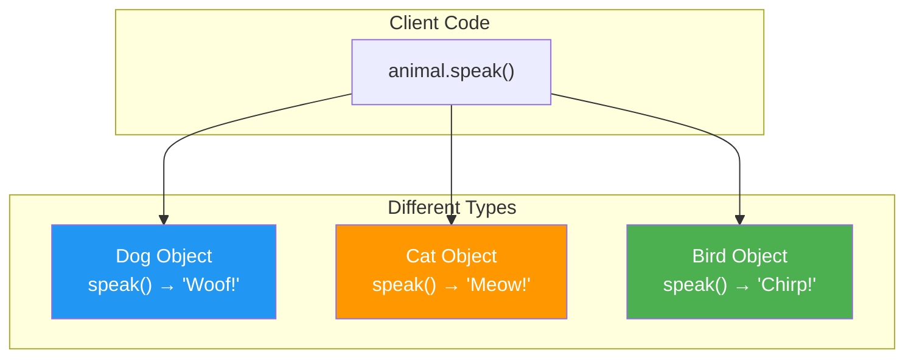

# Polymorphism

## Introduction

**Polymorphism** (from Greek: "poly" = many, "morph" = form) is the ability of objects of different types to respond to the same method call in **different ways**. It's one of the four pillars of OOP and enables flexible, extensible code.

### Why Does It Exist?
- To write code that works with **multiple types** without knowing their specific implementation
- To enable **extensibility** — new types can be added without changing existing code
- To implement **strategy pattern** — swapping behaviors at runtime
- To realize the principle "**program to an interface, not an implementation**"

### Why Do Developers Use It?
- To write generic code that handles different types uniformly
- To add new functionality without modifying existing code (Open/Closed Principle)
- To implement callbacks, plugins, and pluggable architectures
- To reduce coupling between components

---

## Real-World Analogy: A Universal Remote

A universal remote has buttons like "Power", "Volume Up", "Volume Down":
- When pointed at a **TV**, pressing "Power" turns the TV on/off
- When pointed at a **Sound System**, pressing "Power" turns the audio on/off
- When pointed at a **DVD Player**, pressing "Power" ejects the tray

Same button (interface), different behavior depending on the device (implementation). That's polymorphism!

---

## Definition

**Polymorphism** is the ability of different classes to provide their own implementation of methods that share the same name, allowing objects of different types to be treated uniformly through a common interface.

---

## Why Do We Need It?

Without polymorphism:

```javascript
// ❌ Without polymorphism — conditional logic for each type
function processPayment(payment, amount) {
  if (payment.type === "credit") {
    // Credit card processing
  } else if (payment.type === "paypal") {
    // PayPal processing
  } else if (payment.type === "bitcoin") {
    // Bitcoin processing
  }
  // Every time a new type is added, this function must change!
}
```

With polymorphism:

```javascript
// ✅ With polymorphism — each type handles itself
function processPayment(payment, amount) {
  payment.process(amount); // Each payment type implements its own process()
}

// New payment types can be added without changing processPayment()
```

---

## Visual Explanation



---

## Types of Polymorphism

### 1. Compile-Time (Static) Polymorphism — Method Overloading

Multiple methods with the **same name** but **different parameters**. Resolved at compile time.

```javascript
// JavaScript doesn't support true overloading, but can simulate
class Calculator {
  // Using default parameters and type checking
  add(a, b, c) {
    if (c !== undefined) return a + b + c;
    return a + b;
  }
}

console.log(calc.add(2, 3));      // 5
console.log(calc.add(2, 3, 4));   // 9
```

### 2. Run-Time (Dynamic) Polymorphism — Method Overriding

A child class provides its own implementation of a method defined in the parent. Resolved at runtime.

```javascript
class Animal {
  speak() { return "Some sound"; }
}

class Dog extends Animal {
  speak() { return "Woof!"; } // Override
}

class Cat extends Animal {
  speak() { return "Meow!"; } // Override
}

function makeSound(animal) {
  console.log(animal.speak()); // Behavior depends on actual type
}

makeSound(new Dog()); // "Woof!"
makeSound(new Cat()); // "Meow!"
```

---

## Code Examples

### JavaScript

```javascript
// Polymorphism through inheritance
class Shape {
  area() {
    return 0;
  }
}

class Circle extends Shape {
  constructor(radius) {
    super();
    this.radius = radius;
  }

  area() {
    return Math.PI * this.radius ** 2;
  }
}

class Rectangle extends Shape {
  constructor(width, height) {
    super();
    this.width = width;
    this.height = height;
  }

  area() {
    return this.width * this.height;
  }
}

class Triangle extends Shape {
  constructor(base, height) {
    super();
    this.base = base;
    this.height = height;
  }

  area() {
    return (this.base * this.height) / 2;
  }
}

// Polymorphic function — works with any Shape
function printArea(shape) {
  console.log(`Area: ${shape.area()}`);
}

const shapes = [
  new Circle(5),
  new Rectangle(4, 6),
  new Triangle(3, 8)
];

shapes.forEach(s => printArea(s));
// Area: 78.539...
// Area: 24
// Area: 12
```

### TypeScript (Interface-based Polymorphism)

```typescript
// Interface-based polymorphism
interface NotificationChannel {
  send(message: string): void;
}

class EmailChannel implements NotificationChannel {
  send(message: string): void {
    console.log(`📧 Sending email: ${message}`);
  }
}

class SMSChannel implements NotificationChannel {
  send(message: string): void {
    console.log(`📱 Sending SMS: ${message}`);
  }
}

class PushChannel implements NotificationChannel {
  send(message: string): void {
    console.log(`🔔 Sending push notification: ${message}`);
  }
}

class NotificationService {
  constructor(private channels: NotificationChannel[]) {}

  notify(message: string): void {
    // Polymorphic call — works with any NotificationChannel
    this.channels.forEach(channel => channel.send(message));
  }
}

const service = new NotificationService([
  new EmailChannel(),
  new SMSChannel(),
  new PushChannel()
]);

service.notify("Your order has shipped!");
// 📧 Sending email: Your order has shipped!
// 📱 Sending SMS: Your order has shipped!
// 🔔 Sending push notification: Your order has shipped!
```

### Python

```python
from abc import ABC, abstractmethod

class Payment(ABC):
    @abstractmethod
    def pay(self, amount: float) -> str:
        pass

class CreditCard(Payment):
    def pay(self, amount: float) -> str:
        return f"Paid ${amount} using Credit Card"

class PayPal(Payment):
    def pay(self, amount: float) -> str:
        return f"Paid ${amount} using PayPal"

class Crypto(Payment):
    def pay(self, amount: float) -> str:
        return f"Paid ${amount} in Cryptocurrency"

# Polymorphic function
def checkout(payment_method: Payment, amount: float):
    print(payment_method.pay(amount))  # Same call, different behavior

checkout(CreditCard(), 100)  # "Paid $100 using Credit Card"
checkout(PayPal(), 50)       # "Paid $50 using PayPal"
checkout(Crypto(), 200)      # "Paid $200 in Cryptocurrency"
```

### Java

```java
interface SortStrategy {
    void sort(int[] numbers);
}

class BubbleSort implements SortStrategy {
    @Override
    public void sort(int[] numbers) {
        System.out.println("Sorting using Bubble Sort");
    }
}

class QuickSort implements SortStrategy {
    @Override
    public void sort(int[] numbers) {
        System.out.println("Sorting using Quick Sort");
    }
}

class MergeSort implements SortStrategy {
    @Override
    public void sort(int[] numbers) {
        System.out.println("Sorting using Merge Sort");
    }
}

class Sorter {
    private SortStrategy strategy;

    public Sorter(SortStrategy strategy) {
        this.strategy = strategy;
    }

    public void setStrategy(SortStrategy strategy) {
        this.strategy = strategy; // Change behavior at runtime
    }

    public void sort(int[] numbers) {
        strategy.sort(numbers); // Polymorphic call
    }
}
```

---

## Polymorphism Comparison

| Aspect | Compile-Time (Overloading) | Run-Time (Overriding) |
|--------|---------------------------|----------------------|
| **When resolved** | At compile time | At runtime |
| **Also called** | Static binding, Early binding | Dynamic binding, Late binding |
| **Mechanism** | Same name, different parameters | Child class redefines parent method |
| **Inheritance needed?** | No | Yes |
| **Performance** | Faster | Slightly slower (vtable lookup) |
| **Languages** | Java, C++, C# | All OOP languages |
| **JavaScript support** | Limited (simulated) | Yes |

---

## Benefits of Polymorphism

| Benefit | Description |
|---------|-------------|
| **Extensibility** | Add new types without changing existing code |
| **Maintainability** | Centralized behavior in each class |
| **Reusability** | Generic functions work with many types |
| **Flexibility** | Swap implementations at runtime |
| **Testability** | Mock interfaces easily |
| **Clean Code** | No switch/if-else chains for type checking |

---

## Best Practices

- **Program to interfaces**, not concrete implementations
- **Use polymorphism instead of type-checking** (`if instanceof` / `switch` on type)
- **Keep interfaces focused** (Interface Segregation Principle)
- **Use the Strategy pattern** for runtime algorithm selection
- **Prefer interface-based polymorphism** over inheritance-based
- **Don't overuse** — simple conditionals can be clearer for simple cases

---

## Common Mistakes

- **Using `instanceof` checks** — defeats polymorphism's purpose
- **Inconsistent method signatures** when overriding
- **Forgetting `virtual`/`override` keywords** in languages that require them
- **Breaking Liskov Substitution** — child class that doesn't behave like parent
- **Over-engineering** — using polymorphism when a simple if-else suffices
- **Deep inheritance for polymorphism** — interfaces are usually better

---

## Interview Questions

**Easy:**
1. What is polymorphism?
2. What's the difference between method overloading and overriding?
3. Give a real-world example of polymorphism.

**Medium:**
4. How does polymorphism improve code extensibility?
5. What's the difference between compile-time and run-time polymorphism?
6. How does polymorphism relate to the Open/Closed Principle?

**Advanced:**
7. Explain how virtual tables (vtables) work in implementing polymorphism.
8. How does duck typing in JavaScript relate to polymorphism?
9. Compare polymorphism through inheritance vs through interfaces.

---

## Summary

| Concept | Key Point |
|---------|-----------|
| **Polymorphism** | Same interface, different implementations |
| **Overloading** | Same name, different parameters (compile-time) |
| **Overriding** | Child redefines parent method (run-time) |
| **Benefits** | Extensibility, flexibility, clean code |
| **Rule of Thumb** | Code to interfaces, not implementations |
| **Common Pitfall** | Using type checks instead of polymorphic calls |

---

**Previous Topic:** [Inheritance →](/DSA-Notes-Problems/oops/10-inheritance)
**Next Topic:** [Association →](/DSA-Notes-Problems/oops/12-association)
**Related Topics:** [Method Overloading](/DSA-Notes-Problems/oops/20-method-overloading), [Method Overriding](/DSA-Notes-Problems/oops/21-method-overriding)
