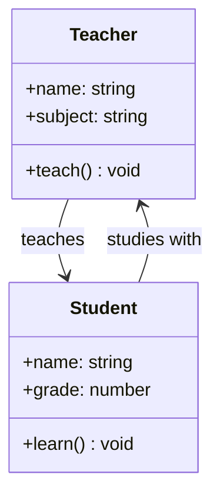

# Association

## Introduction

**Association** is a relationship between two classes where one class **knows about** or is **connected to** another class. It represents a "uses-a" relationship where objects can communicate with each other.

### Why Does It Exist?
- Models real-world relationships where entities interact with each other
- Enables collaboration between objects
- Forms the basis for more specific relationships (aggregation, composition)

### Why Do Developers Use It?
- To define how objects in a system interact
- To create loosely coupled relationships where possible
- To model connections like "Teacher teaches Student"

---

## Real-World Analogy: Teacher and Student

A teacher and a student have an association:
- They **know about** each other
- They **interact** (teacher teaches, student learns)
- They have **independent lifetimes** — a teacher exists without a specific student
- The relationship can be **one-way** (student knows their teacher) or **two-way**

---

## Definition

**Association** is a structural relationship between two classes that indicates that objects of one class are connected to objects of another class. It represents a "uses-a" relationship.

---

## Why Do We Need It?

Without association, objects would be isolated:

```javascript
class Teacher {
  constructor(name) {
    this.name = name;
  }
}

class Student {
  constructor(name) {
    this.name = name;
  }
}

// These objects can't interact!
```

With association, objects can communicate:

```javascript
class Student {
  constructor(name) {
    this.name = name;
    this.teacher = null; // Association
  }

  assignTeacher(teacher) {
    this.teacher = teacher;
  }
}
```

---

## Visual Explanation



---

## Types of Association

### 1. Unidirectional (One-Way)

One class knows about the other, but not vice versa.

```javascript
class Order {
  constructor(id, customer) {
    this.id = id;
    this.customer = customer; // Order knows about Customer
  }
}

class Customer {
  constructor(name) {
    this.name = name;
  }
  // Customer does NOT know about Order directly
}
```

### 2. Bidirectional (Two-Way)

Both classes know about each other.

```javascript
class Doctor {
  constructor(name) {
    this.name = name;
    this.patients = [];
  }

  addPatient(patient) {
    this.patients.push(patient);
    patient.addDoctor(this); // Establish bidirectional link
  }
}

class Patient {
  constructor(name) {
    this.name = name;
    this.doctors = [];
  }

  addDoctor(doctor) {
    this.doctors.push(doctor);
  }
}
```

### 3. Cardinality

| Type | Description | Example |
|------|-------------|---------|
| **One-to-One** | One object maps to one other | Person → Passport |
| **One-to-Many** | One object maps to many others | Department → Employees |
| **Many-to-Many** | Many objects map to many others | Students → Courses |

---

## Code Examples

### JavaScript

```javascript
// One-to-Many Association
class Department {
  constructor(name) {
    this.name = name;
    this.employees = [];
  }

  addEmployee(emp) {
    this.employees.push(emp);
    emp.department = this; // Bidirectional link
  }

  listEmployees() {
    return this.employees.map(e => e.name);
  }
}

class Employee {
  constructor(name) {
    this.name = name;
    this.department = null;
  }

  getDepartmentName() {
    return this.department?.name ?? "Unassigned";
  }
}

// Usage
const engineering = new Department("Engineering");
const alice = new Employee("Alice");
const bob = new Employee("Bob");

engineering.addEmployee(alice);
engineering.addEmployee(bob);

console.log(engineering.listEmployees()); // ["Alice", "Bob"]
console.log(alice.getDepartmentName()); // "Engineering"
```

### TypeScript

```typescript
// Many-to-Many Association
class Course {
  constructor(
    public code: string,
    public name: string
  ) {}

  private students: Set<Student> = new Set();

  enroll(student: Student): void {
    this.students.add(student);
    student.enrollIn(this); // Maintain both sides
  }
}

class Student {
  constructor(
    public id: number,
    public name: string
  ) {}

  private courses: Set<Course> = new Set();

  enrollIn(course: Course): void {
    this.courses.add(course);
  }

  getCourses(): string[] {
    return [...this.courses].map(c => c.name);
  }
}

// Usage
const cs101 = new Course("CS101", "Intro to Programming");
const math201 = new Course("MATH201", "Calculus II");
const alice = new Student(1, "Alice");

cs101.enroll(alice);
math201.enroll(alice);

console.log(alice.getCourses());
// ["Intro to Programming", "Calculus II"]
```

### Python

```python
class Library:
    def __init__(self, name: str):
        self.name = name
        self.books: list[Book] = []

    def add_book(self, book: 'Book'):
        self.books.append(book)
        book.library = self

class Book:
    def __init__(self, isbn: str, title: str):
        self.isbn = isbn
        self.title = title
        self.library: Library | None = None

    def get_library_name(self) -> str:
        return self.library.name if self.library else "Not assigned"
```

---

## Association vs Aggregation vs Composition

| Feature | Association | Aggregation | Composition |
|---------|-------------|-------------|-------------|
| **Relationship** | Uses-a | Has-a (weak) | Has-a (strong) |
| **Lifetime** | Independent | Independent | Dependent |
| **Owner** | No owner | Parent owns children | Parent owns children |
| **Child access** | Both sides | Child accessible outside | Child NOT accessible outside |
| **Destroy parent** | Child lives | Child lives | Child dies |
| **Real-World** | Teacher ↔ Student | Department → Teachers | House → Rooms |

---

## Best Practices

- **Prefer unidirectional** associations (simpler, looser coupling)
- **Be careful with bidirectional** — can cause circular dependencies
- **Use interfaces** to represent association targets
- **Consider lazy initialization** for associations that aren't always needed
- **Document cardinality** in code comments

---

## Common Mistakes

- **Creating unnecessary bidirectional** associations
- **Circular references** causing memory leaks
- **Forgetting to maintain both sides** of bidirectional associations
- **Over-associating** — not every class needs to know about every other class

---

## Interview Questions

**Easy:**
1. What is association in OOP?
2. What's the difference between one-way and two-way association?

**Medium:**
3. What are the different types of cardinality in associations?
4. How is association different from aggregation and composition?

**Advanced:**
5. How do you avoid circular references in bidirectional associations?
6. When would you choose unidirectional over bidirectional association?

---

## Summary

| Concept | Key Point |
|---------|-----------|
| **Association** | Relationship between objects (uses-a) |
| **Unidirectional** | One-way knowledge |
| **Bidirectional** | Two-way knowledge |
| **Cardinality** | 1:1, 1:N, N:M |
| **Lifetime** | Objects have independent lifetimes |
| **Distinction** | Weaker than aggregation/composition |

---

**Previous Topic:** [Polymorphism →](/DSA-Notes-Problems/oops/11-polymorphism)
**Next Topic:** [Aggregation →](/DSA-Notes-Problems/oops/13-aggregation)
**Related Topics:** [Composition](/DSA-Notes-Problems/oops/14-composition), [Aggregation](/DSA-Notes-Problems/oops/13-aggregation)
