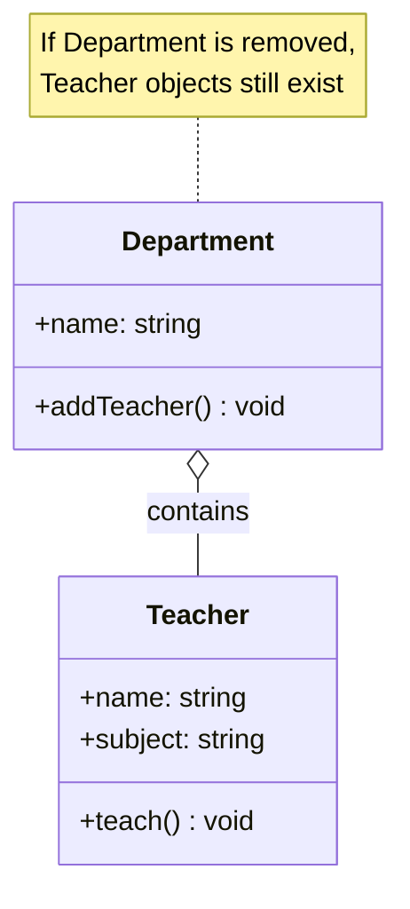

# Aggregation

## Introduction

**Aggregation** is a specialized form of association that represents a **"has-a"** relationship where one class contains a collection of other classes, but the contained classes can exist **independently** of the container.

Think of it as a **weak** ownership — the parent holds a reference to the child, but the child can exist on its own.

### Why Does It Exist?
- To model "whole-part" relationships where parts can outlive the whole
- To indicate weak ownership
- To create collections of related objects

### Why Do Developers Use It?
- When objects need to be shared across different containers
- When parts have independent lifetime
- To model "team contains players" (players exist outside the team)

---

## Real-World Analogy: Department and Teachers

A **Department** contains **Teachers**:
- The department has teachers (has-a relationship)
- If the department is closed, the teachers **still exist**
- Teachers can work in multiple departments
- Teachers have their own identity (employee ID)

This is aggregation: the department aggregates (collects/contains) teachers, but teachers exist independently.

---

## Definition

**Aggregation** is a special form of association where one class (the whole/container) contains references to objects of another class (the part), and the contained objects can exist independently of the container.

---

## Why Do We Need It?

Aggregation models real-world "whole-part" relationships where parts are independent:

```javascript
// Aggregation: Team has Players (Players exist without Team)
class Player {
  constructor(name, skill) {
    this.name = name;
    this.skill = skill;
  }
}

class Team {
  constructor(name) {
    this.name = name;
    this.players = [];
  }

  addPlayer(player) {
    this.players.push(player); // Aggregation
  }
}

// Players exist independently
const messi = new Player("Messi", 99);
const ronaldo = new Player("Ronaldo", 98);

// Players are added to a team
const dreamTeam = new Team("Dream Team");
dreamTeam.addPlayer(messi);
dreamTeam.addPlayer(ronaldo);

// But players still exist even without the team!
console.log(messi.name); // Works!
```

---

## Visual Explanation



---

## Code Examples

### JavaScript

```javascript
class Library {
  constructor(name) {
    this.name = name;
    this.books = []; // Aggregation — empty diamond
  }

  addBook(book) {
    this.books.push(book);
  }

  removeBook(isbn) {
    this.books = this.books.filter(b => b.isbn !== isbn);
  }

  listBooks() {
    return this.books.map(b => b.title);
  }
}

class Book {
  constructor(isbn, title, author) {
    this.isbn = isbn;
    this.title = title;
    this.author = author;
  }
}

// Books exist independently of the library
const book1 = new Book("123", "1984", "Orwell");
const book2 = new Book("456", "Dune", "Herbert");
const book3 = new Book("789", "Neuromancer", "Gibson");

// Books can be in a library
const library = new Library("City Library");
library.addBook(book1);
library.addBook(book2);

// Library is destroyed (goes out of scope)
// Books still exist!
console.log(book1.title); // "1984" — still accessible
```

### TypeScript

```typescript
class Project {
  constructor(public name: string) {}

  private assignedEmployees: Employee[] = [];

  assignEmployee(emp: Employee): void {
    this.assignedEmployees.push(emp);
  }

  getAssignedEmployees(): string[] {
    return this.assignedEmployees.map(e => e.name);
  }
}

class Employee {
  constructor(
    public id: number,
    public name: string,
    public role: string
  ) {}

  // Employee can work on multiple projects
  private projects: Project[] = [];
}
```

### Python

```python
class Student:
    def __init__(self, name: str, student_id: int):
        self.name = name
        self.student_id = student_id
        self.clubs: list[Club] = []  # Student can join multiple clubs

class Club:
    def __init__(self, name: str):
        self.name = name
        self.members: list[Student] = []

    def add_member(self, student: Student):
        self.members.append(student)
        student.clubs.append(self)  # Bidirectional

# Usage
alice = Student("Alice", 101)
bob = Student("Bob", 102)

chess = Club("Chess Club")
drama = Club("Drama Club")

chess.add_member(alice)
chess.add_member(bob)
drama.add_member(alice)  # Alice can be in both!

# If clubs disband, students still exist
```

---

## Aggregation Characteristics

| Characteristic | Description |
|----------------|-------------|
| **Relationship** | "Has-a" (weak ownership) |
| **Lifetime** | Parent and child have independent lifetimes |
| **Sharing** | Child can be shared across multiple parents |
| **Destroy parent** | Child objects continue to exist |
| **Representation** | Empty diamond (◊) in UML |
| **Real-world** | Team → Players, Department → Teachers |

---

## Association vs Aggregation vs Composition

```mermaid
graph TD
    subgraph Association["Association (uses-a)"]
        A1[Teacher] -.->|"uses"| A2[Student]
        note1["Objects know each other<br/>Completely independent"]
    end

    subgraph Aggregation["Aggregation (has-a)"]
        B1[Department] --o B2[Teacher]
        note2["Part can exist without whole<br/>Weak ownership"]
    end

    subgraph Composition["Composition (contains)"]
        C1[House] --* C2[Room]
        note3["Part cannot exist without whole<br/>Strong ownership"]
    end

    style Association fill:#4CAF50,color:#fff
    style Aggregation fill:#FF9800,color:#fff
    style Composition fill:#F44336,color:#fff
```

---

## Best Practices

- Use aggregation when parts can exist without the whole
- Use aggregation when parts need to be shared
- Consider whether the relationship is truly aggregation or just association
- Document the cardinality (one-to-many, many-to-many)

---

## Common Mistakes

- **Using aggregation when it's just association** — not every has-a is aggregation
- **Using aggregation when composition is needed** — parts can't exist independently
- **Forgetting to maintain bidirectional links** when needed
- **Memory leaks** from not removing references when no longer needed

---

## Interview Questions

**Easy:**
1. What is aggregation in OOP?
2. How is aggregation different from association?

**Medium:**
3. Give an example of aggregation vs composition.
4. Can an object be part of multiple aggregates?

**Advanced:**
5. How do you represent aggregation in UML class diagrams?
6. How does aggregation affect memory management?

---

## Summary

| Concept | Key Point |
|---------|-----------|
| **Aggregation** | "Has-a" with weak ownership (◊) |
| **Lifetime** | Part exists independently of whole |
| **Sharing** | Parts can be shared across wholes |
| **Real-world** | Team has players, Department has teachers |
| **vs Composition** | In composition, parts die with the whole |

---

**Previous Topic:** [Association →](/DSA-Notes-Problems/oops/12-association)
**Next Topic:** [Composition →](/DSA-Notes-Problems/oops/14-composition)
**Related Topics:** [Association](/DSA-Notes-Problems/oops/12-association), [Composition](/DSA-Notes-Problems/oops/14-composition)
