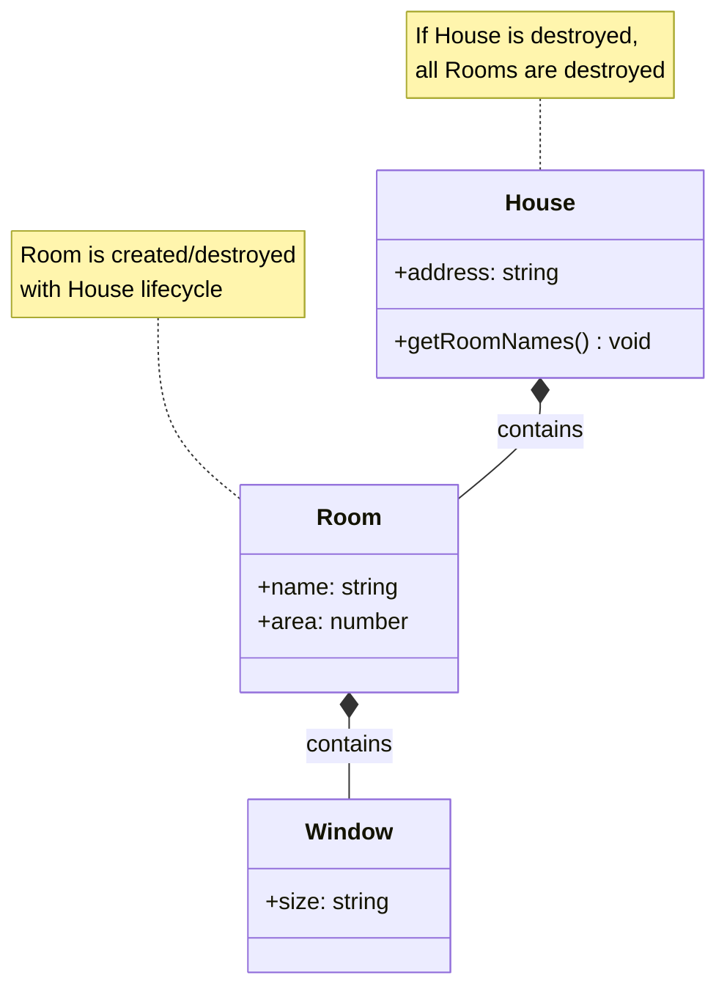

# Composition

## Introduction

**Composition** is a specialized form of association that represents a **strong "has-a"** relationship where one class (the whole/composite) **owns** objects of another class (the part), and the parts **cannot exist independently** of the whole.

Composition is often described as a **"part-of"** relationship with **strong ownership**.

### Why Does It Exist?
- To model "whole-part" relationships where parts are **owned** by the whole
- To enforce **lifetime dependency** — parts are created and destroyed with the whole
- To create **encapsulated** internal components

### Why Do Developers Use It?
- When parts have no meaningful existence without the whole
- When you want to encapsulate internal components
- When you need strict lifecycle management

---

## Real-World Analogy: House and Rooms

A **House** contains **Rooms**:
- A house has rooms (composition)
- If the house is destroyed, the rooms are destroyed too
- A room cannot exist independently without a house
- Rooms are not shared across houses
- The house **owns** the rooms

This is composition: strong ownership and dependent lifetime.

---

## Definition

**Composition** is a form of association where one class (the composite) is composed of one or more objects of another class (the component), and the components **cannot exist** without the composite. The composite is responsible for the **creation and destruction** of its components.

---

## Why Do We Need It?

Composition enforces that parts are tied to their whole:

```javascript
class Room {
  constructor(name) {
    this.name = name;
  }
}

class House {
  constructor(address) {
    this.address = address;
    // Rooms are created WITH the house
    this.rooms = [
      new Room("Living Room"),
      new Room("Kitchen"),
      new Room("Bedroom")
    ];
  }

  // When house is destroyed, rooms are gone
  getRoomNames() {
    return this.rooms.map(r => r.name);
  }
}

const house = new House("123 Main St");
console.log(house.getRoomNames()); // ["Living Room", "Kitchen", "Bedroom"]

// Rooms are NOT accessible from outside!
// They are created and owned by the House
```

---

## Visual Explanation



---

## Code Examples

### JavaScript

```javascript
class Engine {
  constructor(type, horsepower) {
    this.type = type;
    this.horsepower = horsepower;
    this.isRunning = false;
  }

  start() { this.isRunning = true; }
  stop() { this.isRunning = false; }
}

class Wheel {
  constructor(position) {
    this.position = position;
    this.pressure = 32;
  }

  inflate(psi) { this.pressure = psi; }
}

class Car {
  constructor(make, model) {
    this.make = make;
    this.model = model;

    // Composition: Car creates and owns these components
    this.engine = new Engine("V6", 300);
    this.wheels = [
      new Wheel("Front-Left"),
      new Wheel("Front-Right"),
      new Wheel("Rear-Left"),
      new Wheel("Rear-Right")
    ];
  }

  start() {
    this.engine.start();
    console.log(`${this.make} ${this.model} started`);
  }

  // Components are destroyed when Car is garbage collected
  // (Can't access engine or wheels from outside)
}
```

### TypeScript

```typescript
class OrderItem {
  constructor(
    public productId: number,
    public productName: string,
    public quantity: number,
    public unitPrice: number
  ) {}

  getTotalPrice(): number {
    return this.quantity * this.unitPrice;
  }
}

class Order {
  private items: OrderItem[] = [];

  constructor(
    public orderId: number,
    public customerEmail: string
  ) {
    // Order starts empty — items are added
  }

  addItem(productId: number, name: string, qty: number, price: number): void {
    this.items.push(new OrderItem(productId, name, qty, price));
  }

  getTotal(): number {
    return this.items.reduce((sum, item) => sum + item.getTotalPrice(), 0);
  }

  // If Order is deleted, all OrderItems are deleted too
  // OrderItems have no independent existence
}
```

### Python

```python
class Question:
    def __init__(self, text: str, answer: str, points: int):
        self.text = text
        self.answer = answer
        self.points = points

    def check_answer(self, user_answer: str) -> bool:
        return user_answer.lower() == self.answer.lower()

class Quiz:
    def __init__(self, title: str):
        self.title = title
        # Composition: Quiz creates and owns its questions
        self.questions: list[Question] = []

    def add_question(self, text: str, answer: str, points: int = 1):
        self.questions.append(Question(text, answer, points))

    def take_quiz(self, answers: list[str]) -> int:
        score = 0
        for q, a in zip(self.questions, answers):
            if q.check_answer(a):
                score += q.points
        return score

# Questions are created within Quiz
quiz = Quiz("Python Basics")
quiz.add_question("What is OOP?", "Object-Oriented Programming")
quiz.add_question("What is a class?", "A blueprint for objects")

# Questions don't exist independently
```

### Java

```java
class OrderLine {
    private String product;
    private int quantity;
    private double price;

    public OrderLine(String product, int quantity, double price) {
        this.product = product;
        this.quantity = quantity;
        this.price = price;
    }

    public double getLineTotal() {
        return quantity * price;
    }
}

class PurchaseOrder {
    private String orderNumber;
    private List<OrderLine> lines;

    public PurchaseOrder(String orderNumber) {
        this.orderNumber = orderNumber;
        this.lines = new ArrayList<>(); // Composition
    }

    public void addLine(String product, int quantity, double price) {
        lines.add(new OrderLine(product, quantity, price));
    }

    public double getOrderTotal() {
        return lines.stream()
            .mapToDouble(OrderLine::getLineTotal)
            .sum();
    }
}
```

---

## Composition Characteristics

| Characteristic | Description |
|----------------|-------------|
| **Relationship** | "Part-of" (strong ownership) |
| **Lifetime** | Part depends on whole (same lifecycle) |
| **Sharing** | Parts cannot be shared |
| **Destroy parent** | Child objects are destroyed too |
| **Representation** | Filled diamond (◆) in UML |
| **Real-world** | House → Rooms, Car → Engine |

---

## Composition vs Aggregation

| Aspect | Composition | Aggregation |
|--------|-------------|-------------|
| **Ownership** | Strong (parent owns child) | Weak (parent contains child) |
| **Lifetime** | Same lifecycle | Independent lifecycles |
| **Sharing** | Not shared | Can be shared |
| **UML** | Filled diamond (◆) | Empty diamond (◊) |
| **Child dies with parent?** | Yes | No |
| **Example** | House has Rooms | Department has Teachers |
| **Implementation** | Child created in parent constructor | Child passed to parent |

---

## Best Practices

- Use composition when parts have no independent existence
- Use composition for internal implementation details
- Create parts inside the composite's constructor
- Don't expose internal parts outside the composite
- Prefer composition over inheritance (GOF principle)

---

## Common Mistakes

- **Using aggregation when composition is needed** — parts that shouldn't exist alone
- **Exposing internal components** via getters (breaking encapsulation)
- **Allowing external code to create parts** that the composite should own
- **Deep composition chains** — too many nested levels

---

## Interview Questions

**Easy:**
1. What is composition in OOP?
2. How is composition different from inheritance?

**Medium:**
3. What's the difference between aggregation and composition?
4. Why is "favor composition over inheritance" a best practice?
5. How does composition affect object lifecycle?

**Advanced:**
6. How would you implement deep copy in a composition relationship?
7. Explain how composition relates to the Single Responsibility Principle.

---

## Summary

| Concept | Key Point |
|---------|-----------|
| **Composition** | "Part-of" with strong ownership (◆) |
| **Lifetime** | Parts die with the whole |
| **Sharing** | Parts are not shared |
| **Real World** | House → Rooms, Car → Engine |
| **vs Aggregation** | Aggregation: parts survive; Composition: parts don't |
| **Rule of Thumb** | Favor composition over inheritance |

---

**Previous Topic:** [Aggregation →](/DSA-Notes-Problems/oops/13-aggregation)
**Next Topic:** [Dependency →](/DSA-Notes-Problems/oops/15-dependency)
**Related Topics:** [Association](/DSA-Notes-Problems/oops/12-association), [Aggregation](/DSA-Notes-Problems/oops/13-aggregation)
