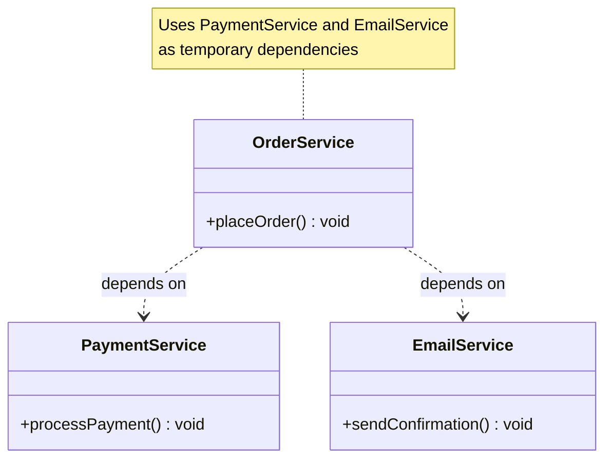

# Dependency

## Introduction

**Dependency** is a relationship where one class (the client) **depends on** another class (the supplier) because it uses that class in some way. If the supplier changes, the client may need to change too.

Dependency is the **weakest** form of relationship between classes.

### Why Does It Exist?
- Objects need other objects to accomplish their tasks
- Dependencies are inevitable in any non-trivial system
- Understanding dependencies helps manage coupling

### Why Do Developers Use It?
- To delegate work to other objects
- To use services provided by other classes
- To follow the Single Responsibility Principle (delegate specialized work)

---

## Real-World Analogy: Ordering Food

A **Customer** depends on a **Restaurant**:
- Customer calls the restaurant to place an order
- The restaurant prepares the food
- Customer doesn't own the restaurant
- Customer just needs the restaurant's service temporarily

If the restaurant changes its menu, the customer may need to change their order. That's dependency.

---

## Definition

**Dependency** is a relationship where one class temporarily uses another class as a parameter, local variable, return type, or through method calls. The dependent class cannot function without the supplier.

---

## Why Do We Need It?

Dependencies allow objects to collaborate:

```javascript
class PaymentService {
  processPayment(order, amount) {
    // Payment processing logic
  }
}

class OrderService {
  placeOrder(items, paymentService) {
    // Dependency: OrderService depends on PaymentService
    paymentService.processPayment(/* ... */);
  }
}
```

---

## Visual Explanation



---

## Types of Dependencies

| Type | Description | Example |
|------|-------------|---------|
| **Method parameter** | Passed into a method | `function process(paymentService)` |
| **Local variable** | Created inside a method | `const email = new EmailService()` |
| **Return type** | Method returns an instance | `getDatabase(): Database` |
| **Static method call** | Calling static methods | `Logger.log("message")` |

---

## Code Examples

### JavaScript (Constructor Injection)

```javascript
class Logger {
  log(message) {
    console.log(`[LOG]: ${message}`);
  }
}

class UserService {
  // Dependency Injection via constructor
  constructor(logger) {
    this.logger = logger;
  }

  createUser(data) {
    // Use the dependency
    this.logger.log(`Creating user: ${data.name}`);
    // User creation logic...
  }
}

const logger = new Logger();
const userService = new UserService(logger); // Inject dependency
```

### TypeScript

```typescript
interface IEmailSender {
  send(to: string, subject: string, body: string): Promise<void>;
}

class SmtpEmailSender implements IEmailSender {
  async send(to: string, subject: string, body: string): Promise<void> {
    // SMTP implementation
  }
}

class NotificationService {
  // Depend on abstraction, not concrete implementation
  constructor(private emailSender: IEmailSender) {}

  async sendWelcomeEmail(userEmail: string): Promise<void> {
    await this.emailSender.send(
      userEmail,
      "Welcome!",
      "Thanks for joining!"
    );
  }
}
```

### Python

```python
class AnalyticsTracker:
    def track_event(self, event_name: str, data: dict):
        print(f"Tracking: {event_name}")
        # Send to analytics service

class CheckoutService:
    def __init__(self, analytics: AnalyticsTracker):
        self.analytics = analytics  # Dependency injection

    def checkout(self, user_id: int, cart_items: list):
        self.analytics.track_event("checkout_started", {
            "user_id": user_id,
            "item_count": len(cart_items)
        })
        # Checkout logic...
```

---

## Dependency Injection (DI)

**Dependency Injection** is a technique where dependencies are "injected" into a class from outside, rather than created inside the class.

### Without DI (Tight Coupling)

```javascript
class OrderService {
  constructor() {
    // ❌ Creating dependency inside — hard to test, hard to change
    this.logger = new Logger();
    this.emailService = new EmailService();
    this.paymentService = new PaymentService();
  }
}
```

### With DI (Loose Coupling)

```javascript
class OrderService {
  constructor(logger, emailService, paymentService) {
    // ✅ Dependencies injected from outside
    this.logger = logger;
    this.emailService = emailService;
    this.paymentService = paymentService;
  }
}
```

### Types of DI

| Type | Description | Example |
|------|-------------|---------|
| **Constructor Injection** | Dependencies via constructor parameters | Most common, best for required deps |
| **Setter Injection** | Dependencies via setter methods | Good for optional deps |
| **Method Injection** | Dependencies via method parameters | For occasional use |

---

## Best Practices

- **Depend on abstractions**, not concrete implementations (DIP)
- **Use dependency injection** for loose coupling
- **Minimize dependencies** — each class should have few dependencies
- **Don't create dependencies inside constructors** — inject them
- **Document required dependencies** clearly

---

## Common Mistakes

- **Creating dependencies inside the class** (using `new`) — makes testing hard
- **Too many dependencies** — class does too much (violates SRP)
- **Circular dependencies** — A depends on B, B depends on A
- **Not depending on interfaces** — concrete coupling
- **Service locator anti-pattern** — hiding dependencies

---

## Interview Questions

**Easy:**
1. What is a dependency in OOP?
2. How does dependency differ from association?

**Medium:**
3. What is dependency injection and why is it useful?
4. What are the types of dependency injection?

**Advanced:**
5. How does dependency inversion differ from dependency injection?
6. How do you handle circular dependencies?

---

## Summary

| Concept | Key Point |
|---------|-----------|
| **Dependency** | One class uses another (weakest relationship) |
| **Visual** | Dashed arrow (..>) in UML |
| **DI** | Inject dependencies from outside |
| **Best Practice** | Depend on abstractions, minimize dependencies |
| **DIP** | Depend on abstractions, not concretions |

---

**Previous Topic:** [Composition →](/DSA-Notes-Problems/oops/14-composition)
**Next Topic:** [Coupling vs Cohesion →](/DSA-Notes-Problems/oops/16-coupling-vs-cohesion)
**Related Topics:** [SOLID Principles](/DSA-Notes-Problems/oops/17-solid-principles)
