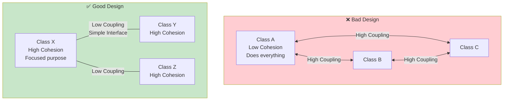

# Coupling vs Cohesion

## Introduction

**Coupling** and **Cohesion** are two fundamental concepts for measuring the quality of software design. They are inversely related — good design has **high cohesion** and **low coupling**.

- **Cohesion** — How focused is a single module/class? (internal)
- **Coupling** — How dependent are modules/classes on each other? (external)

### Why Does It Exist?
- To provide objective measures of code quality
- To guide architectural decisions
- To predict maintainability and changeability

### Why Do Developers Use It?
- To evaluate if a design is good or bad
- To know when to refactor
- To write more maintainable code

---

## Real-World Analogy

### High Cohesion + Low Coupling = Restaurant Kitchen

A well-organized restaurant kitchen:
- Each station has a **focused role** (grill, prep, pastry) → **High cohesion**
- Stations communicate through **tickets** (simple interface) → **Low coupling**
- The pastry chef can be replaced without affecting the grill station
- Each station knows its own job well

### Low Cohesion + High Coupling = Spaghetti

A tangled mess:
- One function does everything (ordering, cooking, cleaning) → **Low cohesion**
- Everything depends on everything else → **High coupling**
- Changing one thing breaks five others
- Hard to understand, harder to fix

---

## Cohesion

**Cohesion** refers to how closely related the responsibilities of a single module/class are.

### High Cohesion (Good)
- Class has a **single, well-defined purpose**
- All methods relate to that purpose
- Easy to understand and maintain

### Low Cohesion (Bad)
- Class does **unrelated things**
- Methods are not related to each other
- Hard to understand, name, and maintain

### Example

```javascript
// ❌ LOW COHESION — Class does too many unrelated things
class Utility {
  calculateTax(income) { /* ... */ }
  sendEmail(to, body) { /* ... */ }
  generateReport(data) { /* ... */ }
  connectToDatabase() { /* ... */ }
  renderUI() { /* ... */ }
}

// ✅ HIGH COHESION — Class has focused responsibility
class TaxCalculator {
  calculateIncomeTax(income) { /* ... */ }
  calculateSalesTax(amount) { /* ... */ }
  calculatePropertyTax(value) { /* ... */ }
}

class EmailService {
  send(to, subject, body) { /* ... */ }
  validateAddress(email) { /* ... */ }
}
```

---

## Coupling

**Coupling** refers to how dependent one module/class is on another.

### Low Coupling (Good)
- Classes interact through **well-defined interfaces**
- Changes in one class rarely affect others
- Easy to test, modify, and replace

### High Coupling (Bad)
- Classes know **too much** about each other
- Changes in one class **ripple** through the system
- Hard to test, modify, or reuse

### Example

```javascript
// ❌ HIGH COUPLING — Tightly bound to concrete implementation
class OrderProcessor {
  constructor() {
    this.mysql = new MySQLConnection({
      host: "localhost",
      user: "root",
      password: "secret"
    });
    this.stripe = new StripeAPI("sk_live_key");
    this.sendgrid = new SendGrid("api_key");
  }

  processOrder(order) {
    this.mysql.query("INSERT INTO orders ...");
    this.stripe.charge(order.total, order.card);
    this.sendgrid.send(order.email, "Order confirmed");
  }
}

// ✅ LOW COUPLING — Depends on abstractions
class OrderProcessor {
  constructor(database, paymentGateway, notificationService) {
    this.database = database;       // Interface
    this.paymentGateway = paymentGateway; // Interface
    this.notifier = notificationService;  // Interface
  }

  async processOrder(order) {
    await this.database.save(order);
    await this.paymentGateway.charge(order.total);
    await this.notifier.send(order.email, "Order confirmed");
  }
}
```

---

## Types of Cohesion (Worst → Best)

| Type | Description | Example |
|------|-------------|---------|
| **Coincidental** | Random grouping | `Utils` class with unrelated functions |
| **Logical** | Same category but different | `MathOperations` with add, sin, sqrt |
| **Temporal** | Related by time | `Startup` with initDB, initUI, loadConfig |
| **Procedural** | Related by sequence | `ProcessOrder` with validate, save, email |
| **Communicational** | Share same data | `UserData` with save, validate, format |
| **Sequential** | Output of one is input of next | `DataPipeline` with parse, transform, load |
| **Functional** (Best) | Single, focused purpose | `TaxCalculator` with income, sales, property |

---

## Types of Coupling (Worst → Best)

| Type | Description | Example |
|------|-------------|---------|
| **Content** (Worst) | Directly modifies another's data | `a.balance = 100` |
| **Common** | Shares global data | Global variables, singletons |
| **External** | Depends on external format | File format, protocol |
| **Control** | Passes control flags | `process(type, data)` |
| **Stamp** | Passes entire object when only one field needed | `process(user)` when only user.email needed |
| **Data** (Best) | Passes only needed data | `sendEmail(user.email, message)` |

---

## Visual Comparison



---

## Guidelines

| Goal | Description |
|------|-------------|
| **Aim for High Cohesion** | Each class should have one clear responsibility |
| **Aim for Low Coupling** | Classes should communicate through minimal interfaces |
| **Use Dependency Injection** | Reduces coupling significantly |
| **Program to Interfaces** | Reduces implementation coupling |
| **Keep interfaces small** | Fewer methods = less coupling |
| **Single Responsibility** | Naturally leads to high cohesion |

---

## Best Practices

- **Single Responsibility Principle** is the path to high cohesion
- **Dependency Inversion Principle** reduces coupling
- **Use interfaces/abstract classes** for loose coupling
- **Limit constructor parameters** — if a class needs 5+ dependencies, it's doing too much
- **Measure and refactor** — regularly check if classes are focused

---

## Common Mistakes

- **Utility classes** with unrelated methods (low cohesion)
- **God classes** that do everything (low cohesion, high coupling)
- **Tight coupling to frameworks** — hard to change frameworks
- **Shotgun surgery** — one change requires modifying many classes (high coupling)
- **Data classes with behavior** scattered across services (low cohesion)

---

## Interview Questions

**Easy:**
1. What is cohesion?
2. What is coupling?
3. Should coupling be high or low? Should cohesion be high or low?

**Medium:**
4. How are coupling and cohesion related?
5. Give an example of high coupling and how to fix it.
6. What's the difference between content coupling and data coupling?

**Advanced:**
7. How do design principles (SRP, DIP) help improve cohesion and reduce coupling?
8. Explain how microservices architecture relates to coupling and cohesion.
9. How would you refactor a class with low cohesion and high coupling?

---

## Summary

| Concept | Good Design | Bad Design |
|---------|-------------|------------|
| **Cohesion (internal)** | High (focused purpose) | Low (does everything) |
| **Coupling (external)** | Low (loosely connected) | High (tightly connected) |
| **Goal** | High Cohesion + Low Coupling | |
| **How** | SRP, DI, Interfaces, Small APIs | |
| **Result** | Maintainable, testable, flexible | Fragile, hard to change |

---

**Previous Topic:** [Dependency →](/DSA-Notes-Problems/oops/15-dependency)
**Next Topic:** [SOLID Principles →](/DSA-Notes-Problems/oops/17-solid-principles)
**Related Topics:** [SOLID](/DSA-Notes-Problems/oops/17-solid-principles), [Design Principles](/DSA-Notes-Problems/oops/25-design-principles)
