# SOLID Principles

## Introduction

**SOLID** is an acronym for five fundamental principles of object-oriented design. These principles guide developers to create code that is **maintainable**, **scalable**, and **flexible**.

The term was coined by **Robert C. Martin (Uncle Bob)** in the early 2000s.

| Letter | Principle | Core Idea |
|--------|-----------|-----------|
| **S** | **Single Responsibility** | A class should have one reason to change |
| **O** | **Open/Closed** | Open for extension, closed for modification |
| **L** | **Liskov Substitution** | Subtypes must be substitutable for their base types |
| **I** | **Interface Segregation** | Many specific interfaces are better than one general interface |
| **D** | **Dependency Inversion** | Depend on abstractions, not concrete implementations |

---

## Why Do We Need SOLID?

Without SOLID principles:
- Code becomes **rigid** — small changes break many things
- Code becomes **fragile** — fixing one bug creates another
- Code becomes **immobile** — hard to reuse in other projects
- Testing becomes **difficult**
- Onboarding new developers becomes **slow**

---

## Visual Overview

```mermaid
graph TD
    SOLID["SOLID Principles"]
    SOLID --> S["S — Single Responsibility<br/>One job per class"]
    SOLID --> O["O — Open/Closed<br/>Extend, don't modify"]
    SOLID --> L["L — Liskov Substitution<br/>Substitute freely"]
    SOLID --> I["I — Interface Segregation<br/>Small, focused interfaces"]
    SOLID --> D["D — Dependency Inversion<br/>Depend on abstractions"]

    S --> S1["✅ Report class only generates reports"]
    S --> S2["❌ Report class generates, prints, emails, saves"]

    O --> O1["✅ Shape.add( new Triangle() )"]
    O --> O2["❌ if(shape === 'triangle') { ... }"]

    L --> L1["✅ Square extends Rectangle (properly)"]
    L --> L2["❌ Penguin extends Bird (but can't fly)"]

    I --> I1["✅ Printer, Scanner interfaces separate"]
    I --> I2["❌ MultiFunctionDevice interface (huge)"]

    D --> D1["✅ DatabaseInterface → MySQL, PostgreSQL"]
    D --> D2["❌ MySQLDatabase directly"]

    style S fill:#4CAF50,color:#fff
    style O fill:#2196F3,color:#fff
    style L fill:#FF9800,color:#fff
    style I fill:#9C27B0,color:#fff
    style D fill:#F44336,color:#fff
```



---

## S — Single Responsibility Principle (SRP)

> **A class should have only one reason to change.**

### Problem
A class that handles multiple responsibilities is hard to maintain.

```javascript
// ❌ Violates SRP — three responsibilities
class ReportManager {
  generateReport(data) { /* ... */ }
  printReport(report) { /* ... */ }
  emailReport(report) { /* ... */ }
  saveToFile(report) { /* ... */ }
}
```

### Solution
Split into focused classes.

```javascript
// ✅ Follows SRP
class ReportGenerator {
  generate(data) { /* Only generates report */ }
}

class ReportPrinter {
  print(report) { /* Only prints */ }
}

class EmailService {
  send(to, report) { /* Only sends email */ }
}

class FileRepository {
  save(report) { /* Only saves to file */ }
}
```

---

## O — Open/Closed Principle (OCP)

> **Classes should be open for extension but closed for modification.**

### Problem
Adding new functionality requires modifying existing code.

```javascript
// ❌ Violates OCP — adding new shape requires modification
class AreaCalculator {
  calculate(shape) {
    if (shape.type === "circle") {
      return Math.PI * shape.radius ** 2;
    } else if (shape.type === "rectangle") {
      return shape.width * shape.height;
    }
    // Need to add more 'else if' for new shapes!
  }
}
```

### Solution
Extend through interfaces, don't modify existing code.

```javascript
// ✅ Follows OCP
class Shape {
  area() { return 0; }
}

class Circle extends Shape {
  constructor(radius) { super(); this.radius = radius; }
  area() { return Math.PI * this.radius ** 2; }
}

class Rectangle extends Shape {
  constructor(w, h) { super(); this.w = w; this.h = h; }
  area() { return this.w * this.h; }
}

// New shape — no existing code modified!
class Triangle extends Shape {
  constructor(b, h) { super(); this.b = b; this.h = h; }
  area() { return (this.b * this.h) / 2; }
}

class AreaCalculator {
  calculate(shape) {
    return shape.area(); // No modification needed!
  }
}
```

---

## L — Liskov Substitution Principle (LSP)

> **Subtypes must be substitutable for their base types.**

### Problem
A subtype that changes the behavior of the parent.

```javascript
// ❌ Violates LSP
class Rectangle {
  constructor(w, h) { this.width = w; this.height = h; }
  setWidth(w) { this.width = w; }
  setHeight(h) { this.height = h; }
  area() { return this.width * this.height; }
}

class Square extends Rectangle {
  constructor(size) { super(size, size); }
  setWidth(w) { this.width = w; this.height = w; } // Changes behavior!
  setHeight(h) { this.width = h; this.height = h; } // Changes behavior!
}

function testRectangle(rect) {
  rect.setWidth(5);
  rect.setHeight(10);
  console.log(rect.area() === 50); // Works for Rectangle, fails for Square!
}
```

### Solution
Don't violate the parent's contract.

```javascript
// ✅ Follows LSP — separate interface
class Shape {
  area() { return 0; }
}

class Rectangle extends Shape {
  constructor(w, h) { super(); this.w = w; this.h = h; }
  setWidth(w) { this.w = w; }
  setHeight(h) { this.h = h; }
  area() { return this.w * this.h; }
}

class Square extends Shape {
  constructor(size) { super(); this.size = size; }
  setSize(size) { this.size = size; }
  area() { return this.size ** 2; }
}
```

---

## I — Interface Segregation Principle (ISP)

> **Many specific interfaces are better than one general interface.**

### Problem
A fat interface forces classes to implement methods they don't need.

```javascript
// ❌ Violates ISP
class MultiFunctionDevice {
  print() { throw "Not implemented"; }
  scan() { throw "Not implemented"; }
  fax() { throw "Not implemented"; }
  email() { throw "Not implemented"; }
}

class SimplePrinter extends MultiFunctionDevice {
  print() { /* works */ }
  scan() { /* NOT needed, but forced */ }
  fax() { /* NOT needed, but forced */ }
}
```

### Solution
Small, focused interfaces.

```javascript
// ✅ Follows ISP
class Printer {
  print() { throw "Not implemented"; }
}

class Scanner {
  scan() { throw "Not implemented"; }
}

class Fax {
  fax() { throw "Not implemented"; }
}

// SimplePrinter only implements what it needs
class SimplePrinter extends Printer {
  print() { /* works */ }
}

class MultiFunctionPrinter extends Printer {
  constructor() {
    super();
    this.scanner = new Scanner();
    this.fax = new Fax();
  }
  print() { /* works */ }
}
```

---

## D — Dependency Inversion Principle (DIP)

> **Depend on abstractions, not concrete implementations.**

### Problem
High-level modules depend directly on low-level modules.

```javascript
// ❌ Violates DIP
class MySQLDatabase {
  save(data) { /* MySQL-specific save */ }
}

class UserService {
  constructor() {
    this.db = new MySQLDatabase(); // Direct dependency on MySQL!
  }

  saveUser(user) {
    this.db.save(user); // Tightly coupled to MySQL
  }
}
```

### Solution
Depend on an abstraction (interface/abstract class).

```javascript
// ✅ Follows DIP
class Database {
  save(data) { throw "Not implemented"; }
}

class MySQLDatabase extends Database {
  save(data) { /* MySQL-specific save */ }
}

class PostgreSQLDatabase extends Database {
  save(data) { /* PostgreSQL-specific save */ }
}

class UserService {
  constructor(database) {
    this.db = database; // Depends on abstraction
  }

  saveUser(user) {
    this.db.save(user); // Works with any Database!
  }
}

// Easy to switch databases
const userService = new UserService(new PostgreSQLDatabase());
```

---

## Benefits of SOLID

| Principle | Benefit |
|-----------|---------|
| **SRP** | Easier to understand, test, and maintain |
| **OCP** | Add features without breaking existing code |
| **LSP** | Inheritance hierarchies are reliable |
| **ISP** | Classes aren't forced to implement unused methods |
| **DIP** | Loose coupling, easy to swap implementations |

---

## Interview Questions

**Easy:**
1. What does SOLID stand for?
2. What is the Single Responsibility Principle?

**Medium:**
3. What's the difference between OCP and DIP?
4. Give an example of LSP violation.
5. How does ISP improve code quality?

**Advanced:**
6. How do SOLID principles relate to design patterns?
7. Can you violate a SOLID principle and still have good code?
8. How do you balance SRP with not over-splitting classes?

---

## Summary

| Principle | One-Liner |
|-----------|-----------|
| **S** | One class = one job |
| **O** | Extend without modifying |
| **L** | Don't break parent contracts |
| **I** | Small, focused interfaces |
| **D** | Depend on abstractions |

---

**Previous Topic:** [Coupling vs Cohesion →](/DSA-Notes-Problems/oops/16-coupling-vs-cohesion)
**Next Topic:** [Access Modifiers →](/DSA-Notes-Problems/oops/18-access-modifiers)
**Related Topics:** [Design Principles](/DSA-Notes-Problems/oops/25-design-principles)
