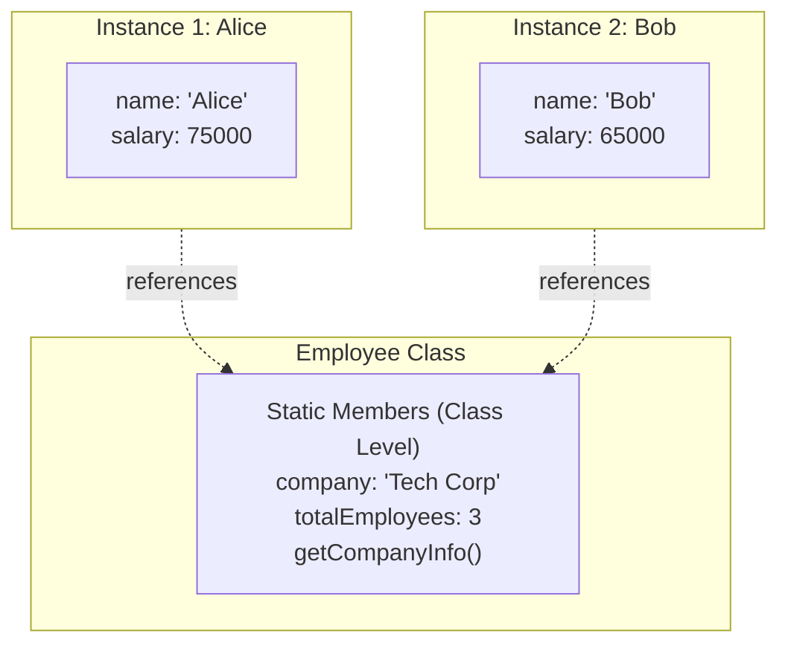

# Static Members

## Introduction

**Static members** (also called class-level members) belong to the **class itself**, not to individual instances. They are shared across all instances and can be accessed without creating an object.

### Why Does It Exist?
- To represent data or behavior that belongs to the **class**, not any specific instance
- To create **utility methods** that don't need object state
- To track **instance-level counters** (how many objects were created)
- To implement the **Singleton** pattern

### Why Do Developers Use It?
- For factory methods (`Array.from()`, `Promise.resolve()`)
- For constants and configuration (`Math.PI`)
- For counters and global state tracking

---

## Real-World Analogy: School

| Concept | Analogy |
|---------|---------|
| **Instance members** | Each student's name, grades, locker number |
| **Static members** | School name, total enrollment, bell schedule |
| **Static method** | Calculate GPA formula (same for all students) |
| **Instance method** | A student attending a specific class |

The school name is shared by all students — it doesn't change per student. That's static.

---

## Definition

**Static members** are properties and methods that are defined on the class itself rather than on instances. They are accessed using the class name, not through an object.

---

## Why Do We Need It?

Without static:

```javascript
// Without static — each instance has its own copy
class Employee {
  constructor(name) {
    this.name = name;
    this.company = "Tech Corp"; // Same for every employee!
    this.benefitsPolicy = "Standard policy"; // Same for every employee!
  }
}
```

With static:

```javascript
class Employee {
  static company = "Tech Corp"; // Shared across all instances
  static totalEmployees = 0;

  constructor(name) {
    this.name = name;
    Employee.totalEmployees++; // Track instance count
  }

  static getCompanyInfo() {
    return `${Employee.company} has ${Employee.totalEmployees} employees`;
  }
}
```

---

## Visual Explanation



---

## Code Examples

### JavaScript

```javascript
class Configuration {
  // Static properties
  static appName = "MyApp";
  static version = "1.0.0";
  static #apiKey = "secret-key-123"; // Private static!

  // Static method
  static getAppInfo() {
    return `${Configuration.appName} v${Configuration.version}`;
  }

  // Private static method
  static #validateConfig() {
    return Configuration.#apiKey.length > 0;
  }

  // Public static that uses private static
  static isConfigured() {
    return Configuration.#validateConfig();
  }

  // Instance method
  constructor(name) {
    this.name = name;
  }
}

// Access static members via class name
console.log(Configuration.appName); // "MyApp"
console.log(Configuration.getAppInfo()); // "MyApp v1.0.0"
console.log(Configuration.isConfigured()); // true
// console.log(Configuration.#apiKey); // ❌ SyntaxError

// Static is NOT accessible on instances
const config = new Configuration("test");
// console.log(config.appName); // undefined
```

### TypeScript

```typescript
class DatabasePool {
  private static instance: DatabasePool;
  private connections: number = 0;

  // Private constructor — Singleton pattern
  private constructor() {}

  // Static factory method
  static getInstance(): DatabasePool {
    if (!DatabasePool.instance) {
      DatabasePool.instance = new DatabasePool();
    }
    return DatabasePool.instance;
  }

  static readonly MAX_CONNECTIONS = 10;

  static createConnectionString(host: string, port: number): string {
    return `postgresql://${host}:${port}/mydb`;
  }

  getConnection(): void {
    if (this.connections < DatabasePool.MAX_CONNECTIONS) {
      this.connections++;
    }
  }
}

// Usage
const pool = DatabasePool.getInstance();
console.log(DatabasePool.MAX_CONNECTIONS); // 10
console.log(DatabasePool.createConnectionString("localhost", 5432));
```

### Python

```python
class Circle:
    # Class variable (static)
    pi = 3.14159
    circle_count = 0

    def __init__(self, radius: float):
        self.radius = radius  # Instance variable
        Circle.circle_count += 1

    @classmethod
    def from_diameter(cls, diameter: float) -> 'Circle':
        """Class method — factory that creates instances."""
        return cls(diameter / 2)

    @staticmethod
    def calculate_area(radius: float) -> float:
        """Static method — utility, no class/instance reference."""
        return Circle.pi * radius ** 2

    @classmethod
    def get_circle_count(cls) -> int:
        """Class method — has access to class variable."""
        return cls.circle_count

# Usage
c1 = Circle(5)
c2 = Circle(10)
print(Circle.pi)              # 3.14159
print(Circle.circle_count)    # 2
print(Circle.calculate_area(5))  # 78.53975
print(Circle.get_circle_count()) # 2

# Class method as factory
c3 = Circle.from_diameter(20)
print(c3.radius)  # 10.0
```

### Java

```java
public class MathUtils {
    // Constants
    public static final double PI = 3.14159;
    public static final double E = 2.71828;

    // Static counter
    private static int calculationCount = 0;

    // Static methods
    public static int add(int a, int b) {
        calculationCount++;
        return a + b;
    }

    public static int factorial(int n) {
        calculationCount++;
        if (n <= 1) return 1;
        return n * factorial(n - 1);
    }

    public static int getCalculationCount() {
        return calculationCount;
    }

    // Private constructor — prevent instantiation
    private MathUtils() {}
}

// Usage
System.out.println(MathUtils.PI);     // 3.14159
System.out.println(MathUtils.add(5, 3)); // 8
System.out.println(MathUtils.getCalculationCount()); // 1
// MathUtils utils = new MathUtils(); // ❌ Private constructor
```

---

## Static vs Instance Members

| Aspect | Static Members | Instance Members |
|--------|---------------|------------------|
| **Belongs to** | The class | The instance/object |
| **Access** | `ClassName.member` | `object.member` |
| **Memory** | One copy shared by all instances | Copy per instance |
| **Can access instance data?** | No | Yes |
| **Can access static data?** | Yes | Yes (via class name) |
| **`this` reference** | Not available | Available |
| **Use for** | Utilities, constants, factories | Object-specific state/behavior |

---

## When to Use Static

### ✅ Good Uses
- **Constants** — `MAX_SIZE`, `PI`, `DEFAULT_TIMEOUT`
- **Factory methods** — `Promise.resolve()`, `Array.from()`
- **Utility functions** — `Math.round()`, `String.format()`
- **Singleton pattern** — Single shared instance
- **Counters** — Track number of instances

### ❌ Bad Uses
- **Overuse of static methods** — creates procedural code in OOP clothing
- **Hidden dependencies** — static methods can't be mocked easily
- **Global mutable state** — static variables that change
- **Static methods that should be instance methods**

---

## Best Practices

- Use static for **constants and configuration**
- Use static **factory methods** for complex object creation
- Avoid **mutable static state** — leads to bugs in concurrent code
- Don't overuse — static methods can't be overridden (no polymorphism)
- Consider **dependency injection** instead of static helpers
- Keep static methods **pure** (no side effects) when possible

---

## Common Mistakes

- **Using static for everything** — creates global state hell
- **Modifying static variables** from instance methods (confusing)
- **Testing static methods** — hard to mock/stub
- **Forgetting static methods can't access `this`**
- **Creating utility classes** with static methods as a dumping ground

---

## Interview Questions

**Easy:**
1. What is a static member?
2. How do you access a static method?
3. Can a static method access instance variables?

**Medium:**
4. What's the difference between static and instance members?
5. When would you use a static factory method?
6. How does memory allocation differ for static vs instance members?

**Advanced:**
7. Why is global mutable state problematic?
8. How do static members affect testability?
9. Compare class methods vs static methods in Python vs Java.

---

## Summary

| Concept | Key Point |
|---------|-----------|
| **Static** | Belongs to class, not instances |
| **Access** | `ClassName.member` |
| **Memory** | One copy shared by all instances |
| **Common Uses** | Constants, factories, utilities, counters |
| **Limitation** | No access to instance data |
| **Rule of Thumb** | Use sparingly, prefer instance members |

---

**Previous Topic:** [Access Modifiers →](/DSA-Notes-Problems/oops/18-access-modifiers)
**Next Topic:** [Method Overloading →](/DSA-Notes-Problems/oops/20-method-overloading)
**Related Topics:** [Access Modifiers](/DSA-Notes-Problems/oops/18-access-modifiers), [Constructor](/DSA-Notes-Problems/oops/05-constructor)
