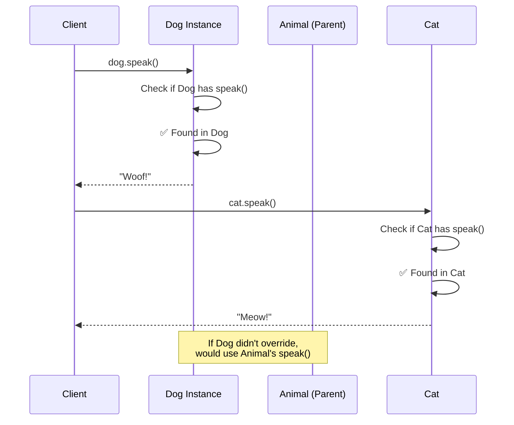

# Method Overriding

## Introduction

**Method overriding** is a feature where a child class provides its own implementation of a method that is already defined in its parent class. It's a form of **run-time polymorphism** (dynamic dispatch).

### Why Does It Exist?
- To allow child classes to **customize** inherited behavior
- To implement **polymorphism** — same method name, different behavior
- To follow the **Open/Closed Principle** — extend behavior without modifying parent

### Why Do Developers Use It?
- To provide specialized behavior in subclasses
- To implement template method pattern
- To override `toString()`, `equals()`, `hashCode()` in Java/C#

---

## Real-World Analogy: Generic vs Specific Sounds

A generic "Animal" makes a generic sound. But specific animals override that:
- `Animal.speak()` → "Some sound"
- `Dog.speak()` → "Woof!" (overrides)
- `Cat.speak()` → "Meow!" (overrides)

Same method name (`speak`), different implementations.

---

## Definition

**Method overriding** is the process of redefining a method in a child class that already exists in the parent class with the same signature (name and parameters).

---

## Why Do We Need It?

Without overriding:

```javascript
class Animal {
  speak() {
    return "Some sound";
  }
}

class Dog extends Animal {
  // ❌ Dog makes generic sound!
}

const dog = new Dog();
console.log(dog.speak()); // "Some sound" — not accurate!
```

With overriding:

```javascript
class Animal {
  speak() {
    return "Some sound";
  }
}

class Dog extends Animal {
  speak() {
    return "Woof!"; // Override with specific behavior
  }
}
```

---

## Visual Explanation



---

## Rules for Method Overriding

| Rule | Description |
|------|-------------|
| **Same signature** | Method name and parameters must match |
| **Inheritance** | Must be a parent-child relationship |
| **Return type** | Same or covariant return type (subtype) |
| **Access level** | Cannot be more restrictive (private can't override public) |
| **Final methods** | Cannot be overridden if marked `final` (Java) |
| **Static methods** | Cannot be overridden (can be hidden) |
| **Constructors** | Cannot be overridden |

---

## Code Examples

### JavaScript

```javascript
class Employee {
  constructor(name, salary) {
    this.name = name;
    this.salary = salary;
  }

  work() {
    return `${this.name} is working`;
  }

  getCompensation() {
    return `Annual salary: $${this.salary}`;
  }

  // This can be overridden
  getRole() {
    return "Employee";
  }
}

class Manager extends Employee {
  constructor(name, salary, department) {
    super(name, salary);
    this.department = department;
  }

  // Override work()
  work() {
    return `${this.name} is managing the ${this.department} department`;
  }

  // Override getRole()
  getRole() {
    return "Manager";
  }

  // Extend — call parent method then add more
  getCompensation() {
    const base = super.getCompensation(); // Call parent
    const bonus = this.salary * 0.2; // 20% bonus
    return `${base} + $${bonus} bonus`;
  }
}

class Developer extends Employee {
  constructor(name, salary, language) {
    super(name, salary);
    this.language = language;
  }

  work() {
    return `${this.name} is coding in ${this.language}`;
  }

  getRole() {
    return "Developer";
  }
}

// Polymorphism in action
const employees = [
  new Employee("Generic", 50000),
  new Manager("Alice", 80000, "Engineering"),
  new Developer("Bob", 70000, "TypeScript")
];

employees.forEach(e => {
  console.log(`${e.getRole()}: ${e.work()}`);
  // "Employee: Generic is working"
  // "Manager: Alice is managing the Engineering department"
  // "Developer: Bob is coding in TypeScript"
});
```

### TypeScript

```typescript
abstract class Shape {
  abstract area(): number;

  // Can be overridden
  describe(): string {
    return `Shape with area ${this.area()}`;
  }
}

class Circle extends Shape {
  constructor(private radius: number) {
    super();
  }

  // Must override abstract method
  area(): number {
    return Math.PI * this.radius ** 2;
  }

  // Override with more specific behavior
  describe(): string {
    return `Circle(radius=${this.radius}) with area ${this.area()}`;
  }
}
```

### Python

```python
class Vehicle:
    def __init__(self, make: str, model: str):
        self.make = make
        self.model = model

    def start(self) -> str:
        return f"{self.make} {self.model} engine starting..."

    def fuel_type(self) -> str:
        return "Regular fuel"

    def __str__(self) -> str:
        return f"{self.make} {self.model}"

class ElectricCar(Vehicle):
    def start(self) -> str:
        # Override completely
        return f"{self.make} {self.model} motor starting silently..."

    def fuel_type(self) -> str:
        # Override with specific behavior
        return "Electricity"

class HybridCar(Vehicle):
    def start(self) -> str:
        # Call parent and extend
        parent_start = super().start()
        return f"{parent_start} (using electric motor)"

# Usage
cars = [Vehicle("Toyota", "Camry"), ElectricCar("Tesla", "Model 3"),
        HybridCar("Toyota", "Prius")]

for car in cars:
    print(f"{car}: {car.start()}")
    # "Toyota Camry: Toyota Camry engine starting..."
    # "Tesla Model 3: Tesla Model 3 motor starting silently..."
    # "Toyota Prius: Toyota Prius engine starting... (using electric motor)"
```

### Java

```java
class BankAccount {
    protected double balance;

    public BankAccount(double balance) {
        this.balance = balance;
    }

    public boolean withdraw(double amount) {
        if (amount <= balance) {
            balance -= amount;
            return true;
        }
        return false;
    }

    public void applyInterest() {
        balance *= 1.01; // 1% base interest
    }
}

class SavingsAccount extends BankAccount {
    private double interestRate;

    public SavingsAccount(double balance, double interestRate) {
        super(balance);
        this.interestRate = interestRate;
    }

    @Override
    public void applyInterest() {
        balance *= (1 + interestRate); // Override with specific rate
    }

    @Override
    public boolean withdraw(double amount) {
        if (amount <= balance - 500) { // Must maintain $500 minimum
            balance -= amount;
            return true;
        }
        return false;
    }
}
```

---

## Overriding vs Overloading

| Aspect | Overriding | Overloading |
|--------|-----------|-------------|
| **Relationship** | Parent → Child | Same class |
| **Method signature** | Same | Different |
| **Polymorphism type** | Run-time | Compile-time |
| **Keyword** | `override`/`@Override` | None needed |
| **Purpose** | Specialize behavior | Convenience API |
| **Return type** | Same or covariant | Can differ |

---

## The `super` Keyword

Use `super` to call the parent's overridden method:

```javascript
class Parent {
  greet() {
    return "Hello from parent";
  }
}

class Child extends Parent {
  greet() {
    // Call parent method, then extend
    return super.greet() + " and child!";
  }
}

console.log(new Child().greet()); // "Hello from parent and child!"
```

---

## Best Practices

- Use `@Override` annotation (Java) or `override` keyword for clarity
- Call `super.methodName()` when extending, not replacing
- Keep overridden methods **consistent** with the parent's contract (LSP)
- Document that a method is overridden and why
- Don't override to add **completely unrelated** behavior

---

## Common Mistakes

- **Changing the method signature** — that's overloading, not overriding
- **Making access more restrictive** — can't reduce visibility
- **Breaking Liskov Substitution** — overridden method that violates parent contract
- **Forgetting `super()` call** in constructors
- **Overriding to add validation that the parent doesn't have** (LSP violation)

---

## Interview Questions

**Easy:**
1. What is method overriding?
2. How is overriding different from overloading?

**Medium:**
3. What are the rules for method overriding in Java/TypeScript?
4. Why can't static methods be overridden?

**Advanced:**
5. How does the `super` keyword work in overriding?
6. Explain the Liskov Substitution Principle in the context of overriding.

---

## Summary

| Concept | Key Point |
|---------|-----------|
| **Overriding** | Child redefines parent method |
| **Polymorphism** | Run-time (dynamic dispatch) |
| **Same signature** | Name + parameters must match |
| **super** | Call parent's version |
| **Purpose** | Specialization, customization |
| **Rule** | Don't violate LSP when overriding |

---

**Previous Topic:** [Method Overloading →](/DSA-Notes-Problems/oops/20-method-overloading)
**Next Topic:** [Interfaces →](/DSA-Notes-Problems/oops/22-interfaces)
**Related Topics:** [Inheritance](/DSA-Notes-Problems/oops/10-inheritance), [Polymorphism](/DSA-Notes-Problems/oops/11-polymorphism)
