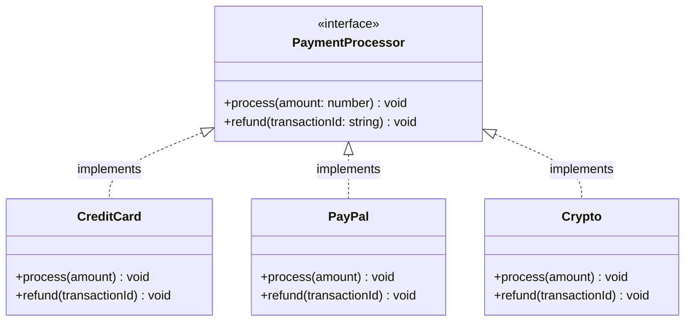

# Interfaces

## Introduction

An **interface** is a **contract** that defines a set of methods that implementing classes must provide. It specifies **what** a class should do, but not **how** it should do it.

Interfaces enable **abstraction** and **polymorphism** without implementation details.

### Why Does It Exist?
- To define **contracts** between components
- To enable **polymorphism** without inheritance
- To support **multiple inheritance** of behavior (in languages with single class inheritance)
- To implement **loose coupling** (depend on interfaces, not implementations)

### Why Do Developers Use It?
- To define capabilities that any class can implement (`Comparable`, `Runnable`)
- To write code that works with **any implementation** of an interface
- To make code **testable** (mock interfaces in tests)
- To follow **Dependency Inversion Principle**

---

## Real-World Analogy: USB Port

A USB port is an interface:
- **USB defines**: "You must transfer data using this protocol"
- **Devices implement**: Flash drives, keyboards, phones, cameras (all implement USB)
- **Benefit**: Any USB device works with any USB port
- If a new USB device is created, existing ports work with it

This is the power of interfaces: **standardized contracts** enable interchangeable parts.

---

## Definition

An **interface** is a reference type that defines a set of abstract method signatures (and optionally, default methods or constants). Classes implement interfaces by providing concrete implementations of all declared methods.

---

## Why Do We Need It?

Without interfaces:

```javascript
// ❌ Tight coupling to concrete types
function processPayment(paymentType, amount) {
  if (paymentType === "credit") {
    // Specific credit card logic
  } else if (paymentType === "paypal") {
    // Specific PayPal logic
  }
}
```

With interfaces:

```typescript
// ✅ Loose coupling via interface
interface PaymentProcessor {
  process(amount: number): void;
}

function checkout(processor: PaymentProcessor, amount: number) {
  processor.process(amount); // Works with ANY payment processor!
}
```

---

## Visual Explanation



---

## Code Examples

### TypeScript

```typescript
// Interface definition
interface Loggable {
  log(message: string): void;
  error?(message: string): void; // Optional method
}

// Class implements the interface
class ConsoleLogger implements Loggable {
  log(message: string): void {
    console.log(`[LOG]: ${message}`);
  }

  // Optional method is implemented
  error(message: string): void {
    console.error(`[ERROR]: ${message}`);
  }
}

class FileLogger implements Loggable {
  constructor(private filename: string) {}

  log(message: string): void {
    // Write to file
    console.log(`Writing to ${this.filename}: ${message}`);
  }
}

// Multiple interfaces
interface Serializable {
  serialize(): string;
}

interface JSONSerializable extends Serializable {
  toJSON(): object;
}

class User implements Loggable, JSONSerializable {
  constructor(
    public id: number,
    public name: string,
    public email: string
  ) {}

  log(message: string): void {
    console.log(`User ${this.id}: ${message}`);
  }

  toJSON(): object {
    return { id: this.id, name: this.name, email: this.email };
  }

  serialize(): string {
    return JSON.stringify(this.toJSON());
  }
}
```

### JavaScript (Duck Typing)

JavaScript doesn't have interfaces, but uses **duck typing**: "If it walks like a duck and quacks like a duck, it's a duck."

```javascript
// Interface is implicit — just implement the methods
const consoleLogger = {
  log(message) {
    console.log(`[LOG]: ${message}`);
  }
};

const fileLogger = {
  filename: "app.log",
  log(message) {
    // Write to file logic
  }
};

function processLog(logger, message) {
  // Works with any object that has a log() method — duck typing!
  logger.log(message);
}

processLog(consoleLogger, "test"); // Works
processLog(fileLogger, "test");    // Works
```

### Python

```python
from abc import ABC, abstractmethod

class Drawable(ABC):
    @abstractmethod
    def draw(self) -> str:
        pass

    @abstractmethod
    def get_area(self) -> float:
        pass

class Circle(Drawable):
    def __init__(self, radius: float):
        self.radius = radius

    def draw(self) -> str:
        return f"Drawing circle with radius {self.radius}"

    def get_area(self) -> float:
        return 3.14159 * self.radius ** 2

class Rectangle(Drawable):
    def __init__(self, width: float, height: float):
        self.width = width
        self.height = height

    def draw(self) -> str:
        return f"Drawing rectangle {self.width}x{self.height}"

    def get_area(self) -> float:
        return self.width * self.height
```

### Java

```java
// Interface definition
interface Comparable<T> {
    int compareTo(T other);
}

interface Sortable {
    void sort();
}

// Multiple interface implementation
class Student implements Comparable<Student>, Sortable {
    private String name;
    private int grade;

    public Student(String name, int grade) {
        this.name = name;
        this.grade = grade;
    }

    @Override
    public int compareTo(Student other) {
        return Integer.compare(this.grade, other.grade);
    }

    @Override
    public void sort() {
        // Sorting logic
    }
}

// Usage
List<Student> students = new ArrayList<>();
Collections.sort(students); // Uses Comparable interface
```

---

## Interface vs Abstract Class

| Aspect | Interface | Abstract Class |
|--------|-----------|---------------|
| **Purpose** | Contract (what to do) | Partial implementation (what + how) |
| **Methods** | All abstract (traditionally) | Mix of abstract and concrete |
| **State** | No instance state | Can have fields/state |
| **Constructors** | No | Yes |
| **Multiple inheritance** | Yes (implement many) | No (extend one) |
| **When to use** | Capability/behavior | Related classes with shared code |
| **Access modifiers** | Public only | Any |

---

## Best Practices

- **Follow Interface Segregation** — small, focused interfaces
- **Name with capability** in mind (`Runnable`, `Serializable`, `Comparable`)
- **Avoid "Marker Interfaces"** — use annotations instead (Java)
- **Default methods** sparingly (Java 8+) only for backward compatibility
- **Prefer interfaces over abstract classes** for defining contracts
- **Program to interfaces** in your public API

---

## Common Mistakes

- **Fat interfaces** — too many methods (violates ISP)
- **Interfaces that change frequently** — expensive to update all implementations
- **Not using interfaces** for dependencies (tight coupling)
- **Using interface where abstract class makes more sense** (shared state needed)
- **Empty marker interfaces** without behavior

---

## Interview Questions

**Easy:**
1. What is an interface?
2. How is an interface different from a class?

**Medium:**
3. What's the difference between interface and abstract class?
4. Why are interfaces important for loose coupling?
5. Can a class implement multiple interfaces?

**Advanced:**
6. How do interfaces support the Strategy pattern?
7. What's the "Interface Segregation Principle" and how does it relate to interfaces?
8. How has the concept of interfaces evolved in Java (from Java 7 to Java 8+)?

---

## Summary

| Concept | Key Point |
|---------|-----------|
| **Interface** | Contract defining what methods a class must implement |
| **Purpose** | Abstraction, polymorphism, loose coupling |
| **vs Abstract Class** | Interface = contract; Abstract class = partial implementation |
| **Multiple** | Can implement multiple interfaces |
| **Rule of Thumb** | Program to interfaces, not implementations |

---

**Previous Topic:** [Method Overriding →](/DSA-Notes-Problems/oops/21-method-overriding)
**Next Topic:** [Abstract Classes →](/DSA-Notes-Problems/oops/23-abstract-classes)
**Related Topics:** [Abstraction](/DSA-Notes-Problems/oops/09-abstraction), [SOLID](/DSA-Notes-Problems/oops/17-solid-principles)
