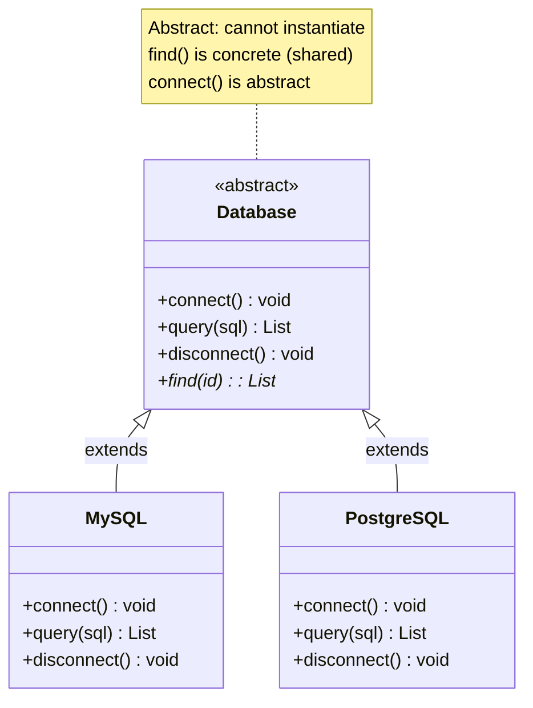

# Abstract Classes

## Introduction

An **abstract class** is a class that cannot be instantiated directly. It's designed to be a **base class** that other classes extend. It can contain both **abstract methods** (no implementation) and **concrete methods** (with implementation).

### Why Does It Exist?
- To provide **partial implementations** that subclasses can build upon
- To define a **common base** with shared code and abstract contracts
- To enforce that certain methods **must** be implemented by subclasses

### Why Do Developers Use It?
- When related classes share **code** AND have different **behavior**
- To implement the **Template Method** pattern
- To define a **base class** with default behavior and extension points

---

## Real-World Analogy: Vehicle Blueprint

An abstract "Vehicle" blueprint:
- It defines **shared parts** every vehicle has (wheels, engine, steering) — like concrete methods
- It says every vehicle must **move()**, but doesn't specify *how* — like abstract methods
- You **can't** build a "Vehicle" directly (it's abstract)
- You **can** build a "Car", "Bike", or "Truck" based on the blueprint

---

## Definition

An **abstract class** is a class declared with the `abstract` keyword (in languages that support it). It may contain both fully implemented methods and abstract methods (without a body) that subclasses must implement.

---

## Why Do We Need It?

Without abstract classes, you have to choose between:
- A concrete class (can be instantiated, but shouldn't be)
- An interface (can't provide any shared implementation)

Abstract classes fill the gap: **shared implementation + abstract contracts**.

---

## Visual Explanation



---

## Code Examples

### TypeScript

```typescript
abstract class Report {
  constructor(protected title: string) {}

  // Abstract methods — subclasses must implement
  abstract generate(): string;
  abstract getFormat(): string;

  // Concrete method — shared behavior
  print(): void {
    console.log(`Printing report: ${this.title}`);
    console.log(`Format: ${this.getFormat()}`);
    console.log(`Content: ${this.generate()}`);
  }

  // Concrete method with hook
  preview(): string {
    const content = this.generate();
    return content.length > 100 ? content.substring(0, 100) + "..." : content;
  }
}

class PDFReport extends Report {
  constructor(title: string, private data: any[]) {
    super(title);
  }

  generate(): string {
    return this.data.map(d => JSON.stringify(d)).join("\n");
  }

  getFormat(): string {
    return "PDF";
  }
}

class HTMLReport extends Report {
  constructor(title: string, private data: any[]) {
    super(title);
  }

  generate(): string {
    return `<html><body><h1>${this.title}</h1></body></html>`;
  }

  getFormat(): string {
    return "HTML";
  }
}

// Cannot instantiate abstract class
// const report = new Report("Test"); // ❌ Error

const pdf = new PDFReport("Sales", [{ item: "Widget", price: 10 }]);
pdf.print();
```

### JavaScript (Simulated Abstract Classes)

```javascript
// JavaScript doesn't have native abstract classes
// Simulate with constructor checks
class Database {
  constructor() {
    if (new.target === Database) {
      throw new Error("Cannot instantiate abstract class Database");
    }
  }

  // Abstract methods — should be overridden
  connect() {
    throw new Error("Abstract method connect() must be implemented");
  }

  query(sql) {
    throw new Error("Abstract method query() must be implemented");
  }

  // Concrete method
  find(id) {
    this.connect();
    const result = this.query(`SELECT * FROM users WHERE id = ${id}`);
    this.disconnect();
    return result;
  }
}

class MySQLDatabase extends Database {
  connect() {
    console.log("Connected to MySQL");
  }

  query(sql) {
    console.log(`MySQL query: ${sql}`);
    return [];
  }

  disconnect() {
    console.log("Disconnected from MySQL");
  }
}

// const db = new Database(); // ❌ Error!
const db = new MySQLDatabase();
db.find(1); // Works — uses concrete find() from parent
```

### Python

```python
from abc import ABC, abstractmethod

class Shape(ABC):
    @abstractmethod
    def area(self) -> float:
        """Subclasses must implement this."""
        pass

    @abstractmethod
    def perimeter(self) -> float:
        """Subclasses must implement this."""
        pass

    # Concrete method
    def describe(self) -> str:
        return f"Area: {self.area():.2f}, Perimeter: {self.perimeter():.2f}"

    # Concrete method with abstract usage
    def is_larger_than(self, other: 'Shape') -> bool:
        return self.area() > other.area()

class Circle(Shape):
    def __init__(self, radius: float):
        self.radius = radius

    def area(self) -> float:
        return 3.14159 * self.radius ** 2

    def perimeter(self) -> float:
        return 2 * 3.14159 * self.radius

class Square(Shape):
    def __init__(self, side: float):
        self.side = side

    def area(self) -> float:
        return self.side ** 2

    def perimeter(self) -> float:
        return 4 * self.side

# shape = Shape()  # ❌ TypeError
circle = Circle(5)
square = Square(4)
print(circle.describe())        # "Area: 78.54, Perimeter: 31.42"
print(circle.is_larger_than(square))  # True
```

### Java

```java
abstract class AbstractPayment {
    protected double amount;

    public AbstractPayment(double amount) {
        this.amount = amount;
    }

    // Abstract
    public abstract boolean process();

    public abstract String getReceipt();

    // Concrete
    public void printSummary() {
        System.out.println("Amount: $" + amount);
        System.out.println("Processed: " + process());
    }

    // Template method
    public final void executePayment() {
        validate();
        process();
        sendConfirmation();
    }

    protected abstract void validate();
    protected abstract void sendConfirmation();
}
```

---

## Abstract Class vs Interface

| Aspect | Abstract Class | Interface |
|--------|---------------|-----------|
| **Purpose** | Share code + define contracts | Pure contract |
| **Methods** | Abstract + concrete | All abstract (traditionally) |
| **Fields** | Can have instance fields | Static constants only (Java) |
| **Constructors** | Yes | No |
| **Multiple inheritance** | No (extends one) | Yes (implements many) |
| **Access modifiers** | Any | Public only |
| **When to use** | Related classes with shared code | Unrelated classes with shared capability |
| **Example** | `Database` — MySQL, PostgreSQL extend | `Comparable` — any class can implement |

---

### When to Use Abstract Class vs Interface

**Use Abstract Class when:**
- Classes share common **state** (fields)
- Classes share common **code** (concrete methods)
- Classes are closely **related** in hierarchy

**Use Interface when:**
- You want to define a **capability** across unrelated classes
- You need **multiple inheritance** of behavior
- You want a **pure contract** without any implementation

---

## Best Practices

- Use abstract classes for **shared implementation**, interfaces for **pure contracts**
- Keep abstract classes **focused** (Single Responsibility)
- Mark abstract classes with clear naming (`Abstract` prefix or language keywords)
- Use the **Template Method pattern** with abstract methods as hooks
- Avoid **deep abstract class hierarchies** (prefer composition)

---

## Common Mistakes

- **Using abstract class when interface is sufficient** (prefer interface)
- **Too many abstract methods** — makes subclassing difficult
- **Adding concrete methods that all subclasses override** — should be abstract
- **Calling abstract methods from constructor** — may call uninitialized code
- **Deep hierarchies** — abstract class → abstract class → ... → concrete

---

## Interview Questions

**Easy:**
1. What is an abstract class?
2. Why can't you instantiate an abstract class?

**Medium:**
3. What's the difference between abstract class and interface?
4. When would you use an abstract class over an interface?
5. Can an abstract class have constructors?

**Advanced:**
6. How does the Template Method pattern use abstract classes?
7. Why can't abstract methods be private?
8. How does C++ achieve abstraction without an `abstract` keyword?

---

## Summary

| Concept | Key Point |
|---------|-----------|
| **Abstract Class** | Cannot be instantiated; designed for extension |
| **Abstract Methods** | No implementation; subclasses must implement |
| **Concrete Methods** | Shared implementation for subclasses |
| **vs Interface** | Abstract = shared code + contract; Interface = pure contract |
| **Rule of Thumb** | Interface for capability; Abstract for shared base |

---

**Previous Topic:** [Interfaces →](/DSA-Notes-Problems/oops/22-interfaces)
**Next Topic:** [Object Lifecycle →](/DSA-Notes-Problems/oops/24-object-lifecycle)
**Related Topics:** [Interfaces](/DSA-Notes-Problems/oops/22-interfaces), [Inheritance](/DSA-Notes-Problems/oops/10-inheritance)
