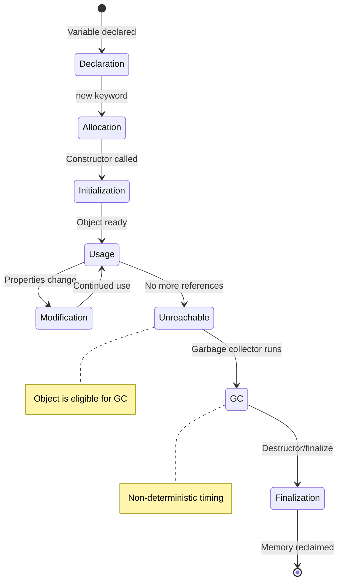

# Object Lifecycle

## Introduction

Every object in a program goes through a **lifecycle**: from the moment it's created (memory allocated) to the moment it's destroyed (memory reclaimed). Understanding this lifecycle is crucial for writing efficient, leak-free code.

### Why Does It Exist?
- Objects need to be **initialized** before use
- Resources need to be **managed** (memory, file handles, connections)
- Objects need to be **cleaned up** when no longer needed

### Why Do Developers Use It?
- To ensure proper resource management
- To prevent memory leaks
- To understand when constructors and destructors are called
- To optimize performance by controlling object lifetimes

---

## Real-World Analogy: A Hotel Guest

| Stage | Hotel Analogy | Object Lifecycle |
|-------|---------------|------------------|
| **1. Reservation** | Booking a room | Memory allocation |
| **2. Check-in** | Guest arrives, gets key | Constructor initializes |
| **3. Stay** | Guest uses the room | Object is used |
| **4. Check-out** | Guest leaves, returns key | Object is released |
| **5. Cleaning** | Room is cleaned for next guest | Garbage collection |

---

## The Object Lifecycle Stages



---

## Stage 1: Declaration

The variable is declared — a reference is created but no object exists yet.

```javascript
let user; // Just a reference, no object
// user is undefined
```

## Stage 2: Allocation

Memory is allocated on the **heap** for the object.

```javascript
// Behind the scenes:
// 1. JVM/Engine allocates memory on heap
// 2. Sets default values (0, null, false)
user = new User(); // Allocation + Initialization
```

## Stage 3: Initialization

The **constructor** runs to set up the initial state.

```javascript
class User {
  constructor(name, email) {
    this.name = name;     // Initialize
    this.email = email;   // Initialize
    this.createdAt = new Date(); // Initialize
  }
}

const user = new User("Alice", "alice@email.com");
// Object fully initialized and ready
```

## Stage 4: Usage

The object is used by the program — methods called, properties accessed.

```javascript
user.login();           // Using the object
user.updateProfile();   // Using the object
console.log(user.name); // Accessing properties
```

## Stage 5: Unreachable

When no references point to the object, it becomes eligible for garbage collection.

```javascript
let user = new User("Alice", "alice@email.com");
user = null; // The User object is now unreachable
// Ready for garbage collection!
```

## Stage 6: Garbage Collection

The memory is reclaimed.

```javascript
// Can happen at any time after object becomes unreachable
// Developer has no control over exactly when
```

---

## Code Examples

### JavaScript — Lifecycle Demo

```javascript
class Resource {
  static instanceCount = 0;

  constructor(name) {
    this.name = name;
    this.id = ++Resource.instanceCount;
    console.log(`[CREATED] Resource #${this.id}: ${this.name}`);
  }

  use() {
    console.log(`[USING] Resource #${this.id}: ${this.name}`);
  }

  // JavaScript doesn't have destructors
  // But we can provide a cleanup method
  dispose() {
    console.log(`[DISPOSED] Resource #${this.id}: ${this.name}`);
    // Cleanup file handles, connections, etc.
  }
}

// --- Lifecycle ---
console.log("--- Declaration ---");
let res; // Stage 1: Declaration (res is undefined)

console.log("--- Allocation & Initialization ---");
res = new Resource("Database Connection"); // Stage 2 & 3

console.log("--- Usage ---");
res.use(); // Stage 4
res.use();

console.log("--- Disposal ---");
res.dispose(); // Manual cleanup

console.log("--- Unreachable ---");
res = null; // Stage 5: Now eligible for GC
// Stage 6: GC runs eventually (non-deterministic)
```

### Python — With Destructor

```python
import weakref

class Connection:
    def __init__(self, host: str):
        self.host = host
        self.is_open = True
        print(f"[INIT] Connected to {host}")

    def query(self, sql: str):
        if not self.is_open:
            raise RuntimeError("Connection is closed")
        print(f"[QUERY] {sql}")
        return []

    def close(self):
        if self.is_open:
            self.is_open = False
            print(f"[CLOSE] Connection to {self.host} closed")

    def __del__(self):
        """Destructor — called when object is garbage collected."""
        if self.is_open:
            print(f"[DEL] Warning: {self.host} was not properly closed!")
        print(f"[DEL] Cleaning up {self.host}")

# Usage
conn = Connection("localhost")  # Created
conn.query("SELECT * FROM users")
conn.close()                    # Manual cleanup

# Without close() — __del__ will show warning
conn2 = Connection("server.com")
conn2 = None  # Eligible for GC — __del__ called eventually
```

### Java

```java
public class FileProcessor {
    private String filename;
    private BufferedReader reader;

    public FileProcessor(String filename) throws IOException {
        this.filename = filename;
        this.reader = new BufferedReader(new FileReader(filename));
        System.out.println("Opened file: " + filename);
    }

    public String readLine() throws IOException {
        return reader.readLine();
    }

    // Cleanup method
    public void close() throws IOException {
        if (reader != null) {
            reader.close();
            System.out.println("Closed file: " + filename);
        }
    }

    // Deprecated — not guaranteed to be called
    @Override
    protected void finalize() throws Throwable {
        try {
            if (reader != null) reader.close();
        } finally {
            super.finalize();
        }
    }
}

// Using try-with-resources (Java 7+)
// Ensures close() is called even if exceptions occur
try (FileProcessor fp = new FileProcessor("data.txt")) {
    String line = fp.readLine();
    System.out.println(line);
} // Automatically calls close()
```

---

## References and Reachability

```mermaid
graph TD
    subgraph Stack["Stack (Variables)"]
        V1[user1 → Object A]
        V2[user2 → Object A]
        V3[user3 → Object B]
    end

    subgraph Heap["Heap (Objects)"]
        A[Object A<br/>name: 'Alice']
        B[Object B<br/>name: 'Bob']
        C[Object C<br/>name: 'Charlie'<br/>(unreachable)]
    end

    V1 --> A
    V2 --> A
    V3 --> B

    note for C["Object C: No references → Eligible for GC"]
```

---

## Memory Management

| Aspect | Stack | Heap |
|--------|-------|------|
| **What lives here** | Primitive values, references | Objects |
| **Allocation** | Automatic | Manual (`new`) |
| **Deallocation** | When scope exits | Garbage collector |
| **Speed** | Fast | Slower |
| **Size** | Small (MB) | Large (GB) |

---

## Best Practices

- **Clean up resources explicitly** — close files, connections, sockets
- **Use try-with-resources** or `finally` blocks for cleanup
- **Don't rely on finalizers/destructors** — they're not deterministic
- **Nullify references** to help GC (in long-lived collections)
- **Avoid circular references** that prevent GC
- **Use weak references** for caches and listeners

---

## Common Mistakes

- **Resource leaks** — forgetting to close files/connections
- **Relying on `finalize()`/`__del__`** for cleanup — they may never run
- **Memory leaks** — holding references longer than needed
- **Circular references** preventing garbage collection
- **Forgetting to call `super()`** in inherited cleanup methods

---

## Interview Questions

**Easy:**
1. What are the stages of an object's lifecycle?
2. What happens when you use the `new` keyword?

**Medium:**
3. What is garbage collection and how does it work?
4. What's the difference between stack and heap memory?

**Advanced:**
5. How do circular references affect garbage collection?
6. What are weak references and when would you use them?

---

## Summary

| Stage | What Happens |
|-------|--------------|
| **Declaration** | Reference variable created (null) |
| **Allocation** | Memory allocated on heap |
| **Initialization** | Constructor runs |
| **Usage** | Methods called, properties accessed |
| **Unreachable** | No more references |
| **GC** | Memory reclaimed (non-deterministic) |

---

**Previous Topic:** [Abstract Classes →](/DSA-Notes-Problems/oops/23-abstract-classes)
**Next Topic:** [Memory Management →](/DSA-Notes-Problems/oops/25-memory-management)
**Related Topics:** [Constructor](/DSA-Notes-Problems/oops/05-constructor), [Memory Management](/DSA-Notes-Problems/oops/25-memory-management)
