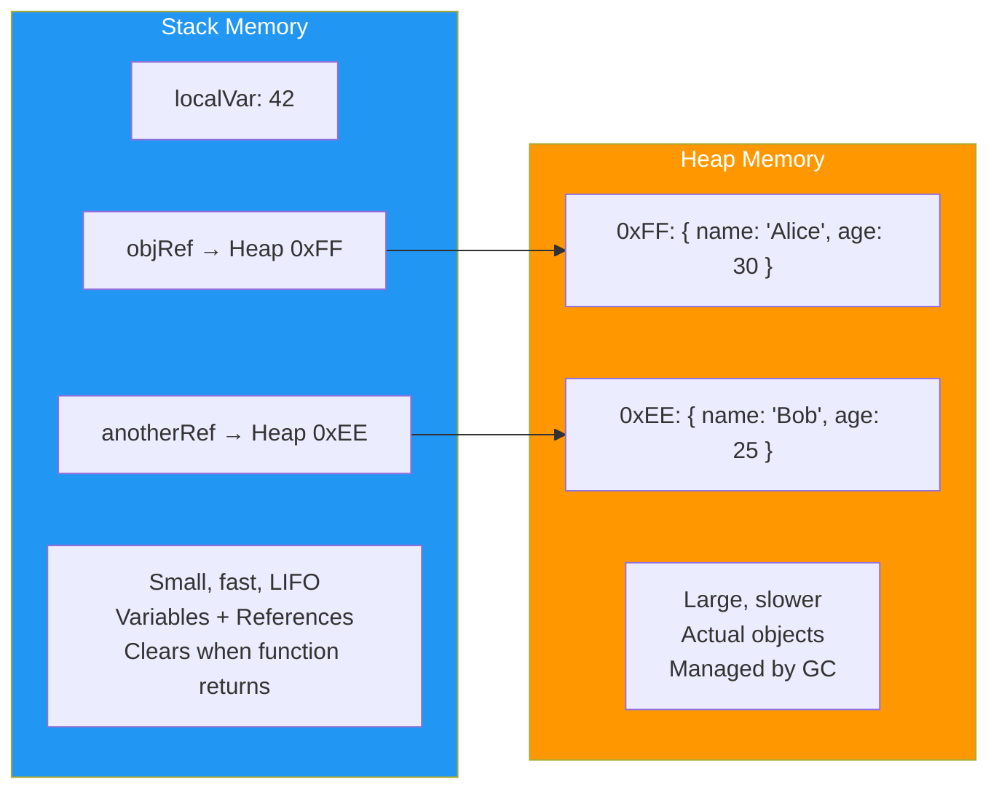
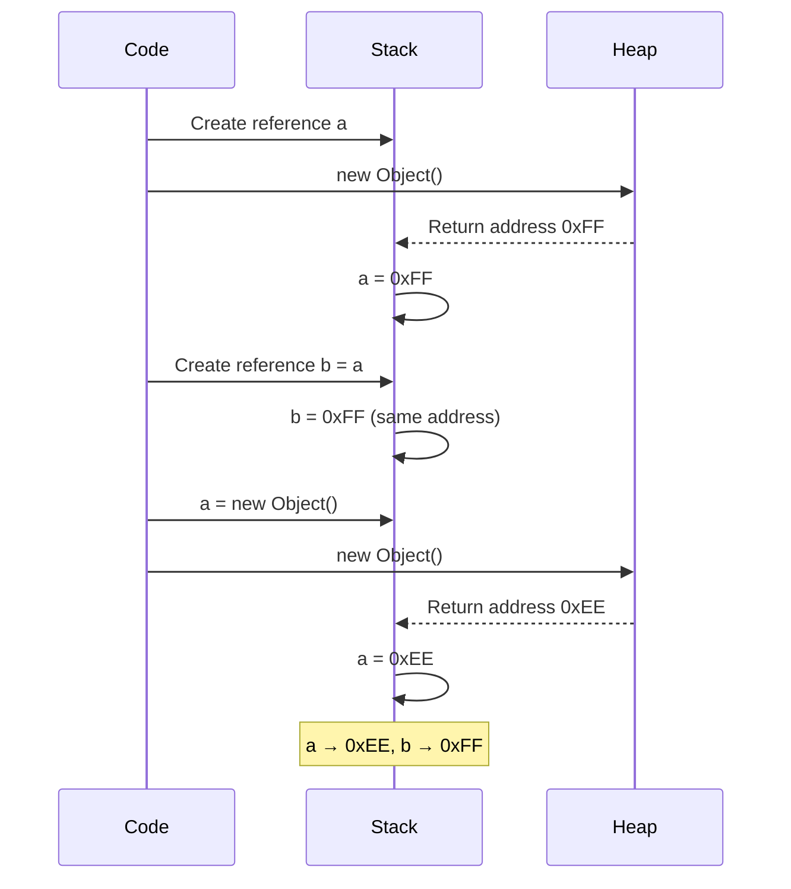
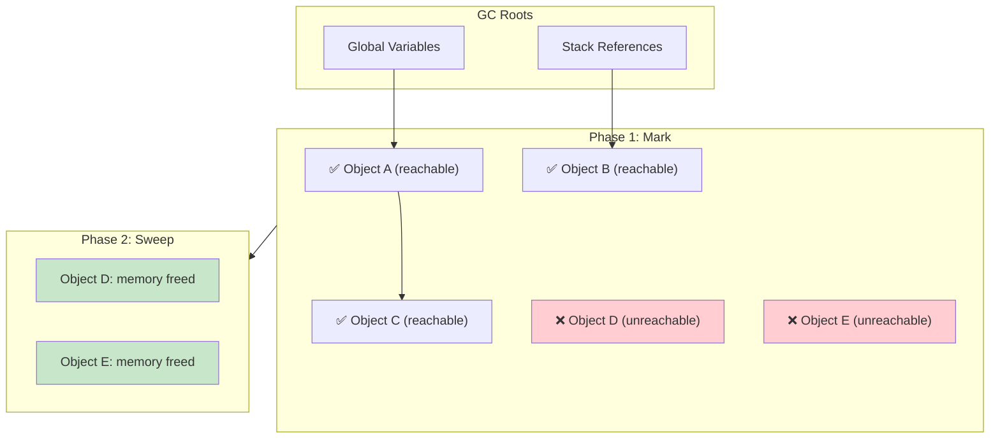

# Memory Management

## Introduction

**Memory management** in OOP refers to how objects are allocated, accessed, and freed in memory. Understanding this helps developers write efficient code and avoid memory leaks.

### Why Does It Exist?
- Programs need memory to store objects
- Memory is **limited** — must be managed efficiently
- Objects need to be **created** and eventually **destroyed**

### Why Do Developers Use It?
- To optimize performance
- To prevent memory leaks and crashes
- To understand reference behavior (pass by reference)

---

## Real-World Analogy: Library

| Memory Concept | Library Analogy |
|----------------|-----------------|
| **Stack** | The librarian's desk — small, fast, organized |
| **Heap** | The book shelves — large, slower, holds everything |
| **Reference** | A call number telling you where to find a book |
| **Object** | The actual book on the shelf |
| **Garbage collection** | Librarian returns returned books to shelves |

---

## Stack vs Heap



---

## Stack Memory

The **stack** stores:
- Primitive values (numbers, booleans, etc.)
- References/pointers to objects on the heap
- Function call frames (parameters, return addresses)

**Characteristics:**
- Fixed size (typically 1-8 MB)
- LIFO (Last In, First Out) access
- Very fast
- Automatically managed (cleared when function returns)

```javascript
function calculate() {
  let x = 10;       // Stored on stack (primitive)
  let y = 20;       // Stored on stack (primitive)
  let user = new User(); // Reference on stack, object on heap
  return x + y;
} // Stack cleared when function returns
```

---

## Heap Memory

The **heap** stores all objects.

**Characteristics:**
- Large (can be GBs)
- Dynamic allocation
- Slower (allocation + garbage collection overhead)
- Managed by garbage collector

```javascript
// All objects are on the heap
const obj1 = { name: "Alice" };  // heap
const obj2 = [1, 2, 3];          // heap
const obj3 = new Date();          // heap
const obj4 = function() {};      // heap
```

---

## References

Variables don't contain objects — they contain **references** to objects.

```javascript
// Reference behavior
let a = { value: 10 };
let b = a; // b REFERS to the same object as a

b.value = 20;
console.log(a.value); // 20 — because a and b reference same object

// Reassigning a doesn't affect b
a = { value: 30 };
console.log(b.value); // 20 — b still points to original object
```

---

## Visual Reference Diagram



---

## Garbage Collection

**Garbage Collection (GC)** is the automatic process of reclaiming memory occupied by objects that are no longer reachable.

### How GC Works (Mark and Sweep)



---

## Code Examples: Memory Management

### JavaScript

```javascript
// Understanding references
let obj1 = { data: "Hello" };
let obj2 = obj1;       // Same object
let obj3 = { data: "Hello" }; // Different object

console.log(obj1 === obj2); // true — same reference
console.log(obj1 === obj3); // false — different objects

// Nullifying references
let bigData = new Array(1000000).fill("data");
bigData = null; // Now eligible for GC

// Memory leak example
const cache = {};
function addToCache(key, value) {
  cache[key] = value; // Never deleted — memory leak!
}
```

### Memory Leak Examples

```javascript
// 1. Forgotten timers
class Timer {
  constructor() {
    this.data = new Array(1000);
    setInterval(() => {
      console.log(this.data.length); // Holds reference to 'this'
    }, 1000);
  }
}
// Even if timer instance is nulled, interval still runs!

// 2. Event listeners not removed
class Button {
  constructor() {
    this.data = new Array(1000);
    document.addEventListener("click", () => {
      console.log(this.data); // Holds reference
    });
  }
}

// 3. Closures holding references
function createLeak() {
  const largeData = new Array(1000000);
  return function() {
    console.log("still holding largeData");
    // largeData can never be GC'd while this function exists
  };
}
```

---

## Best Practices

- **Nullify references** when done with large objects
- **Remove event listeners** when components are destroyed
- **Clear timers/intervals** (`clearInterval`, `clearTimeout`)
- **Use weak references** for caches (`WeakMap`, `WeakSet`)
- **Avoid global variables** for temporary data
- **Use object pooling** for frequently created/destroyed objects

---

## Common Mistakes

- **Memory leaks** — holding references longer than needed
- **Circular references** (most modern GCs handle this, but be careful)
- **Large objects in closures** — accidentally captured
- **Not cleaning up** event listeners, timers, subscriptions
- **Assuming `delete` frees memory** — it only removes properties

---

## Interview Questions

**Easy:**
1. What's the difference between stack and heap memory?
2. What is garbage collection?

**Medium:**
3. How does pass-by-reference work in JavaScript?
4. What causes memory leaks in JavaScript?
5. How does the mark-and-sweep algorithm work?

**Advanced:**
6. What are weak references and when would you use them?
7. How do closures affect memory management?

---

## Summary

| Concept | Key Point |
|---------|-----------|
| **Stack** | Stores primitives and references; fast, automatic |
| **Heap** | Stores objects; managed by GC |
| **Reference** | A pointer to an object on the heap |
| **GC** | Automatically frees unreachable objects |
| **Memory Leak** | Object held in memory but never used again |
| **Rule** | Clean up: nullify, remove listeners, clear timers |

---

**Previous Topic:** [Object Lifecycle →](/DSA-Notes-Problems/oops/24-object-lifecycle)
**Next Topic:** [Design Principles →](/DSA-Notes-Problems/oops/26-design-principles)
**Related Topics:** [Object Lifecycle](/DSA-Notes-Problems/oops/24-object-lifecycle)
