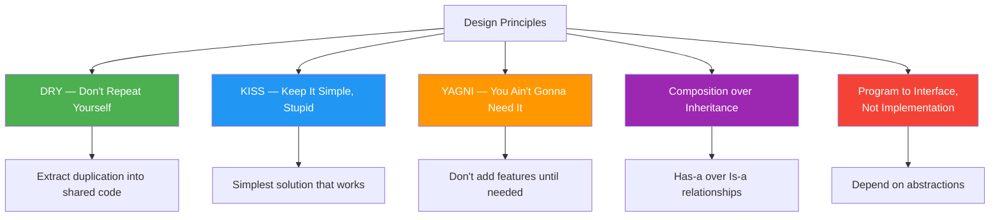

# Design Principles

## Introduction

**Design principles** are guidelines that help developers create better software. Unlike SOLID (which is more specific), these principles are **general rules of thumb** that apply across paradigms and languages.

### Why Do They Exist?
- To guide decision-making during design
- To prevent common mistakes
- To create maintainable, readable code

### Why Do Developers Use It?
- To avoid over-engineering
- To keep code simple and focused
- To make better architectural decisions

---

## The Principles



---

## DRY — Don't Repeat Yourself

> **Every piece of knowledge must have a single, unambiguous, authoritative representation within a system.**

### Problem
Duplicated code leads to maintenance nightmares.

```javascript
// ❌ Violates DRY — validation logic repeated
function validateUser(name, email, age) {
  if (!name || name.length < 2) throw new Error("Invalid name");
  if (!email || !email.includes("@")) throw new Error("Invalid email");
  if (age < 0 || age > 150) throw new Error("Invalid age");
}

function validateProduct(name, price, quantity) {
  if (!name || name.length < 2) throw new Error("Invalid name");
  if (price < 0) throw new Error("Invalid price");
  if (quantity < 0) throw new Error("Invalid quantity");
}
```

### Solution

```javascript
// ✅ Follows DRY — reusable validator
function required(value, message) {
  if (!value) throw new Error(message);
}

function minLength(value, min, message) {
  if (value.length < min) throw new Error(message);
}

function validateUser(name, email, age) {
  required(name, "Name required");
  minLength(name, 2, "Name too short");
  required(email, "Email required");
  // ...
}
```

### When to bend DRY
- Sometimes duplication is better than the wrong abstraction
- Don't DRY prematurely — wait until you see the pattern 3 times

---

## KISS — Keep It Simple, Stupid

> **Most systems work best if they are kept simple rather than made complex.**

### Problem
Over-engineered solutions are hard to understand and maintain.

```javascript
// ❌ Violates KISS — overly complex
class StringFormatter {
  constructor(strategy, options) {
    this.strategy = strategy;
    this.options = options;
  }

  format(input) {
    return this.strategy.execute(input, this.options);
  }
}

// ✅ Follows KISS — simple and direct
function formatName(first, last) {
  return `${first} ${last}`.trim();
}
```

### Rules of thumb:
- Choose the simplest solution that works
- Don't add patterns/frameworks until needed
- If a method needs comments to explain what it does, it's too complex
- Favor readability over cleverness

---

## YAGNI — You Ain't Gonna Need It

> **Always implement things when you actually need them, never when you just foresee that you might need them.**

### Problem
Building features "just in case" adds complexity without value.

```javascript
// ❌ Violates YAGNI — building for future that may never come
class User {
  constructor(name) {
    this.name = name;
    this.theme = "light";          // Might be needed later?
    this.locale = "en-US";         // Might be needed later?
    this.accessibility = "none";   // Might be needed later?
    this.exportFormats = ["json"]; // Might be needed later?
  }
}

// ✅ Follows YAGNI — only what's needed now
class User {
  constructor(name, email) {
    this.name = name;
    this.email = email;
  }
}
```

### When to ignore YAGNI
- When you're building for a known, planned feature
- When the cost of adding later is much higher
- When the feature is core to the architecture

---

## Composition over Inheritance

> **Prefer composing objects from smaller parts over inheriting from large base classes.**

### Problem
Inheritance creates tight coupling and fragile hierarchies.

```javascript
// ❌ Deep inheritance — fragile and inflexible
class Bird { fly() { /* ... */ } }
class Penguin extends Bird { fly() { throw "Can't fly"; } } // LSP violation!

// ✅ Composition — flexible and focused
class FlyBehavior {
  fly() { /* flying logic */ }
}

class SwimBehavior {
  swim() { /* swimming logic */ }
}

class Bird {
  constructor(flyBehavior) {
    this.flyBehavior = flyBehavior;
  }

  fly() {
    this.flyBehavior.fly();
  }
}

class Penguin {
  constructor(swimBehavior) {
    this.swimBehavior = swimBehavior;
  }

  swim() {
    this.swimBehavior.swim();
  }
}
```

### When inheritance is better
- Genuine IS-A relationship (a Dog IS-A Animal)
- Shared behavior is intrinsic to the type
- The hierarchy is stable (won't change often)

---

## Program to an Interface, Not an Implementation

> **Depend on abstract interfaces rather than concrete classes.**

### Problem
Tight coupling to concrete implementations.

```javascript
// ❌ Tight coupling
class PaymentService {
  process(amount) {
    const stripe = new StripeAPI("sk_live_key");
    stripe.charge(amount);
  }
}

// ✅ Programming to interface
class PaymentService {
  constructor(paymentGateway) {
    this.paymentGateway = paymentGateway; // Any gateway works
  }

  process(amount) {
    this.paymentGateway.charge(amount);
  }
}

// Can use any implementation
const service = new PaymentService(new StripeGateway(key));
const service2 = new PaymentService(new PayPalGateway(clientId));
```

---

## Principles Comparison

| Principle | Core Idea | Common Violation |
|-----------|-----------|------------------|
| **DRY** | Don't duplicate code | Copy-pasted validation logic |
| **KISS** | Keep it simple | Over-engineered solutions |
| **YAGNI** | Don't build for the unknown | Features "just in case" |
| **Composition** | Favor has-a over is-a | Deep inheritance hierarchies |
| **Program to Interface** | Depend on abstractions | Tight coupling to concrete classes |

---

## Interview Questions

**Easy:**
1. What does DRY stand for and why is it important?
2. Explain KISS principle.

**Medium:**
3. When would you violate DRY intentionally?
4. Why is composition preferred over inheritance?
5. How does YAGNI speed up development?

**Advanced:**
6. How do you balance DRY with YAGNI?
7. Give an example where inheritance is better than composition.
8. How do these principles relate to the SOLID principles?

---

## Summary

| Principle | One-Liner |
|-----------|-----------|
| **DRY** | Don't repeat yourself — extract duplication |
| **KISS** | Keep it simple — simplest solution works |
| **YAGNI** | Don't build for the unknown future |
| **Composition** | Prefer has-a over is-a |
| **Program to Interface** | Depend on abstractions |

---

**Previous Topic:** [Memory Management →](/DSA-Notes-Problems/oops/25-memory-management)
**Next Topic:** [Real-World Examples →](/DSA-Notes-Problems/oops/27-real-world-examples)
**Related Topics:** [SOLID](/DSA-Notes-Problems/oops/17-solid-principles), [Coupling vs Cohesion](/DSA-Notes-Problems/oops/16-coupling-vs-cohesion)
