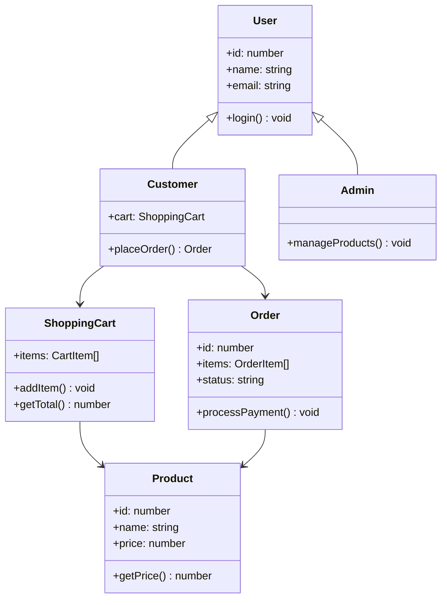
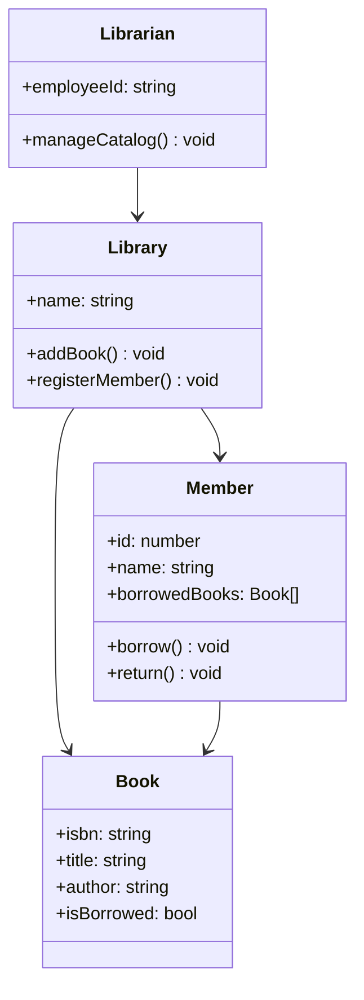

# Real-World OOP Examples

## Introduction

This page demonstrates how OOP principles are applied in **real-world systems**. Each example shows a complete, practical implementation of OOP concepts.

---

## 1. E-Commerce System

A complete e-commerce system demonstrating classes, inheritance, polymorphism, and composition.



```javascript
class User {
  constructor(id, name, email) {
    this.id = id;
    this.name = name;
    this.email = email;
    this.createdAt = new Date();
  }

  login() {
    console.log(`${this.name} logged in`);
  }

  logout() {
    console.log(`${this.name} logged out`);
  }
}

class Customer extends User {
  constructor(id, name, email) {
    super(id, name, email);
    this.cart = new ShoppingCart();
  }

  addToCart(product, quantity = 1) {
    this.cart.addItem(product, quantity);
  }

  placeOrder() {
    if (this.cart.isEmpty()) {
      throw new Error("Cart is empty");
    }
    const order = new Order(this, this.cart.getItems());
    this.cart.clear();
    return order;
  }
}

class Admin extends User {
  constructor(id, name, email) {
    super(id, name, email);
    this.role = "admin";
  }

  manageProducts() {
    console.log(`${this.name} is managing products`);
  }

  generateReport() {
    return `Sales report generated by ${this.name}`;
  }
}

class Product {
  constructor(id, name, price, stock) {
    this.id = id;
    this.name = name;
    this.price = price;
    this.stock = stock;
  }

  isInStock() {
    return this.stock > 0;
  }
}

class ShoppingCart {
  constructor() {
    this.items = [];
  }

  addItem(product, quantity = 1) {
    const existing = this.items.find(i => i.product.id === product.id);
    if (existing) {
      existing.quantity += quantity;
    } else {
      this.items.push({ product, quantity });
    }
  }

  removeItem(productId) {
    this.items = this.items.filter(i => i.product.id !== productId);
  }

  getTotal() {
    return this.items.reduce((sum, item) => sum + item.product.price * item.quantity, 0);
  }

  isEmpty() {
    return this.items.length === 0;
  }

  clear() {
    this.items = [];
  }

  getItems() {
    return [...this.items]; // Return copy
  }
}

class Order {
  constructor(customer, items) {
    this.id = Date.now();
    this.customer = customer;
    this.items = items;
    this.status = "pending";
    this.total = items.reduce((sum, i) => sum + i.product.price * i.quantity, 0);
    this.createdAt = new Date();
  }

  processPayment() {
    console.log(`Processing payment of $${this.total}...`);
    this.status = "paid";
  }

  ship() {
    if (this.status !== "paid") {
      throw new Error("Cannot ship unpaid order");
    }
    this.status = "shipped";
  }

  getSummary() {
    return `Order #${this.id}: ${this.items.length} items, $${this.total}`;
  }
}

// Usage
const laptop = new Product(1, "Laptop", 1200, 10);
const mouse = new Product(2, "Mouse", 25, 50);

const alice = new Customer(1, "Alice", "alice@email.com");
alice.login();
alice.addToCart(laptop);
alice.addToCart(mouse, 2);

const order = alice.placeOrder();
console.log(order.getSummary()); // "Order #...: 3 items, $1250"
order.processPayment();
order.ship();
```

---

## 2. Library Management System

Demonstrates association, aggregation, and polymorphism.



```javascript
class Book {
  constructor(isbn, title, author) {
    this.isbn = isbn;
    this.title = title;
    this.author = author;
    this.isBorrowed = false;
  }

  getInfo() {
    return `'${this.title}' by ${this.author} [${this.isbn}]`;
  }
}

class Member {
  constructor(id, name) {
    this.id = id;
    this.name = name;
    this.borrowedBooks = [];
  }

  borrowBook(book) {
    if (book.isBorrowed) {
      throw new Error(`'${book.title}' is already borrowed`);
    }
    if (this.borrowedBooks.length >= 5) {
      throw new Error("Borrowing limit reached (5 books)");
    }
    book.isBorrowed = true;
    this.borrowedBooks.push(book);
    console.log(`${this.name} borrowed '${book.title}'`);
  }

  returnBook(book) {
    const index = this.borrowedBooks.findIndex(b => b.isbn === book.isbn);
    if (index === -1) {
      throw new Error(`${this.name} didn't borrow '${book.title}'`);
    }
    book.isBorrowed = false;
    this.borrowedBooks.splice(index, 1);
    console.log(`${this.name} returned '${book.title}'`);
  }
}

class Librarian {
  constructor(name, employeeId) {
    this.name = name;
    this.employeeId = employeeId;
  }

  addBook(library, isbn, title, author) {
    const book = new Book(isbn, title, author);
    library.addBook(book);
    return book;
  }

  registerMember(library, id, name) {
    const member = new Member(id, name);
    library.addMember(member);
    return member;
  }
}

class Library {
  constructor(name) {
    this.name = name;
    this.books = [];
    this.members = [];
  }

  addBook(book) {
    this.books.push(book);
  }

  addMember(member) {
    this.members.push(member);
  }

  findBook(isbn) {
    return this.books.find(b => b.isbn === isbn);
  }

  listAvailableBooks() {
    return this.books.filter(b => !b.isBorrowed).map(b => b.getInfo());
  }
}

// Usage
const library = new Library("City Library");
const librarian = new Librarian("John", "LIB001");

const book1 = librarian.addBook(library, "978-0451524935", "1984", "George Orwell");
const book2 = librarian.addBook(library, "978-0061120084", "To Kill a Mockingbird", "Harper Lee");

const alice = librarian.registerMember(library, 1, "Alice");

alice.borrowBook(book1);
alice.borrowBook(book2);
alice.returnBook(book1);

console.log("Available:", library.listAvailableBooks());
```

---

## 3. Banking System

Demonstrates encapsulation, abstraction, and inheritance.

```javascript
class Account {
  constructor(accountNumber, holderName) {
    this.accountNumber = accountNumber;
    this.holderName = holderName;
    this.balance = 0;
    this.transactions = [];
  }

  deposit(amount) {
    if (amount <= 0) throw new Error("Amount must be positive");
    this.balance += amount;
    this.transactions.push({
      type: "deposit",
      amount,
      date: new Date(),
      balance: this.balance
    });
  }

  withdraw(amount) {
    if (amount <= 0) throw new Error("Amount must be positive");
    if (amount > this.balance) throw new Error("Insufficient funds");
    this.balance -= amount;
    this.transactions.push({
      type: "withdrawal",
      amount,
      date: new Date(),
      balance: this.balance
    });
  }

  getStatement() {
    return this.transactions.map(t =>
      `${t.date.toLocaleDateString()} - ${t.type}: $${t.amount} (Balance: $${t.balance})`
    );
  }
}

class SavingsAccount extends Account {
  constructor(accountNumber, holderName, interestRate = 0.02) {
    super(accountNumber, holderName);
    this.interestRate = interestRate;
    this.minimumBalance = 500;
  }

  withdraw(amount) {
    if (this.balance - amount < this.minimumBalance) {
      throw new Error(`Must maintain minimum balance of $${this.minimumBalance}`);
    }
    super.withdraw(amount); // Call parent's withdraw
  }

  applyInterest() {
    const interest = this.balance * this.interestRate;
    this.deposit(interest);
    console.log(`Applied interest: $${interest.toFixed(2)}`);
  }
}

class CheckingAccount extends Account {
  constructor(accountNumber, holderName, overdraftLimit = 0) {
    super(accountNumber, holderName);
    this.overdraftLimit = overdraftLimit;
  }

  withdraw(amount) {
    if (amount > this.balance + this.overdraftLimit) {
      throw new Error("Overdraft limit exceeded");
    }
    if (amount > this.balance) {
      console.log("Warning: Using overdraft");
    }
    super.withdraw(amount);
  }
}

// Usage
const savings = new SavingsAccount("SAV-001", "Alice", 0.03);
savings.deposit(2000);
savings.withdraw(500); // Balance: 1500
savings.applyInterest();
console.log(savings.balance); // ~1545

const checking = new CheckingAccount("CHK-001", "Bob", 500);
checking.deposit(1000);
checking.withdraw(1200); // Uses $200 overdraft
console.log(checking.balance); // -200
```

---

## 4. Notification System

Demonstrates polymorphism and interface-based design.

```javascript
// Interface-like base class
class NotificationChannel {
  send(recipient, message) {
    throw new Error("Must implement send()");
  }
}

class EmailChannel extends NotificationChannel {
  send(recipient, message) {
    console.log(`📧 Email to ${recipient}: ${message}`);
  }
}

class SMSChannel extends NotificationChannel {
  send(recipient, message) {
    console.log(`📱 SMS to ${recipient}: ${message}`);
  }
}

class PushChannel extends NotificationChannel {
  send(recipient, message) {
    console.log(`🔔 Push to ${recipient}: ${message}`);
  }
}

class NotificationService {
  constructor() {
    this.channels = new Map();
  }

  registerChannel(name, channel) {
    this.channels.set(name, channel);
  }

  send(channelName, recipient, message) {
    const channel = this.channels.get(channelName);
    if (!channel) throw new Error(`Channel '${channelName}' not found`);
    channel.send(recipient, message);
  }

  sendToAll(recipient, message) {
    this.channels.forEach(channel => {
      channel.send(recipient, message);
    });
  }
}

// Usage
const notifier = new NotificationService();
notifier.registerChannel("email", new EmailChannel());
notifier.registerChannel("sms", new SMSChannel());
notifier.registerChannel("push", new PushChannel());

notifier.send("email", "alice@email.com", "Welcome!");
notifier.sendToAll("all-users", "Server maintenance at midnight");
```

---

## Summary

These examples demonstrate:

| Concept | E-Commerce | Library | Banking | Notifications |
|---------|-----------|---------|---------|---------------|
| **Classes** | Product, Order | Book, Member | Account | Channel types |
| **Inheritance** | Customer extends User | — | Savings extends Account | — |
| **Encapsulation** | Private cart items | Book availability | Balance via methods | Channel registration |
| **Polymorphism** | — | — | Different withdraw() logic | send() across channels |
| **Composition** | Cart → Items | Library → Books | Account → Transactions | Service → Channels |

---

**Previous Topic:** [Design Principles →](/DSA-Notes-Problems/oops/26-design-principles)
**Next Topic:** [Machine Coding →](/DSA-Notes-Problems/oops/28-machine-coding)
**Related Topics:** [SOLID](/DSA-Notes-Problems/oops/17-solid-principles), [Interview Questions](/DSA-Notes-Problems/oops/30-interview-questions)
