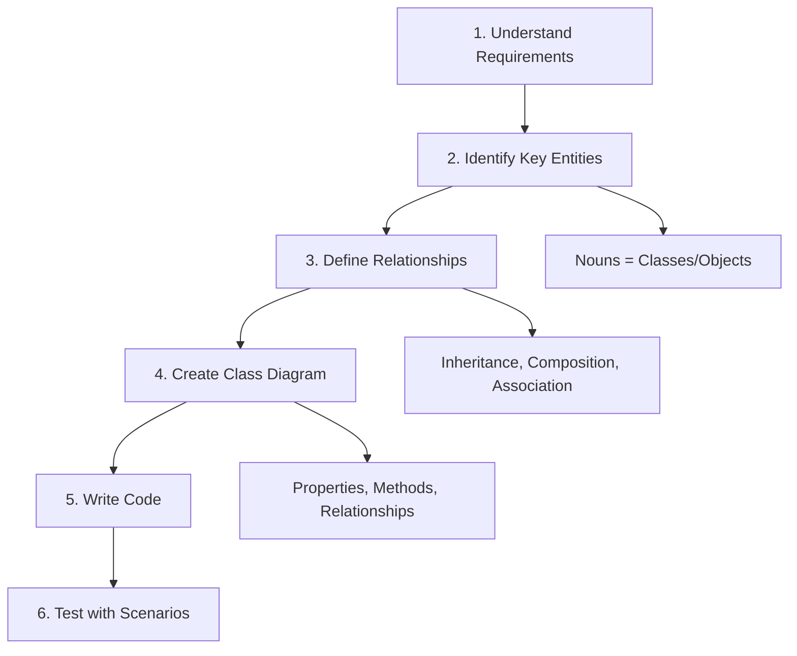
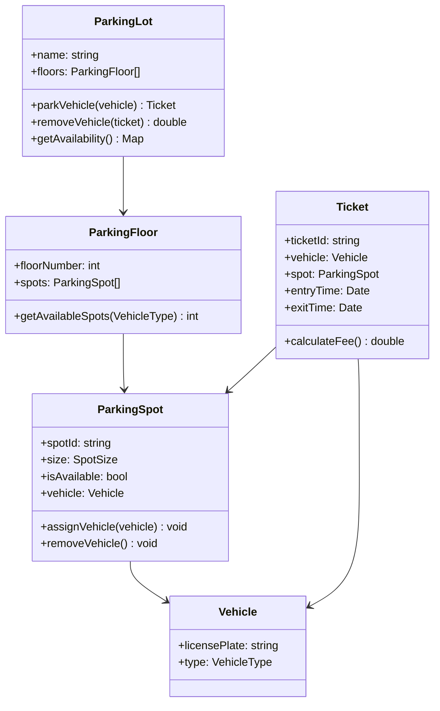
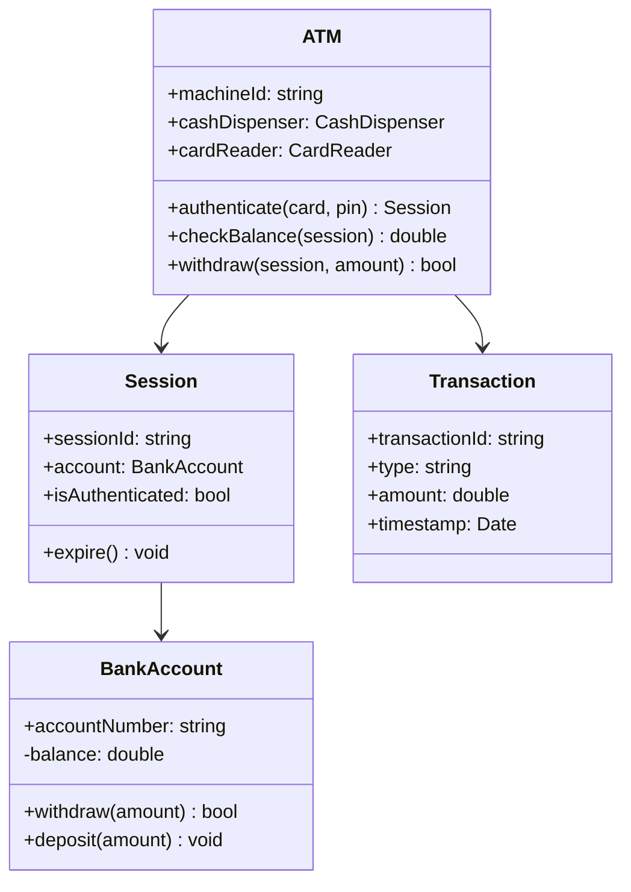
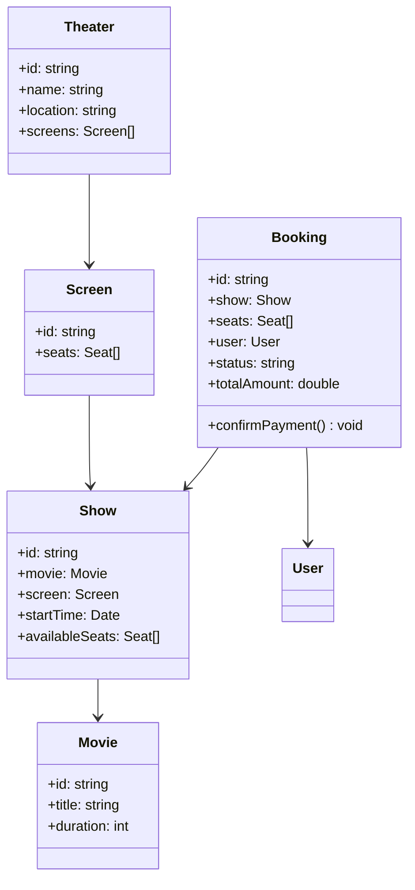

# Machine Coding — OOP Design Problems

## Introduction

**Machine coding** rounds test your ability to design and implement OOP systems. You're given a problem and expected to create a clean, extensible class design with proper OOP principles.

### Why Does It Exist?
- Tests **design thinking**, not just coding
- Evaluates understanding of OOP principles
- Checks code organization and extensibility

### Common Problems
- Parking Lot
- ATM Machine
- Library Management
- BookMyShow (Movie Booking)
- Splitwise (Expense Sharing)
- Chess Game
- Elevator System
- Restaurant Management

---

## General Approach



---

## Example 1: Parking Lot System

### Requirements
- Parking lot has multiple floors
- Each floor has multiple spots (different sizes: Small, Medium, Large)
- Vehicles can be parked and removed
- Track available spots per floor
- Generate ticket on entry

### Class Diagram



### Implementation (Partial)

```javascript
// Enums
const VehicleType = { BIKE: "bike", CAR: "car", TRUCK: "truck" };
const SpotSize = { SMALL: "small", MEDIUM: "medium", LARGE: "large" };

const SPOT_SIZE_MAP = {
  [VehicleType.BIKE]: SpotSize.SMALL,
  [VehicleType.CAR]: SpotSize.MEDIUM,
  [VehicleType.TRUCK]: SpotSize.LARGE
};

// Vehicle class
class Vehicle {
  constructor(licensePlate, type) {
    this.licensePlate = licensePlate;
    this.type = type;
  }
}

// ParkingSpot
class ParkingSpot {
  constructor(spotId, size) {
    this.spotId = spotId;
    this.size = size;
    this.isAvailable = true;
    this.vehicle = null;
  }

  assignVehicle(vehicle) {
    if (!this.isAvailable) throw new Error("Spot taken");
    if (SPOT_SIZE_MAP[vehicle.type] !== this.size &&
        vehicle.type !== VehicleType.CAR) { // Car fits in medium/large
      throw new Error("Vehicle doesn't fit");
    }
    this.vehicle = vehicle;
    this.isAvailable = false;
  }

  removeVehicle() {
    this.vehicle = null;
    this.isAvailable = true;
  }
}

// ParkingFloor
class ParkingFloor {
  constructor(floorNumber) {
    this.floorNumber = floorNumber;
    this.spots = [];
  }

  addSpot(spot) {
    this.spots.push(spot);
  }

  getAvailableSpot(vehicleType) {
    return this.spots.find(s => s.isAvailable &&
      (SPOT_SIZE_MAP[vehicleType] === s.size || s.size === SpotSize.LARGE));
  }

  getAvailability() {
    const counts = { small: 0, medium: 0, large: 0 };
    this.spots.forEach(s => {
      if (s.isAvailable) counts[s.size]++;
    });
    return counts;
  }
}

// Ticket
class Ticket {
  constructor(ticketId, vehicle, spot) {
    this.ticketId = ticketId;
    this.vehicle = vehicle;
    this.spot = spot;
    this.entryTime = new Date();
    this.exitTime = null;
  }

  calculateFee() {
    const hours = Math.ceil((new Date() - this.entryTime) / (1000 * 60 * 60));
    const rates = { small: 10, medium: 20, large: 30 };
    return Math.max(hours, 1) * (rates[this.spot.size] || 20);
  }
}

// ParkingLot
class ParkingLot {
  constructor(name) {
    this.name = name;
    this.floors = [];
    this.activeTickets = new Map();
    this.ticketCounter = 0;
  }

  addFloor(floor) {
    this.floors.push(floor);
  }

  parkVehicle(vehicle) {
    for (const floor of this.floors) {
      const spot = floor.getAvailableSpot(vehicle.type);
      if (spot) {
        spot.assignVehicle(vehicle);
        const ticket = new Ticket(`TICKET-${++this.ticketCounter}`, vehicle, spot);
        this.activeTickets.set(ticket.ticketId, ticket);
        console.log(`${vehicle.licensePlate} parked on Floor ${floor.floorNumber}, Spot ${spot.spotId}`);
        return ticket;
      }
    }
    throw new Error("No spots available");
  }

  removeVehicle(ticketId) {
    const ticket = this.activeTickets.get(ticketId);
    if (!ticket) throw new Error("Invalid ticket");
    ticket.spot.removeVehicle();
    ticket.exitTime = new Date();
    this.activeTickets.delete(ticketId);
    const fee = ticket.calculateFee();
    console.log(`Fee: $${fee}`);
    return fee;
  }

  getAvailability() {
    return this.floors.map(f => ({
      floor: f.floorNumber,
      spots: f.getAvailability()
    }));
  }
}

// Usage
const lot = new ParkingLot("Downtown Parking");
const floor1 = new ParkingFloor(1);
floor1.addSpot(new ParkingSpot("A1", SpotSize.SMALL));
floor1.addSpot(new ParkingSpot("A2", SpotSize.MEDIUM));
floor1.addSpot(new ParkingSpot("A3", SpotSize.LARGE));
lot.addFloor(floor1);

const car = new Vehicle("ABC-123", VehicleType.CAR);
const ticket = lot.parkVehicle(car);
console.log(lot.getAvailability());
// lot.removeVehicle(ticket.ticketId);
```

---

## Example 2: ATM Machine



---

## Example 3: Movie Booking (BookMyShow)



---

## General Tips for Machine Coding

| Tip | Description |
|-----|-------------|
| **Start with entities** | Identify nouns as potential classes |
| **Define relationships** | IS-A (inheritance), HAS-A (composition/aggregation) |
| **Use encapsulation** | Private fields, public methods |
| **Think extensibility** | Can you add new types without modifying core? |
| **Handle errors** | Invalid inputs, edge cases |
| **Write tests** | At minimum, test the main scenarios |

---

## Summary

When solving machine coding problems:
1. **Understand** the requirements thoroughly
2. **Identify** entities and their relationships
3. **Design** the class hierarchy
4. **Implement** with proper OOP principles
5. **Test** with real scenarios

---

**Previous Topic:** [Real-World Examples →](/DSA-Notes-Problems/oops/27-real-world-examples)
**Next Topic:** [Interview Questions →](/DSA-Notes-Problems/oops/29-interview-questions)
**Related Topics:** [SOLID](/DSA-Notes-Problems/oops/17-solid-principles), [Design Principles](/DSA-Notes-Problems/oops/26-design-principles)
