# How Python Works Internally

## Introduction

Python is neither purely compiled nor purely interpreted — it uses a **hybrid approach**: source code is compiled to bytecode, which is then executed by the Python Virtual Machine (PVM).

## Execution Flow

```mermaid
flowchart LR
    Source["📝 Source Code
hello.py"] -->|"1. Tokenization
Lexical Analysis"| Tokens["🔤 Tokens
NAME, NUMBER, OP"]
    Tokens -->|"2. Parsing
Syntax Analysis"| AST["🌳 AST
Abstract Syntax Tree"]
    AST -->|"3. Compilation"| Bytecode["⚙️ Bytecode
.pyc file
Platform-independent"]
    Bytecode -->|"4. Execution"| PVM["🖥️ Python VM
Interprets bytecode
one instruction at a time"]
    PVM --> Output["✅ Result
CPU executes
(one thread at a time 🧵)"]

    style Source fill:#7c3aed,color:#fff
    style Tokens fill:#4f46e5,color:#fff
    style AST fill:#059669,color:#fff
    style Bytecode fill:#f59e0b,color:#000
    style PVM fill:#dc2626,color:#fff
    style Output fill:#9333ea,color:#fff
```



```
Step 1: You write Python source code (hello.py)
Step 2: Python compiles it to BYTECODE (.pyc) — done automatically
Step 3: Python Virtual Machine (PVM) interprets the bytecode
Step 4: CPU executes the result
```

### Detailed Breakdown

#### Stage 1: Tokenization (Lexical Analysis)

```python
# Source code
x = 10 + 5

# Becomes tokens:
# NAME 'x'
# OP '='
# NUMBER '10'
# OP '+'
# NUMBER '5'
```

#### Stage 2: Parsing (Syntax Analysis)

Tokens are organized into an **Abstract Syntax Tree (AST)**:

```
Module
  └── Assign
        ├── Name('x')
        └── BinOp
              ├── Num(10)
              ├── Add
              └── Num(5)
```

#### Stage 3: Bytecode Compilation

The AST is compiled to bytecode — a lower-level, platform-independent instruction set.

#### Stage 4: Python Virtual Machine (PVM)

The PVM reads and executes bytecode instructions one at a time.

## CPython: The Default Python

When people say "Python," they almost always mean **CPython** — the reference implementation written in C.

| Implementation | Written In | Special Feature |
|---------------|-----------|-----------------|
| **CPython** | C | Default, most compatible |
| **PyPy** | Python + RPython | JIT compiled, 5–10x faster |
| **Jython** | Java | Runs on JVM |
| **IronPython** | C# | Runs on .NET CLR |
| **MicroPython** | C | For microcontrollers |

## The Global Interpreter Lock (GIL)

> 🔥 **Advanced Concept — Interview Favourite**

The GIL is a **mutex (lock)** inside CPython that allows only **one thread to execute Python bytecode at a time**, even on multi-core processors.

```python
import threading

counter = 0

def increment():
    global counter
    for _ in range(1_000_000):
        counter += 1

t1 = threading.Thread(target=increment)
t2 = threading.Thread(target=increment)
t1.start(); t2.start()
t1.join(); t2.join()

print(counter)  # May be less than 2,000,000 due to GIL
```

**Why does the GIL exist?**
- Simplifies CPython's memory management (reference counting)
- Makes single-threaded programs faster
- Makes C extension integration easier

**Workarounds:**
- For CPU-bound tasks → use `multiprocessing`
- For I/O-bound tasks → use `asyncio` or `threading`

## Viewing Bytecode

```python
import dis

def add(a, b):
    return a + b

dis.dis(add)
```

## Why It Matters

Understanding Python's internal execution model helps you write more performant code and debug issues effectively.

## Interview Questions

**Q1: Is Python compiled or interpreted?**

A: Both. Python compiles source code to bytecode automatically, then the PVM interprets that bytecode. This is a hybrid approach.

**Q2: What is the GIL and how does it affect Python?**

A: The GIL allows only one thread to execute Python bytecode at a time on multi-core CPUs. It affects CPU-bound multithreaded programs but not I/O-bound ones. Workaround: use `multiprocessing` for CPU-bound tasks.

**Q3: What is bytecode in Python?**

A: Bytecode is the intermediate, platform-independent representation of Python code after compilation. Stored in `.pyc` files inside `__pycache__/`.

## Practice Exercises

1. Run `import dis; dis.dis(lambda x: x * 2)` and describe what you see.
2. Create a script and check the `__pycache__` directory.
3. Research Python 3.13's experimental free-threaded mode (no GIL).
