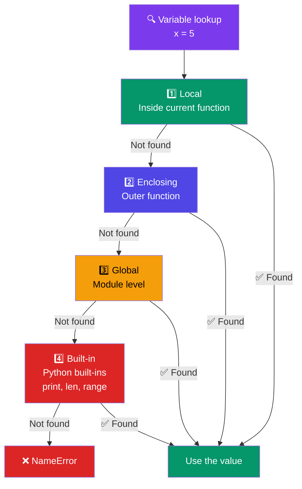

# Scope and Namespace

## Introduction

**Scope** determines where a variable is accessible. Python follows the **LEGB** rule: Local → Enclosing → Global → Built-in.

### LEGB Lookup Order



## LEGB Rule

```python
# LEGB: Local → Enclosing → Global → Built-in

built_in = "built-in"  # This won't shadow print()

def outer():
    enclosing = "enclosing"
    
    def inner():
        local = "local"
        print(local)         # Finds 'local' in Local scope
        print(enclosing)     # Finds 'enclosing' in Enclosing scope
        print(global_var)    # Finds 'global_var' in Global scope
        print(len)           # Finds 'len' in Built-in scope
    
    inner()

global_var = "global"
outer()
```

## Local Scope

```python
def my_func():
    x = 10  # Local variable — only accessible inside the function
    print(x)

my_func()   # 10
# print(x)  # NameError: name 'x' is not defined
```

## Global Scope

```python
x = 100  # Global variable

def my_func():
    print(x)  # Can READ global

my_func()  # 100
```

## The `global` Keyword

```python
counter = 0

def increment():
    global counter  # Declare intent to modify global
    counter += 1

increment()
increment()
print(counter)  # 2
```

## The `nonlocal` Keyword

```python
def outer():
    count = 0
    
    def inner():
        nonlocal count  # Modify enclosing scope variable
        count += 1
        return count
    
    return inner

counter = outer()
print(counter())  # 1
print(counter())  # 2
print(counter())  # 3
```

## Closures

A closure is a function that remembers variables from its enclosing scope even after the outer function has finished executing.

```python
def make_multiplier(factor):
    def multiply(x):
        return x * factor
    return multiply

double = make_multiplier(2)
triple = make_multiplier(3)

print(double(5))  # 10
print(triple(5))  # 15
```

## Best Practices

1. **Minimize global variables** — they make code harder to test and reason about
2. **Use `global` and `nonlocal` sparingly** — they indicate design issues
3. **Prefer passing parameters and returning values** over shared mutable state
4. **Use closures** for creating function factories and decorators

## Practice Exercises

**Exercise 1:** Write a function that creates a counter using closures (like `counter()` that returns 1, 2, 3... on each call).

**Exercise 2:** Create a function that limits how many times another function can be called.
