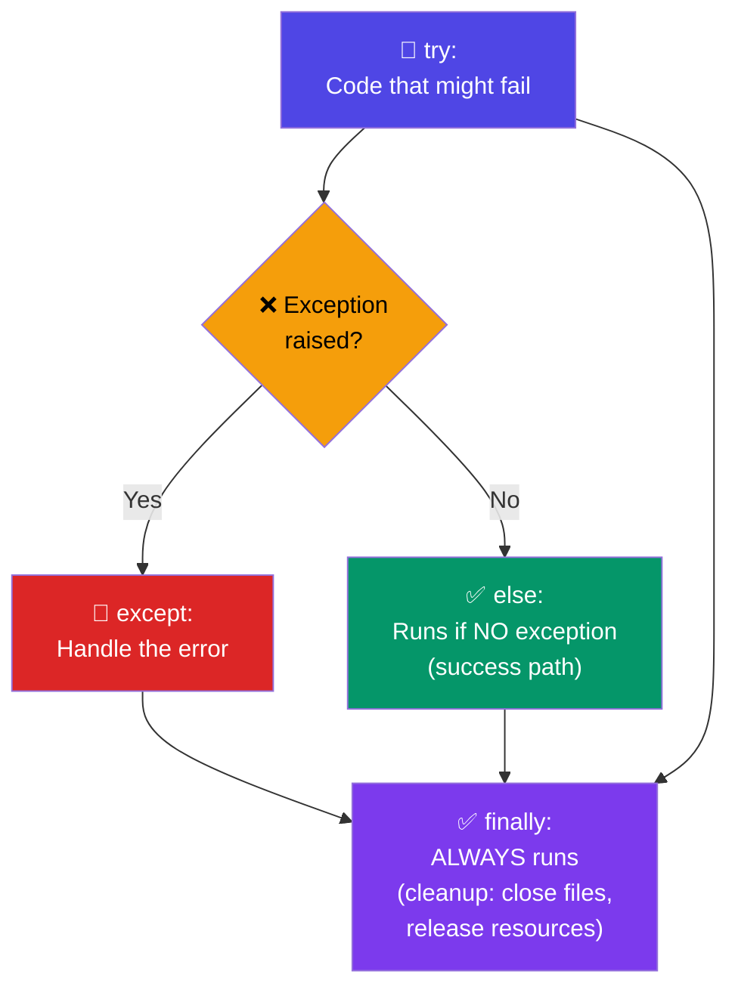

# Exception Handling

## Introduction

**Exception handling** allows your program to respond to errors gracefully instead of crashing. Python uses `try/except` blocks to catch and handle exceptions.

### Exception Flow: try → except → else → finally



## Basic Syntax

```python
try:
    # Code that might raise an exception
    risky_operation()
except SomeException:
    # Code to handle the exception
    handle_error()
```

## try/except

```python
try:
    number = int(input("Enter a number: "))
    print(f"100 / {number} = {100 / number}")
except ValueError:
    print("That's not a valid number!")
except ZeroDivisionError:
    print("Cannot divide by zero!")
```

## Catching Multiple Exceptions

```python
try:
    value = int(input("Enter a number: "))
    result = 100 / value
    print(result)
except (ValueError, ZeroDivisionError) as e:
    print(f"Error: {e}")
```

## else and finally

```python
try:
    file = open("data.txt", "r")
    content = file.read()
except FileNotFoundError:
    print("File not found!")
else:
    # Runs only if no exception occurred
    print(f"Read {len(content)} characters")
finally:
    # ALWAYS runs — great for cleanup
    if 'file' in locals():
        file.close()
        print("File closed")
```

## Raising Exceptions

```python
def withdraw(balance, amount):
    if amount < 0:
        raise ValueError("Amount cannot be negative")
    if amount > balance:
        raise InsufficientFundsError("Insufficient balance")
    return balance - amount
```

## Best Practices

1. **Be specific** — catch specific exceptions, not bare `except:`
2. **Don't swallow exceptions** — unless you handle them meaningfully
3. **Use `finally` for cleanup** — close files, release resources
4. **Prefer `else`** — keep success logic separate from error handling
5. **Raise early, catch late** — validate inputs at boundaries

## Practice Exercises

**Exercise 1:** Write a function that safely parses a list of strings into integers, returning only the valid ones.

**Exercise 2:** Create a simple bank account class that raises custom exceptions for invalid operations.
