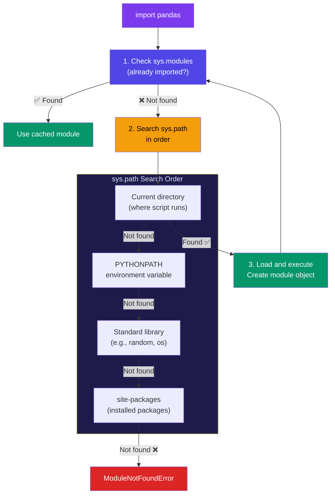

# Import System

## Simple Analogy 📚

Think of importing a module like borrowing a book from a library:
1. Python checks its **catalog** (module search path) — a list of directories to look in
2. Finds the **book** (the `.py` file or package)
3. **Reads it** (executes the code)
4. Makes it available for you to use

---

## How Import Resolution Works

When you write `import pandas`, Python searches in this order:



---

## import vs from ... import

```python
# import — imports the whole module (use module.thing)
import math
print(math.sqrt(16))       # 4.0
print(math.pi)             # 3.14159

# from ... import — imports specific names (use directly)
from math import sqrt, pi
print(sqrt(16))            # 4.0
print(pi)                  # 3.14159

# as — alias (avoid name conflicts)
import pandas as pd
import numpy as np
from decimal import Decimal as D
```

---

## Absolute vs Relative Imports

```python
# Project structure:
# myproject/
#   __init__.py
#   main.py
#   utils/
#     __init__.py
#     helpers.py
#   models/
#     __init__.py
#     user.py

# --- ABSOLUTE IMPORT (always works, from project root) ---
# In models/user.py
from myproject.utils.helpers import format_date

# --- RELATIVE IMPORT (shorter, but fragile) ---
# In models/user.py
from ..utils.helpers import format_date   # Go up one folder, then to utils

# Relative import prefixes:
# .    = current package
# ..   = parent package
# ...  = grandparent package
```

| | Absolute | Relative |
|--|----------|----------|
| **Readable** | ✅ Clear where it comes from | ⚠️ Less clear |
| **Refactoring** | ✅ Move files easily | ❌ Breaks when moving files |
| **Length** | Can be very long | ✅ Shorter |
| **Recommendation** | ✅ Prefer for most cases | Use for internal package imports |

---

## `if __name__ == "__main__":`

Every Python module has a `__name__` variable:
- When run directly → `__name__` = `"__main__"`
- When imported → `__name__` = module name (e.g., `"mymodule"`)

```python
# mymodule.py
def greet(name):
    return f"Hello, {name}!"

print(f"Module name: {__name__}")

if __name__ == "__main__":
    # This only runs when executed directly, not when imported
    print(greet("World"))
    print(greet("Python"))
```

```bash
# Run directly
python mymodule.py
# Module name: __main__
# Hello, World!
# Hello, Python!

# Import in another file
from mymodule import greet
# Module name: mymodule
# (The if-block doesn't execute!)
```

---

## sys.path — The Module Search Path

```python
import sys

# View the search path
for path in sys.path:
    print(path)

# Add your own directory to search path
sys.path.append("/path/to/my/modules")

# Or set PYTHONPATH environment variable
# export PYTHONPATH=/path/to/modules:$PYTHONPATH
```

---

## Common Mistakes

| Mistake | Why | Fix |
|---------|-----|-----|
| Circular imports | Module A imports B, B imports A | Restructure code, use late imports |
| Not using `if __name__` | Code runs on import | Wrap test code in `if __name__ == "__main__"` |
| Relative imports in scripts | Scripts can't use relative imports | Use absolute imports for scripts |
| Import shadowing standard library | `random.py` in your project shadows the stdlib `random` | Rename your file |

---

## 🧠 In Simple Words

- Python searches for modules in **sys.path**: current dir → PYTHONPATH → stdlib → site-packages
- **`import module`** → use `module.thing`; **`from module import thing`** → use `thing` directly
- **Absolute imports** (from the project root) are preferred over relative imports
- Use **`if __name__ == "__main__"`** to protect code that should only run when the file is executed directly
- Watch out for **circular imports** and **shadowing** standard library names
