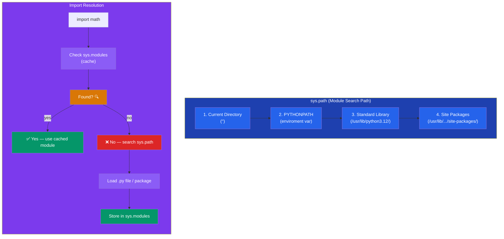

# Modules and Packages

## Introduction

A **module** is a `.py` file containing Python code. A **package** is a directory containing modules and an `__init__.py` file.



## Creating a Module

```python
# mymodule.py
def greet(name):
    return f"Hello, {name}!"

PI = 3.14159

class Calculator:
    @staticmethod
    def add(a, b):
        return a + b
```

## Importing Modules

```python
# Various import styles
import mymodule
print(mymodule.greet("Alice"))  # Hello, Alice!

from mymodule import greet, PI
print(greet("Bob"))  # Hello, Bob!

from mymodule import Calculator as Calc
print(Calc.add(3, 5))  # 8

from mymodule import *  # Not recommended!
```

## Module Search Path

```python
import sys
print(sys.path)
# ['', '/usr/lib/python312.zip', '/usr/lib/python3.12', ...]
```

## Packages

```python
# Directory structure:
# mypackage/
#     __init__.py
#     math_ops.py
#     string_ops.py

# mypackage/__init__.py
from .math_ops import add, subtract
from .string_ops import reverse, capitalize

# Usage
from mypackage import add, reverse
```

## `__name__` and `__main__`

```python
# mymodule.py
print(f"Module name: {__name__}")

if __name__ == "__main__":
    # Only runs when executed directly
    print("Running as script!")
    greet("World")
```

## Namespace Packages

```python
# Python 3.3+ — packages without __init__.py
# Allows splitting a package across multiple directories
```

## Best Practices

1. **Use explicit imports** — avoid `from module import *`
2. **Use meaningful module names** — `string_utils.py` not `str.py`
3. **Use relative imports** within packages (`from . import sibling`)
4. **Keep modules focused** — one responsibility per module
5. **Use `if __name__ == "__main__":`** for testable scripts

## Practice Exercises

**Exercise 1:** Create a `shapes` package with modules for `circle`, `rectangle`, and `triangle`.

**Exercise 2:** Create a utility package with modules for string manipulation, file operations, and math functions.
