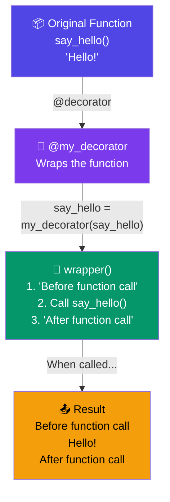

# Decorators

## Introduction

A **decorator** is a function that takes another function and extends its behavior without modifying it directly. Decorators use the `@` syntax.

### Decorator Wrapping



## Basic Decorator

```python
def my_decorator(func):
    def wrapper():
        print("Before function call")
        func()
        print("After function call")
    return wrapper

@my_decorator
def say_hello():
    print("Hello!")

# Equivalent to: say_hello = my_decorator(say_hello)
say_hello()
# Before function call
# Hello!
# After function call
```

## Decorators with Arguments

```python
def repeat(n):
    def decorator(func):
        def wrapper(*args, **kwargs):
            for _ in range(n):
                result = func(*args, **kwargs)
            return result
        return wrapper
    return decorator

@repeat(3)
def greet(name):
    print(f"Hello, {name}!")

greet("Alice")
# Hello, Alice!
# Hello, Alice!
# Hello, Alice!
```

## preserving Metadata with functools.wraps

```python
from functools import wraps

def my_decorator(func):
    @wraps(func)  # Preserves name, docstring, etc.
    def wrapper(*args, **kwargs):
        """Wrapper function"""
        print(f"Calling {func.__name__}")
        return func(*args, **kwargs)
    return wrapper

@my_decorator
def add(a, b):
    """Add two numbers."""
    return a + b

print(add.__name__)   # 'add' (without @wraps: 'wrapper')
print(add.__doc__)    # 'Add two numbers.' (without @wraps: 'Wrapper function')
```

## Common Decorator Patterns

### Timing

```python
import time
from functools import wraps

def timer(func):
    @wraps(func)
    def wrapper(*args, **kwargs):
        start = time.perf_counter()
        result = func(*args, **kwargs)
        elapsed = time.perf_counter() - start
        print(f"{func.__name__} took {elapsed:.4f}s")
        return result
    return wrapper

@timer
def slow_function():
    time.sleep(1)
    return "Done"
```

### Logging

```python
def log_calls(func):
    @wraps(func)
    def wrapper(*args, **kwargs):
        print(f"Calling {func.__name__}({args}, {kwargs})")
        result = func(*args, **kwargs)
        print(f"{func.__name__} returned {result!r}")
        return result
    return wrapper

@log_calls
def multiply(a, b):
    return a * b

multiply(3, 4)
# Calling multiply((3, 4), {})
# multiply returned 12
```

### Validation

```python
def validate_positive(func):
    @wraps(func)
    def wrapper(*args, **kwargs):
        for arg in args:
            if isinstance((int, float)) and arg < 0:
                raise ValueError(f"Argument {arg} must be positive")
        for key, value in kwargs.items():
            if isinstance(value, (int, float)) and value < 0:
                raise ValueError(f"{key}={value} must be positive")
        return func(*args, **kwargs)
    return wrapper

@validate_positive
def sqrt_approx(x):
    return x ** 0.5
```

### Caching / Memoization

```python
def memoize(func):
    cache = {}
    @wraps(func)
    def wrapper(*args):
        if args not in cache:
            cache[args] = func(*args)
        return cache[args]
    return wrapper

@memoize
def fibonacci(n):
    if n <= 1:
        return n
    return fibonacci(n - 1) + fibonacci(n - 2)

# Much faster!
```

## Class-based Decorators

```python
class CountCalls:
    def __init__(self, func):
        self.func = func
        self.count = 0
    
    def __call__(self, *args, **kwargs):
        self.count += 1
        print(f"Call {self.count} of {self.func.__name__}")
        return self.func(*args, **kwargs)

@CountCalls
def say_hello():
    print("Hello!")

say_hello()  # Call 1 of say_hello / Hello!
say_hello()  # Call 2 of say_hello / Hello!
```

## Multiple Decorators

```python
@timer
@log_calls
def process_data(data):
    """Process data with logging and timing."""
    return data * 2

# Equivalent to: timer(log_calls(process_data))
# Applied bottom-up: process_data → log_calls → timer
```

## Best Practices

1. **Always use `@functools.wraps`** to preserve metadata
2. **Use `*args, **kwargs`** in wrappers for maximum flexibility
3. **Keep decorators simple** — one responsibility per decorator
4. **Use class-based decorators** when you need to maintain state
5. **Be careful with decorator order** — they apply bottom-up

## Practice Exercises

**Exercise 1:** Create a `@retry(max_attempts=3, delay=1)` decorator that retries a function on failure.

**Exercise 2:** Create a `@rate_limited(max_per_second=5)` decorator that limits function call frequency.

**Exercise 3:** Implement a `@debug` decorator that prints function arguments, return value, and execution time.
