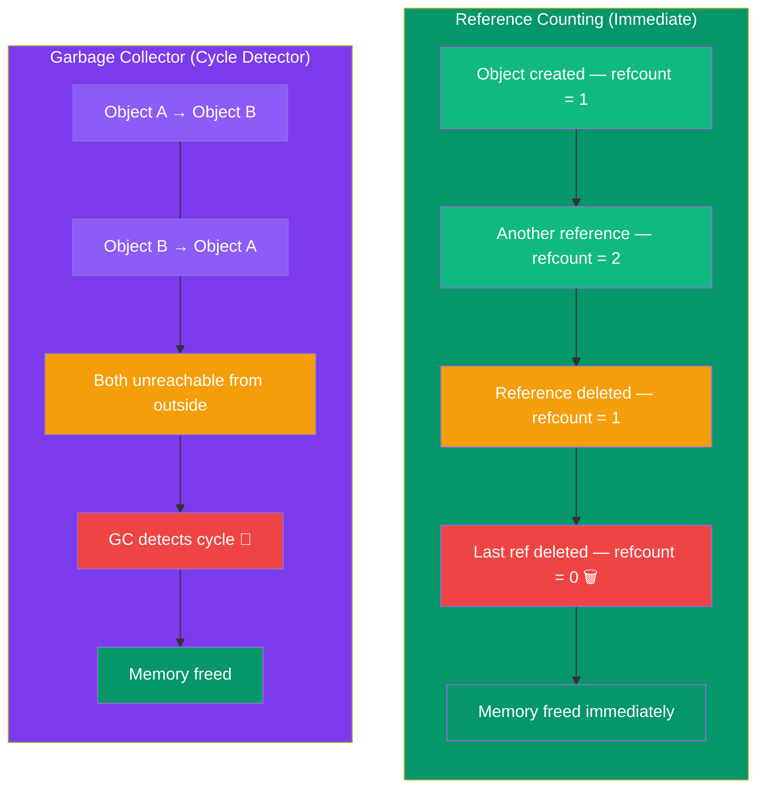

# Memory Management

## Introduction

Python handles memory automatically through **reference counting** and a **garbage collector** for circular references. Understanding these helps you write efficient code.



## Reference Counting

```python
import sys

x = [1, 2, 3]
print(sys.getrefcount(x))  # 2 (x + argument)

y = x
print(sys.getrefcount(x))  # 3 (x, y, argument)

del y
print(sys.getrefcount(x))  # 2 (back to x + argument)

# When reference count reaches 0, memory is freed
```

## The Garbage Collector

```python
import gc

# Enable/disable GC
gc.enable()
# gc.disable()

# Circular reference — GC handles this
class Node:
    def __init__(self, name):
        self.name = name
        self.next = None

a = Node("A")
b = Node("B")
a.next = b
b.next = a  # Circular reference!

del a, b  # Reference count won't free these, but GC will

# Manual GC collection
collected = gc.collect()
print(f"Collected {collected} objects")

# Get GC stats
print(gc.get_stats())

# Debug memory
gc.set_debug(gc.DEBUG_LEAK)
```

## Memory Optimization

```python
# Use __slots__ to save memory (no __dict__)
class Point:
    __slots__ = ('x', 'y')
    
    def __init__(self, x, y):
        self.x = x
        self.y = y

# Compare memory usage
import sys
class PointNormal:
    def __init__(self, x, y):
        self.x = x
        self.y = y

p1 = Point(3, 4)
p2 = PointNormal(3, 4)
print(sys.getsizeof(p1))  # ~56 bytes (with __slots__)
print(sys.getsizeof(p2))  # ~72 bytes (with __dict__)
```

## Memory Profiling

```python
# Using sys.getsizeof
import sys
print(sys.getsizeof(42))          # 28 bytes
print(sys.getsizeof("hello"))     # 54 bytes
print(sys.getsizeof([1,2,3,4,5])) # 104 bytes + elements

# Using tracemalloc
import tracemalloc

tracemalloc.start()
# Your code here
snapshot = tracemalloc.take_snapshot()
top_stats = snapshot.statistics('lineno')
for stat in top_stats[:5]:
    print(stat)
```

## Best Practices

1. **Use `__slots__`** for classes with many instances (thousands+)
2. **Use generators** instead of lists for large datasets
3. **Be aware of circular references** — they delay memory deallocation
4. **Use `weakref`** when you need references without increasing reference count
5. **Profile memory** with `tracemalloc` before optimizing

## Practice Exercises

**Exercise 1:** Create a large number of objects with and without `__slots__` and compare memory usage.

**Exercise 2:** Create a cache using `weakref.WeakValueDictionary` that doesn't prevent garbage collection.
