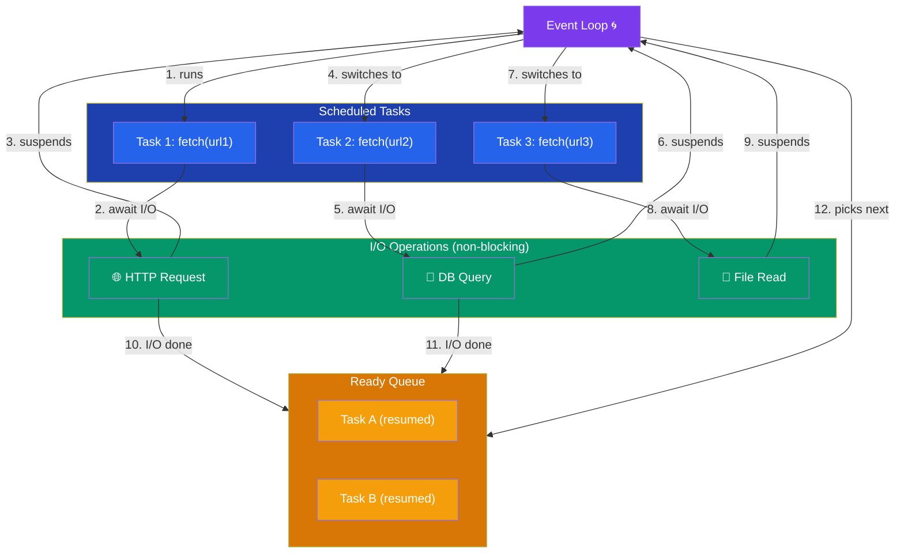

# Async/Await (asyncio)

## Introduction

**asyncio** provides asynchronous I/O using coroutines and an event loop. Perfect for I/O-bound tasks like web requests, database queries, and file operations.

## Coroutines

```python
import asyncio

async def hello():
    print("Hello...")
    await asyncio.sleep(1)  # Non-blocking!
    print("...World!")

# Run the coroutine
asyncio.run(hello())
```



## Running Multiple Tasks

```python
import asyncio
import time

async def fetch_data(url, delay):
    print(f"Fetching {url}...")
    await asyncio.sleep(delay)  # Simulate network I/O
    print(f"Done {url}")
    return f"Data from {url}"

async def main():
    # Run concurrently
    results = await asyncio.gather(
        fetch_data("url1", 3),
        fetch_data("url2", 2),
        fetch_data("url3", 1),
    )
    print(results)

start = time.time()
asyncio.run(main())
print(f"Time: {time.time() - start:.2f}s")  # ~3s, not 6s!
```

## Creating Tasks

```python
async def main():
    # Schedule tasks to run concurrently
    task1 = asyncio.create_task(fetch_data("url1", 3))
    task2 = asyncio.create_task(fetch_data("url2", 2))
    
    # Do other work while tasks run
    print("Doing other work...")
    
    # Await results
    result1 = await task1
    result2 = await task2
```

## Async Context Managers

```python
import aiofiles  # Requires: pip install aiofiles

async def read_file():
    async with aiofiles.open("data.txt", "r") as f:
        content = await f.read()
        return content
```

## Async Iterators

```python
async def async_counter(n):
    for i in range(n):
        await asyncio.sleep(1)
        yield i

async def main():
    async for num in async_counter(5):
        print(num)
```

## Async vs Threading vs Multiprocessing

<Tabs>
<TabItem label="Asyncio (I/O-bound)">Cooperative multitasking, single-threaded, scales to 10,000+ connections.

```python
async def fetch(url):
    async with aiohttp.ClientSession() as session:
        async with session.get(url) as response:
            return await response.text()
```

✅ Best for: Web servers, API clients, database drivers
❌ Not for: CPU-bound work, blocking I/O</TabItem>
<TabItem label="Threading (I/O-bound)">Preemptive multitasking, shared memory, limited by GIL for CPU work.

```python
with ThreadPoolExecutor(max_workers=10) as pool:
    results = list(pool.map(fetch_url, urls))
```

✅ Best for: File I/O, simple concurrent tasks
❌ Not for: CPU-bound work, massive concurrency</TabItem>
<TabItem label="Multiprocessing (CPU-bound)">Separate processes, each with own GIL, true parallelism.

```python
with Pool(processes=4) as pool:
    results = pool.map(cpu_task, data)
```

✅ Best for: Number crunching, parallel computation
❌ Not for: I/O-bound tasks (overkill)</TabItem>
</Tabs>

## Best Practices

1. **Use `asyncio.run()`** as the entry point
2. **Use `asyncio.gather()`** to run multiple coroutines concurrently
3. **Don't mix blocking I/O with asyncio** — it blocks the event loop
4. **Use `asyncio.create_task()`** for fire-and-forget operations
5. **Use async libraries** (aiohttp, aiofiles, asyncpg) with asyncio

## Practice Exercises

**Exercise 1:** Write an async web scraper that fetches multiple pages concurrently.

**Exercise 2:** Implement an async rate limiter that processes tasks at a controlled pace.
