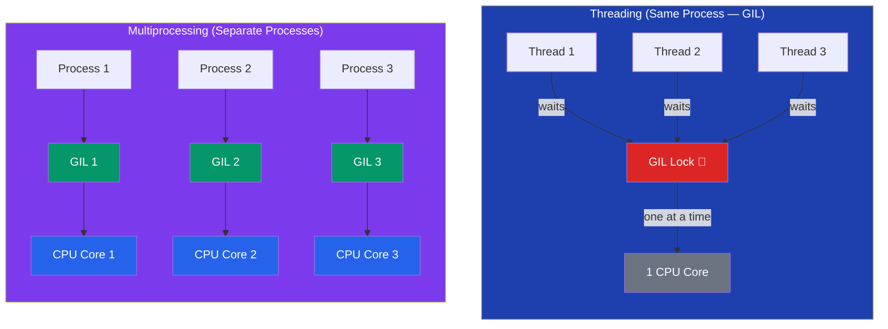

# The Global Interpreter Lock (GIL)

## Introduction

The **Global Interpreter Lock (GIL)** is a mutex that prevents multiple threads from executing Python bytecode simultaneously. It ensures thread safety but limits parallelism for CPU-bound tasks.

## How the GIL Works

```python
import sys

# The GIL ensures that only one thread executes
# Python bytecode at a time — even on multi-core CPUs

# CPU-bound task — GIL prevents parallelism
def count_numbers():
    total = 0
    for i in range(10_000_000):
        total += i
    return total
```



## GIL Impact

```python
import time
import threading
import multiprocessing

def cpu_intensive(n):
    """Heavy CPU computation"""
    return sum(i * i for i in range(n))

# Threading — NO speedup for CPU tasks (GIL)
start = time.time()
threads = [threading.Thread(target=cpu_intensive, args=(10_000_000,))
           for _ in range(4)]
for t in threads: t.start()
for t in threads: t.join()
print(f"Threading: {time.time() - start:.2f}s")  # No faster than single thread!

# Multiprocessing — YES speedup (separate processes, separate GILs)
start = time.time()
with multiprocessing.Pool(4) as pool:
    pool.map(cpu_intensive, [10_000_000] * 4)
print(f"Multiprocessing: {time.time() - start:.2f}s")  # ~4x faster!
```

## When GIL Doesn't Matter

```python
# I/O-bound tasks — GIL is released during I/O operations
import requests

def fetch_url(url):
    response = requests.get(url)  # GIL released during I/O wait
    return response.status_code

# Threading works great here!
urls = ["http://example.com"] * 20
with ThreadPoolExecutor(max_workers=10) as executor:
    results = list(executor.map(fetch_url, urls))

# C extensions release the GIL
import numpy as np
# numpy operations run without the GIL — true parallelism!
```

## Working Around the GIL

1. **Use `multiprocessing`** for CPU-bound tasks
2. **Use C extensions** (numpy, pandas, numba) that release the GIL
3. **Use `asyncio`** for high-concurrency I/O
4. **Use JIT compilers** like PyPy (no GIL in some implementations)
5. **Use Python 3.12+** — improved GIL behavior with sub-interpreters
6. **Use `nogil`** (experimental Python fork without GIL)

## Python 3.12+ Improvements

```python
import sys
print(f"Python {sys.version}")

# Python 3.12 introduced per-interpreter GIL
# Support for sub-interpreters with separate GILs
import _xxsubinterpreters as interpreters

interp = interpreters.create()
interpreters.run_string(interp, "import this")
```

## Best Practices

1. **Don't blame the GIL** until you've measured your bottleneck
2. **Use threading for I/O**, multiprocessing for CPU
3. **Use C extensions** for heavy number crunching
4. **Profile before optimizing** — the GIL may not be your actual problem
5. **Consider alternative Python implementations** if GIL is a true blocker
