# 🐍 Python Documentation

Welcome to the comprehensive Python documentation. This guide covers everything from absolute basics to advanced concepts, designed for beginners through experienced developers.

```mermaid
flowchart TB
    INTRO["01. Introduction"]
    SETUP["02. Setup"]
    BASICS["03. Basics"]
    STR["04. Strings"]
    NUM["05. Numbers"]
    COLL["06. Collections"]
    CTRL["07. Control Flow"]
    FUNC["08. Functions"]
    EXC["09. Exception Handling"]
    OOP["10. OOP"]
    MOD["11. Modules & Packages"]
    FILE["12. File Handling"]
    REGEX["13. Regex"]
    ITER["14. Iterators, Generators & Decorators"]
    ADV["15. Advanced Concepts"]
    STDLIB["15b. Standard Library"]
    CONC["16. Concurrency"]
    DB["17. Database"]
    TEST["18. Testing"]
    INTERV["19. Interview Preparation"]

    INTRO --> SETUP --> BASICS --> STR --> NUM --> COLL --> CTRL
    CTRL --> FUNC --> EXC --> OOP --> MOD --> FILE --> REGEX
    REGEX --> ITER --> ADV --> STDLIB --> CONC --> DB --> TEST --> INTERV

    style INTRO fill:#059669,color:#fff
    style SETUP fill:#059669,color:#fff
    style BASICS fill:#059669,color:#fff
    style STR fill:#059669,color:#fff
    style NUM fill:#059669,color:#fff
    style COLL fill:#059669,color:#fff
    style CTRL fill:#059669,color:#fff
    style FUNC fill:#2563eb,color:#fff
    style EXC fill:#2563eb,color:#fff
    style OOP fill:#2563eb,color:#fff
    style MOD fill:#2563eb,color:#fff
    style FILE fill:#2563eb,color:#fff
    style REGEX fill:#2563eb,color:#fff
    style ITER fill:#7c3aed,color:#fff
    style ADV fill:#7c3aed,color:#fff
    style STDLIB fill:#7c3aed,color:#fff
    style CONC fill:#7c3aed,color:#fff
    style DB fill:#7c3aed,color:#fff
    style TEST fill:#7c3aed,color:#fff
    style INTERV fill:#dc2626,color:#fff
```

## 📋 Sections Overview

| Section | Topics | Level |
|---------|--------|-------|
| **01. Introduction** | What is Python, history, features, how Python runs | Beginner |
| **02. Setup** | Installation, REPL, IDEs, virtual environments, pip | Beginner |
| **03. Basics** | Variables, data types, operators, type casting, PEP 8 | Beginner |
| **04. Strings** | String methods, formatting, Unicode, performance | Beginner |
| **05. Numbers** | Integers, floats, decimals, fractions, math module | Beginner |
| **06. Collections** | Lists, tuples, sets, dictionaries, comprehensions | Beginner→Intermediate |
| **07. Control Flow** | if/elif/else, loops, match-case, ternary operators | Beginner |
| **08. Functions** | Parameters, *args/**kwargs, lambdas, recursion, scope | Intermediate |
| **09. Exception Handling** | try/except, custom exceptions, best practices | Intermediate |
| **10. OOP** | Classes, inheritance, polymorphism, encapsulation | Intermediate |
| **11. Modules & Packages** | Import system, packages, __init__.py, pip | Intermediate |
| **12. File Handling** | Reading/writing files, CSV, JSON, context managers | Intermediate |
| **13. Regex** | Pattern matching, re module, validation | Intermediate |
| **14. Iterators, Generators & Decorators** | Lazy evaluation, yield, decorator patterns | Advanced |
| **15. Advanced Concepts** | Type hints, dataclasses, *args/**kwargs, memory, descriptors | Advanced |
| **15b. Standard Library** | collections, itertools, datetime, pathlib, logging | Advanced |
| **16. Concurrency** | Threading, multiprocessing, asyncio, GIL | Advanced |
| **17. Database Programming** | SQL, ORM, NoSQL integration | Advanced |
| **18. Testing** | unittest, pytest, mocking | Intermediate |
| **19. Interview Preparation** | Practice questions, coding challenges | All Levels |

## 🎯 Learning Path

### Beginner Path (Sections 1–7)
Start here if you're new to Python. Master variables, data types, collections, and control flow.

**New:** [Setting up Virtual Environments →](./02-setup/virtual-environments) · [pip & Packages →](./02-setup/pip-and-packages) · [Pythonic Style & PEP 8 →](./03-basics/pythonic-style-and-pep8)

### Intermediate Path (Sections 8–13)
Learn functions, exception handling, OOP, modules, file handling, and regex.

**New:** [Packages & __init__.py →](./11-modules-packages/packages) · [Import System Deep Dive →](./11-modules-packages/import-system)

### Advanced Path (Sections 14–19)
Dive into generators, decorators, type hints, standard library, concurrency, databases, and testing.

**New:** [Type Hints & typing Module →](./15-advanced-concepts/type-hints-and-typing) · [Dataclasses & Enums →](./15-advanced-concepts/dataclasses-and-enums) · [args, kwargs & Unpacking →](./15-advanced-concepts/args-kwargs-and-unpacking) · [Descriptors & Metaclasses →](./15-advanced-concepts/descriptors-and-metaclasses)

**New Standard Library:** [collections →](./15b-standard-library/collections-module) · [itertools & functools →](./15b-standard-library/itertools-and-functools) · [datetime →](./15b-standard-library/datetime-module) · [os, sys & pathlib →](./15b-standard-library/os-sys-pathlib) · [logging →](./15b-standard-library/logging-module)

## 🔑 Key Features of Python

- **Readable Syntax** — Code reads almost like English
- **Dynamically Typed** — No need to declare variable types
- **Multi-paradigm** — Supports OOP, functional, and procedural styles
- **Extensive Standard Library** — "Batteries included"
- **Large Ecosystem** — 450,000+ packages on PyPI
- **Cross-platform** — Runs on Windows, Mac, Linux
- **Strong in AI/ML** — TensorFlow, PyTorch, scikit-learn
- **Automatic Memory Management** — Garbage collected

## 🛠 Prerequisites

- Basic programming concepts (variables, logic, loops) helpful but not required
- Python 3.12+ installed (see [Setup Guide](./02-setup/installing-python))
- A code editor (VS Code recommended)

Let's begin your Python journey! 🚀
