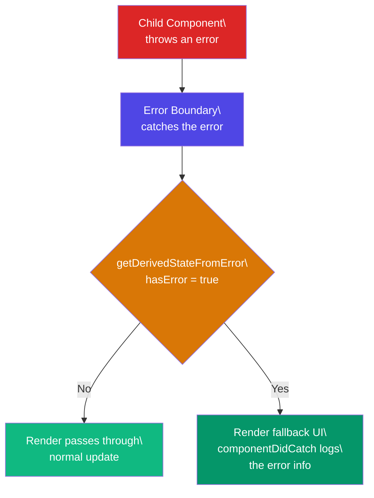

# Error Boundaries

## Simple Words First 🟡

> **Analogy:** 👉 Imagine a circuit breaker in your house. When one room has an electrical fault, the breaker trips for that room — but the rest of the house still has power. An error boundary is the same: if one component crashes, the error boundary catches it and shows a fallback, without breaking the whole app.

## Error Boundary Catch Flow



## Why Error Boundaries Must Be Class Components

React hooks don't have the lifecycle methods needed to catch errors. Error boundaries must be **class components** because they need `getDerivedStateFromError()` and `componentDidCatch()`.

```jsx
import { Component } from 'react';

class ErrorBoundary extends Component {
  constructor(props) {
    super(props);
    this.state = { hasError: false, error: null };
  }

  // 1️⃣ Update state so the next render shows fallback UI
  static getDerivedStateFromError(error) {
    return { hasError: true, error };
  }

  // 2️⃣ Log error info (send to error reporting service)
  componentDidCatch(error, info) {
    console.error('Caught:', error);
    console.error('Component stack:', info.componentStack);
    // Send to Sentry / LogRocket / your logging service
    logErrorToService(error, info);
  }

  render() {
    if (this.state.hasError) {
      // You can render ANY custom fallback UI
      return this.props.fallback || (
        <div className="error-boundary">
          <h2>⚠️ Something went wrong</h2>
          <p>{this.state.error?.message}</p>
          <button onClick={() => this.setState({ hasError: false, error: null })}>
            Try again
          </button>
        </div>
      );
    }

    return this.props.children;
  }
}

// Usage
function App() {
  return (
    <ErrorBoundary fallback={<p>❌ User section crashed</p>}>
      <UserProfile userId={123} />
    </ErrorBoundary>
  );
}
```

## Where to Place Error Boundaries

```jsx
// Wrap the whole app (one fallback for everything)
<ErrorBoundary>
  <App />
</ErrorBoundary>

// Wrap individual sections (granular recovery)
<section>
  <ErrorBoundary fallback={<ErrorWidget />}>
    <UserList />
  </ErrorBoundary>
  <ErrorBoundary fallback={<ErrorWidget />}>
    <ChatWidget />
  </ErrorBoundary>
</section>

// Wrap a single component
<ErrorBoundary>
  <HeavyDataTable data={data} />
</ErrorBoundary>
```

## What Error Boundaries DON'T Catch

```jsx
// ❌ Event handlers — use try/catch instead
function Button() {
  const handleClick = () => {
    try {
      // risky operation
    } catch (err) {
      console.error(err);
    }
  };
  return <button onClick={handleClick}>Click</button>;
}

// ❌ Async code (setTimeout, requestAnimationFrame)
setTimeout(() => {
  try {
    // risky operation
  } catch (err) {
    console.error(err);
  }
}, 1000);

// ❌ Server-side rendering
// ❌ Errors thrown in the error boundary itself
```

## In Simple Words 🧠

- Error boundaries catch render errors in **child components** and show a fallback UI
- They must be **class components** — hooks can't do this (yet)
- Place them at granular levels so one crash doesn't take down the whole app
- They **don't** catch event handler errors, async code, or SSR errors — use `try/catch` for those
- The `componentDidCatch` method is perfect for logging errors to monitoring services
