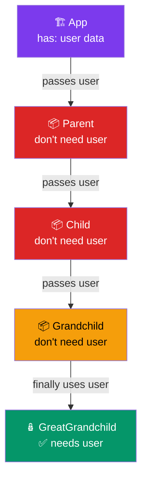
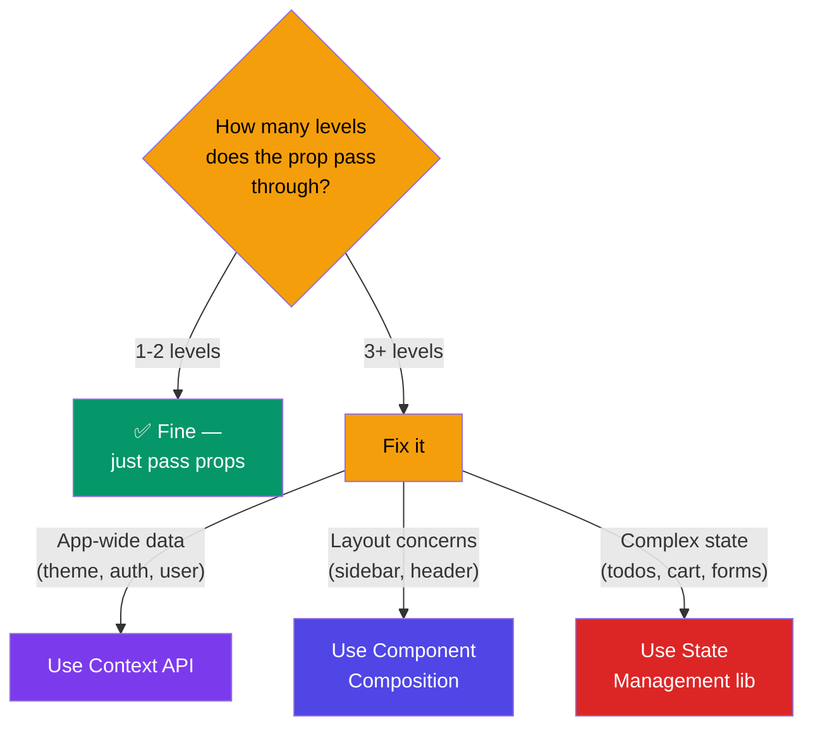

# Prop Drilling

## Simple Analogy 🎭

Imagine you work in a big office building. The CEO (top-level component) needs to give a message to someone on the 5th floor. But instead of calling them directly, the message has to go through every floor manager on the way down.

> CEO → Floor 1 Manager → Floor 2 Manager → ... → Floor 5 Employee

Each manager just passes the message along — they don't need it themselves. That's **prop drilling**.

---

## What is Prop Drilling?

**Prop drilling** happens when you pass props through multiple intermediate components that don't need the data themselves — they just pass it down to a deeper child.

```jsx
function App() {
  const [user, setUser] = React.useState("Prathamesh");
  return <Parent user={user} />;
}

function Parent({ user }) {
  // ❌ Parent doesn't use `user` — just passes it down
  return <Child user={user} />;
}

function Child({ user }) {
  // ❌ Child doesn't use `user` either — passes it further
  return <Grandchild user={user} />;
}

function Grandchild({ user }) {
  // ✅ Finally uses the prop!
  return <h1>Hello {user}</h1>;
}
```

Here, `Parent` and `Child` are **middlemen** — they don't use `user`, they just pass it through.

---

## The Problem 🚨



**Problems with prop drilling:**
- **Tight coupling** — intermediate components know about data they don't need
- **Hard to refactor** — changing a prop means updating every middleman
- **Noise** — components are cluttered with props they just pass through
- **Harder to reuse** — a deeply nested component needs all its ancestors to pass props

---

## Solutions 🛠️

### 1. Context API (Best for app-wide data)

```jsx
// 1. Create the context
const UserContext = React.createContext();

// 2. Provide at the top
function App() {
  const [user, setUser] = React.useState("Prathamesh");
  return (
    <UserContext.Provider value={user}>
      <Parent />
      {/* ✅ No props needed on Parent! */}
    </UserContext.Provider>
  );
}

function Parent() {
  return <Child />;  // ✅ Clean — no prop to pass
}

function Child() {
  return <Grandchild />;  // ✅ Clean
}

function Grandchild() {
  // 3. Consume directly — no drilling!
  const user = React.useContext(UserContext);
  return <h1>Hello {user}</h1>;
}
```

### 2. Component Composition (Pass Components as Props)

Instead of drilling props, pass the rendered component directly:

```jsx
function App() {
  const [user, setUser] = React.useState("Prathamesh");

  // ✅ Pass the already-rendered content
  return (
    <Layout
      header={<Header />}
      sidebar={<Sidebar />}
      main={<Profile user={user} />}
    />
  );
}

function Layout({ header, sidebar, main }) {
  return (
    <div>
      {header}
      {sidebar}
      {main}
    </div>
  );
  // ✅ Layout doesn't know about `user` at all!
}
```

### 3. State Management Library (for complex apps)

For apps with lots of shared state, libraries like **Zustand**, **Redux**, or **Jotai** eliminate drilling entirely.

```jsx
// Zustand example
const useStore = create((set) => ({
  user: "Prathamesh",
  setUser: (name) => set({ user: name }),
}));

// Any component, anywhere in the tree:
function Grandchild() {
  const user = useStore((state) => state.user);
  return <h1>Hello {user}</h1>;
}
```

---

## When is Prop Drilling OK? 🤔

Prop drilling through **1 or 2 levels** is perfectly fine:

```jsx
function App() {
  return <Card><User name="Raj" /></Card>;
}

function Card({ children }) { return <div>{children}</div>; }
function User({ name }) { return <h1>{name}</h1>; }
```

✅ Fine — the data flows through just one simple wrapper.

**⚠️ Reconsider at 3+ levels** — that's when readability starts to suffer.

---

## Decision Guide



---

## 🧠 In Simple Words

- **Prop drilling** = passing data through components that don't need it, just to reach a deep child
- It makes code **harder to read, maintain, and refactor**
- **Context API** solves this by letting any component access data directly from a central provider
- **Component composition** (passing rendered JSX as props) avoids drilling by design
- For 1-2 levels, drilling is fine — save the heavy tools for deeper nesting
