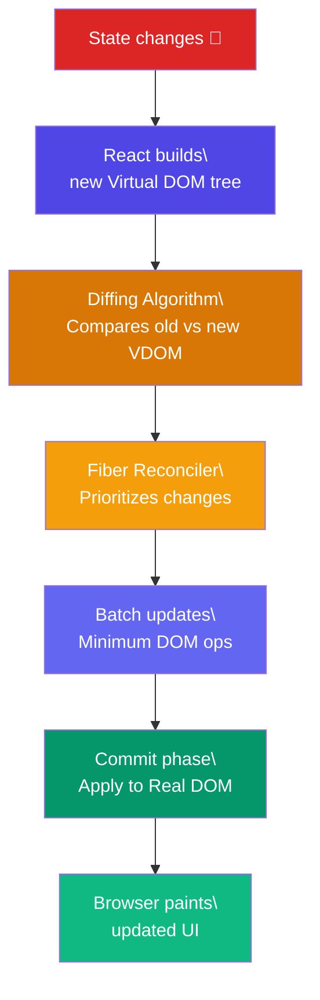

# Reconciliation & Virtual DOM

## Simple Words First 🟡

> **Analogy:** 👉 Imagine you have a grocery list on a whiteboard (Virtual DOM). Instead of erasing everything and rewriting the entire list when you change one item, React compares the new list with the old one (diffing) and only erases and rewrites what changed (reconciliation). The final whiteboard is the Real DOM.

## Virtual DOM Diff → Reconciliation → Real DOM



## How the Diffing Algorithm Works

React makes two key assumptions for O(n) performance:

### Rule 1 — Different Element Types = Replace

```jsx
// Before                    // After
<div>                          <span>
  <Child />         →            <Child />
</div>                         </span>
// Result: Entire subtree destroyed and rebuilt
// Child component loses its state!
```

### Rule 2 — Same Type = Update Props

```jsx
// Before                    // After
<div className="old">          <div className="new">
  <Child />         →           <Child />
</div>                         </div>
// Result: Only className attribute updated in DOM
// Child keeps its state
```

### Rule 3 — Keys for Lists

```jsx
// ❌ Without keys — React re-creates all items
{items.map(item => <ListItem item={item} />)}

// ✅ With stable keys — React reorders efficiently
{items.map(item => <ListItem key={item.id} item={item} />)}
```

## The Two Phases of Reconciliation

### Phase 1: Render (Can be interrupted)

React walks the component tree, collects all changes, and builds a list of effects:

```jsx
// React creates "fiber" nodes for each component
// Work can be paused, reused, or discarded
// Priority: user input > animations > data fetching
```

### Phase 2: Commit (Cannot be interrupted)

```jsx
// All DOM mutations happen here in one synchronous batch
// After this, the user sees the updated screen
// Effects (useEffect) are scheduled to run after paint
```

## In Simple Words 🧠

- React uses a **Virtual DOM** — a lightweight JS copy of the real DOM — to avoid expensive direct manipulations
- The **diffing algorithm** compares old and new VDOM trees in O(n) using smart heuristics
- **Different element types** (div → span) = destroy and rebuild the whole subtree
- **Same element type** = only update changed props/attributes
- **Keys** are essential for list diffing — use stable IDs, not array indices
- **Fiber** (React 16+) makes reconciliation interruptible — prioritizing urgent updates
- React **batches** multiple updates into one DOM operation for efficiency
