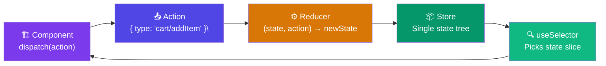

# State Management in React - Redux & Zustand (Simple Guide)

---

## What Even Is "State Management"? 

Imagine you have a shopping cart. The cart total needs to show in the **header**, the **checkout page**, AND the **cart icon**. If all three components each keep their own copy, they'll get out of sync instantly.

**State management = one single source of truth for your data, shared across your whole app.**

```
Without state management:        With state management:
  Header  -> its own count          Header  
  Cart    -> its own count          Cart    -> [ STORE ] <- one place
  Checkout-> its own count          Checkout
  (3 copies, all different )      (all read from same store )
```

---

## The Problem - "Prop Drilling"

Before state management, you'd pass data down through props. This gets painful fast:


**State management solves this** - any component can grab data directly from the store without passing through parents.

---

## Solution - The Store Pattern


---

# Part 1 - Redux

## The Analogy 

Redux is like a **bank**. You can't just reach into the vault and take money. You must:
1. Fill out a **withdrawal form** (Action)
2. Hand it to the **teller** (Reducer)
3. The teller updates the **vault balance** (State)
4. Your **account shows the new balance** (Component re-renders)

## The 3 Core Concepts


## Redux Code - Step by Step

### Step 1 - Install
```bash
npm install @reduxjs/toolkit react-redux
```

### Step 2 - Create a Slice (state + actions together)
```js
// store/cartSlice.js
import { createSlice } from '@reduxjs/toolkit';

const cartSlice = createSlice({
  name: 'cart',
  initialState: { items: [], total: 0 },

  reducers: {
    // Each function here = one action you can dispatch
    addItem(state, action) {
      state.items.push(action.payload);   // RTK lets you "mutate" safely
      state.total += action.payload.price;
    },
    removeItem(state, action) {
      state.items = state.items.filter(i => i.id !== action.payload);
    },
    clearCart(state) {
      state.items = [];
      state.total = 0;
    }
  }
});

// Export actions (to dispatch) and reducer (for store)
export const { addItem, removeItem, clearCart } = cartSlice.actions;
export default cartSlice.reducer;
```

### Step 3 - Create the Store
```js
// store/index.js
import { configureStore } from '@reduxjs/toolkit';
import cartReducer from './cartSlice';

export const store = configureStore({
  reducer: {
    cart: cartReducer,     // access via state.cart
    // user: userReducer,  // add more slices here
  }
});
```

### Step 4 - Wrap your App with Provider
```jsx
// main.jsx
import { Provider } from 'react-redux';
import { store } from './store';

ReactDOM.createRoot(document.getElementById('root')).render(
  <Provider store={store}>  {/* <- makes store available everywhere */}
    <App />
  </Provider>
);
```

### Step 5 - Use in any Component
```jsx
import { useSelector, useDispatch } from 'react-redux';
import { addItem, clearCart } from '../store/cartSlice';

function CartPage() {
  // READ from store
  const { items, total } = useSelector(state => state.cart);

  // WRITE to store
  const dispatch = useDispatch();

  return (
    <div>
      <p>Total: ${total}</p>
      {items.map(item => <div key={item.id}>{item.name}</div>)}

      <button onClick={() => dispatch(addItem({ id: 1, name: 'Shoes', price: 50 }))}>
        Add Shoes
      </button>
      <button onClick={() => dispatch(clearCart())}>
        Clear Cart
      </button>
    </div>
  );
}
```

## Redux Data Flow



---

# Part 2 - Zustand

## The Analogy 

If Redux is a bank with formal procedures, **Zustand is a piggy bank**. You just open it and take what you need. Way less ceremony.

```
Redux:  action -> dispatch -> reducer -> store -> selector -> component
Zustand:        store -> component (that's it!)
```

## Zustand Code - Step by Step

### Step 1 - Install
```bash
npm install zustand
```

### Step 2 - Create a Store (everything in one place)
```js
// store/useCartStore.js
import { create } from 'zustand';

const useCartStore = create((set) => ({
  // STATE
  items: [],
  total: 0,

  // ACTIONS (live right inside the store)
  addItem: (item) => set((state) => ({
    items: [...state.items, item],
    total: state.total + item.price
  })),

  removeItem: (id) => set((state) => ({
    items: state.items.filter(i => i.id !== id),
  })),

  clearCart: () => set({ items: [], total: 0 }),
}));

export default useCartStore;
```

### Step 3 - Use Anywhere (no Provider needed!)
```jsx
import useCartStore from '../store/useCartStore';

function CartPage() {
  // Pick exactly what you need from the store
  const items  = useCartStore(state => state.items);
  const total  = useCartStore(state => state.total);
  const addItem    = useCartStore(state => state.addItem);
  const clearCart  = useCartStore(state => state.clearCart);

  return (
    <div>
      <p>Total: ${total}</p>
      <button onClick={() => addItem({ id: 1, name: 'Shoes', price: 50 })}>
        Add Shoes
      </button>
      <button onClick={clearCart}>Clear Cart</button>
    </div>
  );
}
```

**That's it. No Provider, no dispatch, no actions, no reducers.** Just a hook.

---

## Redux vs Zustand - Side by Side


---

## When to Use What?

---

## Quick Reference Cheatsheet

### Redux
| What | How |
|---|---|
| Read state | `useSelector(state => state.cart.items)` |
| Trigger action | `dispatch(addItem(payload))` |
| Define state + actions | `createSlice({ name, initialState, reducers })` |
| Create store | `configureStore({ reducer: { cart: cartReducer } })` |
| Wrap app | `<Provider store={store}>` |

### Zustand
| What | How |
|---|---|
| Create store | `create((set) => ({ state, actions }))` |
| Read state | `useStore(state => state.items)` |
| Call action | `useStore(state => state.addItem)(payload)` |
| No Provider needed | Just import and use the hook anywhere |

---

## Interview Q&A - The Ones They Always Ask

**Q: Why not just use useState everywhere?**
`useState` is local to one component. If two components need the same data, you'd have to lift state up - and that causes prop drilling. Stores keep shared data in one place.

**Q: What is a reducer?**
A pure function: `(currentState, action) => newState`. It takes the old state and a description of what happened, and returns a brand new state object. It never mutates the original state.

**Q: What does "pure function" mean in Redux?**
Same inputs always give same output. No side effects (no API calls, no Math.random). This is what makes time-travel debugging possible.

**Q: Why is Zustand simpler than Redux?**
Redux separates actions, reducers, and the store into different concepts. Zustand puts everything (state + actions) inside one `create()` call, and you access it with a single hook - no dispatch, no Provider, no selectors.

**Q: Can you use both in one app?**
Technically yes, but you wouldn't want to. Pick one pattern for sanity.

---

*Generated for interview prep - Redux Toolkit + Zustand, React 18+*
