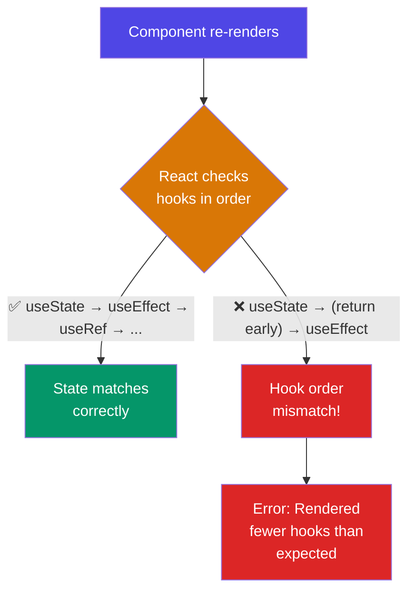

# Hooks

Complete guide to React Hooks including useState, useEffect, useRef, useMemo, useCallback, useContext, useReducer, and custom hooks.

## Rules of Hooks — Why Order Matters

## The Rules

1. **Only call hooks at the top level** — not inside conditions, loops, or nested functions
2. **Only call hooks from React function components** — not regular JavaScript functions
3. React relies on **hook call order** to match state between renders — breaking the order breaks state