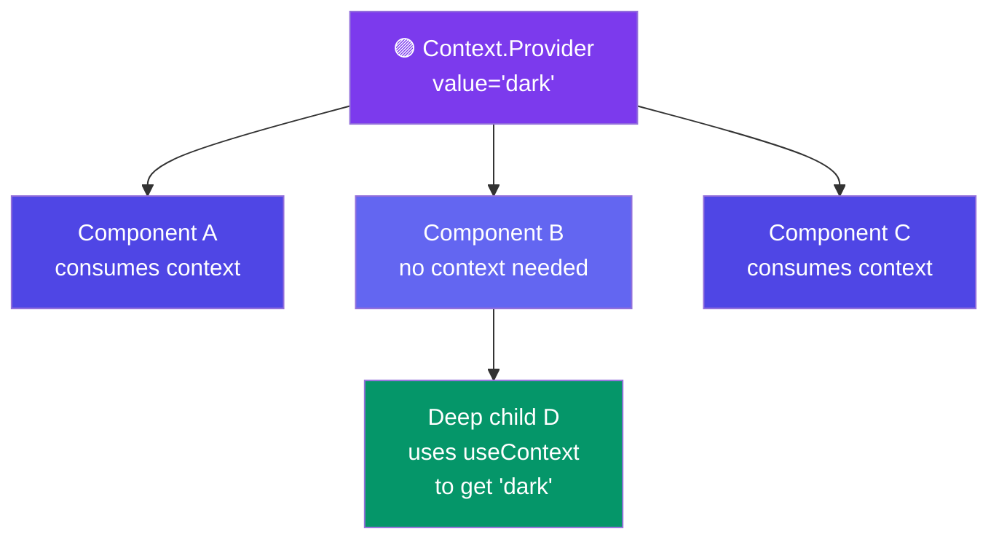

# 6. useContext -> "Global data"
> Simple Explanation: If you have data at the top of your app (like the user's logged-in name or a dark/light theme) and you need it way down at the bottom, passing it step-by-step through every component in between is annoying (this is called "prop drilling"). useContext acts like a teleporter, allowing you to grab that data directly from anywhere in your app.
👉 Example: Checking if dark mode is on.
👉 Avoid passing props everywhere
```jsx
import { useContext, createContext } from 'react';
// 1. Create a "radio station" that broadcasts the theme
const ThemeContext = createContext('light');
function MyComponent() {
 // 2. "Tune in" to the station to get the current theme directly!
 const theme = useContext(ThemeContext);
 return <p>The current theme is {theme}.</p>;
}
```
### Context: Provider → Consumer



### Simple idea:
> "Share data anywhere without props"
---