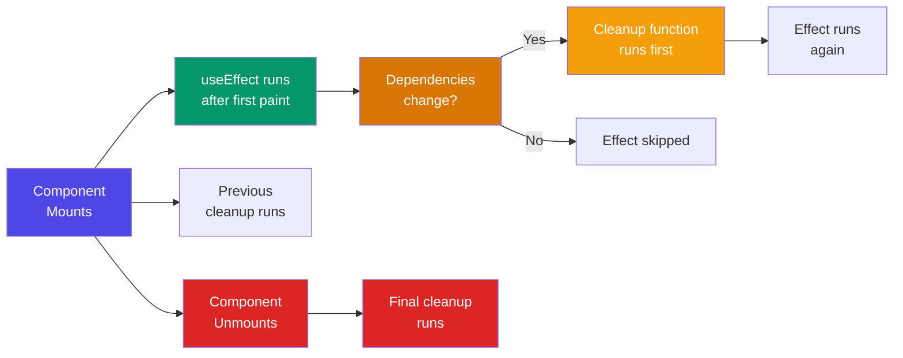

# 2. useEffect -> "Do something after render"
> *Explanation*: 👉 Sometimes your component needs to do things outside of just drawing the UI-like fetching data from the internet, setting a timer, or updating the browser tab's title. useEffect tells React: "Hey, finish drawing the screen first, and then go do this extra task."
Example: Changing the browser tab title when the counter changes.
👉 Used for:
* API calls
* timers
* logging
```jsx
function App() {
 React.useEffect(() => {
 console.log("Page loaded");
 }, []);
 return <h1>Hello</h1>;
}
```
---
### With dependency:
```jsx
useEffect(() => {
 console.log("Count changed");
}, [count]);
```
👉 Runs only when `count` changes
 ### Simple idea:
 > "Run this code after UI is shown"
### useEffect Timeline



---