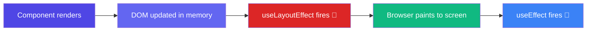

# useLayoutEffect -> "Measure before paint"

> **Simple Explanation:** 👉 `useEffect` runs *after* the browser paints the screen. `useLayoutEffect` runs *before* the browser paints — it's like having a quick moment to fix something in the layout before the user sees it.

## When to Use It

Use `useLayoutEffect` when you need to:
- **Measure DOM elements** — get the width, height, or position of an element
- **Synchronously apply styles** — prevent visible flicker
- **Read scroll position** or layout data before the user sees the paint

## Example — Measuring a Tooltip Position

```jsx
import { useLayoutEffect, useRef, useState } from 'react';

function Tooltip({ text }) {
  const tooltipRef = useRef(null);
  const [position, setPosition] = useState({ top: 0, left: 0 });

  useLayoutEffect(() => {
    const rect = tooltipRef.current.getBoundingClientRect();
    setPosition({
      top: rect.bottom + 8,
      left: rect.left + rect.width / 2,
    });
    // 👆 Runs BEFORE the browser paints — no visible flicker
  }, [text]);

  return (
    <div ref={tooltipRef} style={{ position: 'absolute', top: position.top }}>
      {text}
    </div>
  );
}
```

## useEffect vs useLayoutEffect — Timeline



## Key Difference

| | `useEffect` | `useLayoutEffect` |
|---|---|---|
| When it runs | After paint | Before paint |
| Blocks paint? | No | Yes (briefly) |
| Use for | API calls, subscriptions, logging | DOM measurements, scroll positions |
| Performance | Better (doesn't block) | Slightly worse (blocks paint) |

## In Simple Words 🧠

- `useLayoutEffect` runs **synchronously** right after DOM updates, before the browser paints
- Use it only when you need to **measure or mutate the DOM** in a way the user would see
- For API calls, subscriptions, and most side effects, stick with `useEffect`
- If you ever see a **flicker** when reading layout, `useLayoutEffect` is the fix
- The function signature is identical to `useEffect` — just swap the name
