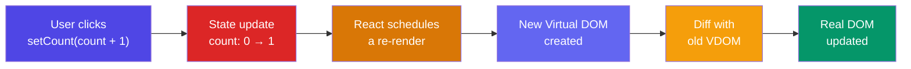

# 1. useState -> "Memory"
> *Simple Explanation*: 👉 Normally, a function forgets everything once it finishes running. useState gives your component a memory. It lets you create a variable that React will remember, and when you update that variable, React automatically updates the screen to show the new value.
Example: A simple click counter.
👉 Used to store data
```jsx
import { useState } from 'react';
function Counter() {
 // We create a piece of memory called "count", starting at 0.
 // "setCount" is the special tool we use to update "count".
 const [count, setCount] = useState(0);
 return (
 <div>
 <p>You clicked {count} times</p>
 {/* When the button is clicked, we tell React to update the memory */}
 <button onClick={() => setCount(count + 1)}>
 Click me
 </button>
 </div>
 );
}
```
### State Update → Re-render Cycle



### Simple idea:
* `count` -> value
* `setCount` -> update value
👉 When you update -> React re-renders
---