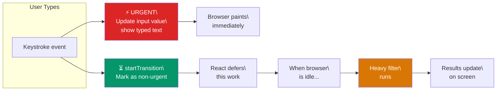

# useTransition -> "Keep the UI smooth"

> **Simple Explanation:** 👉 Imagine typing into a search box that filters 10,000 items. Normally, every keystroke would freeze the screen while it filters. `useTransition` lets you say: "This update is low priority — don't block the user from typing."

## How It Works

```jsx
import { useState, useTransition } from 'react';

function SearchPage() {
  const [query, setQuery] = useState('');
  const [results, setResults] = useState(allItems);
  const [isPending, startTransition] = useTransition();

  function handleChange(e) {
    // URGENT: update the input field immediately
    setQuery(e.target.value);

    // NON-URGENT: let this wait — don't block typing
    startTransition(() => {
      const filtered = allItems.filter(
        item => item.name.toLowerCase().includes(e.target.value)
      );
      setResults(filtered);
    });
  }

  return (
    <div>
      <input value={query} onChange={handleChange} placeholder="Search..." />
      {isPending && <p>⏳ Updating results...</p>}
      <ul>
        {results.map(item => <li key={item.id}>{item.name}</li>)}
      </ul>
    </div>
  );
}
```

### useTransition — Urgent vs Non-Urgent Updates



## When to Use It

| Use `useTransition` When | Don't Use It When |
|---|---|
| Filtering large lists on input | Toggling a simple menu |
| Rendering heavy charts/data | Any update under 10ms |
| Tab switching with big UIs | Animations (use `requestAnimationFrame`) |
| Any slow render the user is waiting on | Updates that MUST finish before the next paint |

## `isPending` — Showing Feedback

The `isPending` flag tells you when the transition is still in progress:

```jsx
function TabSwitcher() {
  const [isPending, startTransition] = useTransition();
  const [tab, setTab] = useState('home');

  function switchTab(nextTab) {
    startTransition(() => setTab(nextTab));
  }

  return (
    <div>
      <button onClick={() => switchTab('home')}>Home</button>
      <button onClick={() => switchTab('settings')}>Settings</button>
      {isPending && <p>🔄 Loading...</p>}
      <SlowTabContent tab={tab} />
    </div>
  );
}
```

## In Simple Words 🧠

- `useTransition` tells React: "Don't block the UI for this update — do it when you have time"
- Returns `[isPending, startTransition]` — a pending flag and a function
- Use it to keep inputs, buttons, and animations **responsive** during heavy renders
- The browser prioritizes urgent (user input) updates over transition updates
- React 18+ feature — key to the concurrent rendering model
