# Actions & Forms

## Simple Words First 🟡

> **Analogy:** 👉 Before React 19, submitting a form was like mailing a letter — you had to write it (set state), stamp it (prevent default), track it (loading state), and wait for a reply (error handling). **Actions** are like an email — press send, and React handles the progress tracking and result for you.

## React 19 Action + Form Submit Flow

```mermaid
flowchart TB
    Submit["User submits form"] --> Action["<form action={action}>\\nor action() called"]
    Action --> Start["React calls\\nyour action function"]
    Start --> Pending["isPending = true\\nForm shows loading state"]
    Pending --> Fetch["Async work runs\\n(API call, validation)"]
    Fetch -->|"Success ✅"| Done["isPending = false\\nForm reset, success UI"]
    Fetch -->|"Error ❌"| Error["isPending = false\\nError displayed"]
    Error --> Action["User can retry"]

    style Submit fill:#4f46e5,color:#fff
    style Action fill:#7c3aed,color:#fff
    style Pending fill:#f59e0b,color:#fff
    style Fetch fill:#d97706,color:#fff
    style Done fill:#059669,color:#fff
    style Error fill:#dc2626,color:#fff
```



## Built-in `<form action>` — The Simplest Way

```jsx
function CreateUser() {
  async function submitAction(formData) {
    'use server'; // Server Action (if using Next.js)
    const name = formData.get('name');
    const email = formData.get('email');
    await createUser({ name, email });
  }

  return (
    <form action={submitAction}>
      <input name="name" required />
      <input name="email" type="email" required />
      <button type="submit">Create User</button>
    </form>
  );
}
```

## `useActionState` — Track Pending & Errors

```jsx
import { useActionState } from 'react';

async function submitReview(prevState, formData) {
  const review = formData.get('review');

  if (!review || review.length < 10) {
    return { error: 'Review must be at least 10 characters', success: false };
  }

  await saveReview(review);
  return { error: null, success: true, message: 'Review submitted!' };
}

function ReviewForm() {
  const [state, formAction, isPending] = useActionState(submitReview, {
    error: null,
    success: false,
    message: '',
  });

  return (
    <form action={formAction}>
      <textarea name="review" disabled={isPending} />
      <button type="submit" disabled={isPending}>
        {isPending ? 'Submitting...' : 'Submit Review'}
      </button>
      {state.error && <p className="error">{state.error}</p>}
      {state.success && <p className="success">{state.message}</p>}
    </form>
  );
}
```

## `useFormStatus` — Loading from Inside a Form

```jsx
import { useFormStatus } from 'react-dom';

function SubmitButton() {
  // 👇 Works from INSIDE a <form> — no prop drilling needed!
  const { pending } = useFormStatus();

  return (
    <button type="submit" disabled={pending}>
      {pending ? '⏳ Saving...' : '💾 Save'}
    </button>
  );
}

function ProfileForm() {
  return (
    <form action={updateProfile}>
      <input name="username" />
      <SubmitButton /> {/* Automatically knows if form is submitting */}
    </form>
  );
}
```

## In Simple Words 🧠

- React 19 **Actions** let you handle form submission with built-in pending state and error tracking
- `<form action={fn}>` — the simplest way to handle forms without `onSubmit`/`preventDefault`
- `useActionState(fn, initialState)` returns `[state, formAction, isPending]`
- `useFormStatus()` reads the parent form's pending state — no prop drilling
- Combine with **Server Actions** (`'use server'`) in Next.js for full-stack forms
