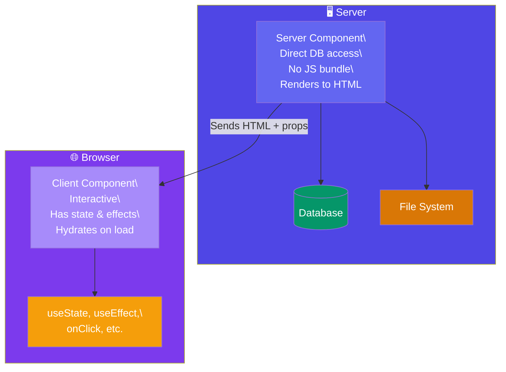

# Server Components

## Simple Words First 🟡

> **Analogy:** 👉 Before React Server Components, all components were like **delivery drivers** — they had to be sent to every house (the browser) even if the package was already at the warehouse (server). Server Components let you **open the package at the warehouse** and send only the finished product to the door — faster, lighter, and with direct access to the warehouse inventory (database).

## Server vs Client Components



## Key Differences

| Server Components | Client Components |
|---|---|
| Run on the **server** only | Run in the **browser** |
| **Zero JavaScript** sent to client | Full JS bundle |
| Direct **database/file system access** | Must call APIs |
| **No state, effects, or event handlers** | Full hooks support |
| Imported by default (in RSC frameworks) | Need `"use client"` directive |

## Example — Server Component

```jsx
// PostsList.js — NO "use client" directive = Server Component by default
// Runs on the server — directly queries the database!
import db from './database';

export default async function PostsList() {
  // ✅ Direct DB access — no API endpoint needed
  const posts = await db.query('SELECT * FROM posts ORDER BY created_at DESC');

  return (
    <ul>
      {posts.map(post => (
        <li key={post.id}>
          <h2>{post.title}</h2>
          <p>{post.body.slice(0, 100)}...</p>
        </li>
      ))}
    </ul>
  );
}
```

## Example — Client Component

```jsx
// LikeButton.js — "use client" directive makes this a Client Component
"use client";

import { useState } from 'react';

export default function LikeButton({ postId }) {
  const [liked, setLiked] = useState(false);

  return (
    <button onClick={() => setLiked(!liked)}>
      {liked ? '❤️' : '🤍'} {liked ? 'Liked' : 'Like'}
    </button>
  );
}
```

## Combining Them

```jsx
// page.js — Server Component (no "use client")
import PostsList from './PostsList';
import LikeButton from './LikeButton'; // Client Component

export default function Page() {
  return (
    <div>
      <PostsList /> {/* Rendered on server, no JS sent */}
      <LikeButton /> {/* Small JS bundle for interactivity */}
    </div>
  );
}
```

## In Simple Words 🧠

- **Server Components** run **only on the server** — zero JavaScript sent to the browser
- They can directly access **databases, file systems, and APIs** — no need for REST endpoints
- **Client Components** (`"use client"`) run in the browser — they have **state, effects, and interactivity**
- Server Components **reduce bundle size** dramatically — only interactive components ship JS
- React 19 + Next.js App Router make RSCs the default — you opt-in to client components
- The line is blurry — you can mix both in the same app freely
