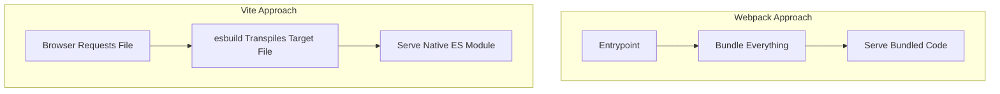
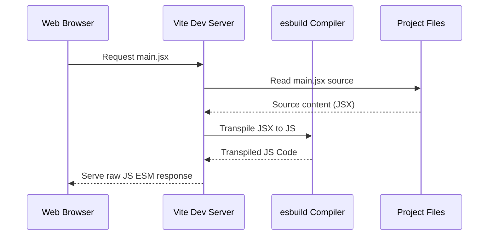
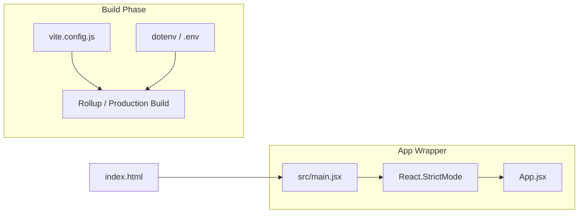
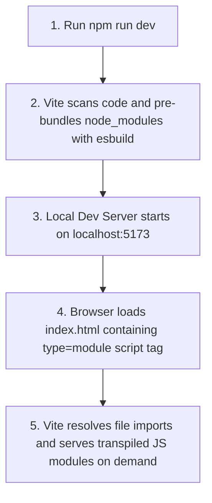

# Development Setup & Workspace Configuration

## Introduction

To write React apps professionally, you need a robust, standardized development setup. Gone are the days of linking React via script tags in an HTML file. Today, we rely on compilation pipelines that transform JSX and modern ESNext code into code standard browsers understand. This module guides you through building a modern local environment using Vite, organizing the workspace, and understanding React Strict Mode.

---

## Why do we need this?

Browsers cannot parse JSX or TypeScript natively. They only understand standard JavaScript, HTML, and CSS. To build modular software, we need a setup that imports external libraries, bundles files, processes stylesheets, resolves path imports, and restarts automatically whenever we save changes.

### Problem Statement
Imagine building a website with 150 different source files. If you load each one using a standard `<script>` tag, the browser will have to issue 150 separate HTTP requests, slowing page load to a crawl. Furthermore, if you use new JavaScript features or JSX, the browser will throw syntax exceptions. We need a compiler to transpile the code, and a bundler to group and optimize the resulting files.

---

## Real World Story

In 2016, Facebook released Create React App (CRA), which used Webpack and Babel under the hood. CRA became the industry standard because it hid the complex, daunting configuration of Webpack from developers. 

However, as codebases grew, Webpack's build times slowed significantly. Every time a file was saved, Webpack had to re-build entire modules, taking up to 30 seconds for hot module replacement in large projects. In 2020, Evan You created Vite, which utilizes native ES Modules (ESM) in the browser during development and compiles modules instantly using esbuild (written in Go). Developers shifted to Vite because it reduced startup and hot-reload times to milliseconds, transforming the developer experience.

---

## Real World Analogy

Think of setting up a React environment like organizing a **Prefabricated Home Construction Site**.

- **Without a build system (Raw Script Tags)**: You order individual bricks, doors, and window panes, and try to assemble them directly on the plot. If you need a special lock, you have to drive to the store, fetch it, and glue it manually.
- **With a build system (Vite/Webpack)**: You have a specialized factory workshop next to the site. The workshop takes complex, engineered blueprints (JSX/TypeScript), slices them into standardized pre-assembled panels, checks them for design errors (ESLint), and delivers them pre-fit. The house is assembled in hours instead of weeks.

---

## Visual Explanation

Below is a flowchart comparing how Webpack bundles the entire project before serving, vs. how Vite serves modules on demand using native ES Modules.

### Webpack Build Strategy (Slow Startup)
```
[Entry Point] ──> [Resolve All Imports] ──> [Bundle Entire App] ──> [Server Ready & Start]
```

### Vite ESM Strategy (Instant Startup)
```
[Browser Request] ──> [Server Intercepts] ──> [Transpile Single File On-Demand] ──> [Send to Browser]
```



---

## Internal Working

Vite splits your application modules into two categories: **Dependencies** and **Source Code**.
1. **Dependencies** are pre-bundled using `esbuild`. These are third-party NPM packages (like React) that do not change often.
2. **Source Code** is served as native ES Modules over HTTP. The browser parses imports like `import App from './App.jsx'` and requests only that specific file. Vite intercepts the request, transpiles JSX to JS on-the-fly, and serves it immediately.



---

## Architecture

A standard Vite React structure separates source files from configuration assets. Environmental values are injected at build time, and Strict Mode wraps the root element to audit safety standards.



---

## Step-by-Step Flow

When Vite boots up the development server and compiles a file, the following steps occur:



---

## Syntax

Vite supports environmental variables prefixed with `VITE_`. These are loaded onto the global meta object:

```javascript
// Accessing environmental variables in Vite projects
const databaseUrl = import.meta.env.VITE_API_URL;
const developmentMode = import.meta.env.DEV; // Boolean
```

---

## Basic Example

Here is a simple `vite.config.js` configuration file using the official React plugin.

```javascript
import { defineConfig } from 'vite';
import react from '@vitejs/plugin-react';

// https://vite.dev/config/
export default defineConfig({
  plugins: [react()],
  server: {
    port: 3000, // Forces the local server to run on port 3000
    open: true, // Auto-opens the browser window when server starts
  },
});
```

---

## Intermediate Example

An intermediate config setting up custom path aliases (so you can import using `@components/Button` instead of `../../components/Button`) and configuring proxy middleware for development API routes.

```javascript
import { defineConfig } from 'vite';
import react from '@vitejs/plugin-react';
import path from 'path';

export default defineConfig({
  plugins: [react()],
  resolve: {
    alias: {
      // Maps the '@' character directly to the 'src' directory
      '@': path.resolve(__dirname, './src'),
    },
  },
  server: {
    proxy: {
      // Intercepts API requests and redirects them to the local backend
      '/api': {
        target: 'http://localhost:5000',
        changeOrigin: true,
        secure: false,
      },
    },
  },
});
```

---

## Advanced Example

An advanced file structure setup illustrating the initialization of React with TypeScript, using environment profiles to configure production CDN hosting paths.

```typescript
import { defineConfig, loadEnv } from 'vite';
import react from '@vitejs/plugin-react';
import { resolve } from 'path';

export default defineConfig(({ mode }) => {
  // Load environment variables based on the active command-line mode
  const env = loadEnv(mode, process.cwd(), '');

  return {
    plugins: [react()],
    base: mode === 'production' ? 'https://cdn.mycompany.com/assets/' : '/',
    resolve: {
      alias: {
        '@core': resolve(__dirname, './src/core'),
        '@features': resolve(__dirname, './src/features'),
      },
    },
    build: {
      outDir: 'dist',
      sourcemap: mode !== 'production', // Enable sourcemaps in development
      rollupOptions: {
        output: {
          // Manual chunk splitting to separate node_modules vendors from application code
          manualChunks(id) {
            if (id.includes('node_modules')) {
              return 'vendor';
            }
          },
        },
      },
    },
  };
});
```

---

## Production Example

A production React root mounting file (`main.jsx`) demonstrating error reporting tracking setups, importing styling packages, and enabling conditional React Strict Mode checks.

```jsx
import React from 'react';
import ReactDOM from 'react-dom/client';
import App from './App.jsx';
import './index.css';

// Simple production logger simulation
function initAnalytics() {
  if (import.meta.env.PROD) {
    console.log('Production mode active: Initializing analytics...');
    // Initialize crash reporter like Sentry here
  }
}

initAnalytics();

// Grab target root container in index.html
const rootElement = document.getElementById('root');

if (!rootElement) {
  throw new Error('Failed to find root DOM element wrapper.');
}

// Create concurrent React Root
const root = ReactDOM.createRoot(rootElement);

root.render(
  <React.StrictMode>
    <App />
  </React.StrictMode>
);
```

---

## Folder Structure

A standardized feature-based directory structure for professional scale:

```
my-enterprise-app/
├── .env.development
├── .env.production
├── index.html
├── package.json
├── vite.config.js
└── src/
    ├── main.jsx
    ├── App.jsx
    ├── index.css
    ├── assets/
    ├── components/
    │   └── Button.jsx
    ├── hooks/
    │   └── useAuth.js
    └── features/
        └── dashboard/
            ├── Dashboard.jsx
            └── components/
```

---

## Best Practices

💡 **Did You Know?**  
React Strict Mode executes hooks like `useEffect` twice in development mode. This is done to help you identify missing cleanup functions (e.g., unsubscribed events, un-cleared intervals) which cause memory leaks.

🚀 **Best Practices**
- Keep your production dependencies separate from devDependencies.
- Keep environment keys out of source control. Always add your `.env` and `.env.local` files to `.gitignore`.
- Use path aliases (like `@/components`) to avoid complex relative paths (`../../../../components`).

---

## Common Mistakes

⚠ **Common Mistakes**

### Exposing Secret Keys
Adding credentials or API secrets inside client-side environment files is a critical security flaw. Any keys prefixed with `VITE_` are bundled directly into the public JavaScript build files, which can be extracted by users.

```javascript
// ❌ CRITICAL SECURITY ERROR
VITE_STRIPE_SECRET_KEY="sk_test_12345" // Stored in client build

//  SECURE APPROACH
// Keep secret keys in backend environments (Node/Express), not React config files.
```

### Missing Cleanup in Strict Mode
Forgetting to return cleanups in effects causes leaks that are highlighted by Strict Mode's double execution.

```jsx
// ❌ WRONG
useEffect(() => {
  window.addEventListener('resize', handleResize);
}, []); // Event handler is duplicated on hot-reload, leaking memory

//  RIGHT
useEffect(() => {
  window.addEventListener('resize', handleResize);
  return () => window.removeEventListener('resize', handleResize); // Cleanup added
}, []);
```

---

## Performance Notes

⚡ **Performance Tips**
Webpack scans every file to bundle your application before starting the dev server, which can lead to slow restarts on large codebases. Vite updates code instantly by utilizing browser native imports, ensuring instant startup.

### Performance Example
Using dynamic imports to split heavy packages from the initial bundle page-load speed:

```jsx
import React, { lazy, Suspense } from 'react';

// Dynamically load heavy module only when requested
const HeavyChart = lazy(() => import('./components/HeavyChart.jsx'));

export function AnalyticsDashboard() {
  return (
    <Suspense fallback={<div>Loading stats chart...</div>}>
      <HeavyChart />
    </Suspense>
  );
}
```

---

## Accessibility Notes

♿ **Accessibility Tips**
- Configure your build tools to run ESLint with the `eslint-plugin-jsx-a11y` plugin. This checks accessibility issues like missing `alt` tags on images and invalid ARIA attributes during compilation.
- Ensure build errors occur if accessibility standards are not met.

---

## SEO Notes

Vite-rendered React apps are Client-Side Rendered (CSR) by default. If your project requires high SEO visibility, configure pre-rendering plugins or migrate to Meta-frameworks like Next.js or Astro.

---

## Interview Questions

🎯 **Interview Tips**  
If an interviewer asks you about React Strict Mode's double-rendering, explain that it helps discover side effects in your render functions. React expects render functions to be pure, and executing them twice makes bugs visible early.

### Q1: Explain why React Strict Mode triggers components to render twice in development.
**Answer**: React Strict Mode intentionally invokes lifecycle methods, render functions, and hooks twice in development. This helps identify side effects, un-cleared intervals, duplicate event listeners, and memory leaks. In production builds, Strict Mode is disabled automatically and does not affect run performance.

### Q2: What is Vite and why is it faster than Webpack during development?
**Answer**: Webpack builds and bundles the entire project source code before launching the dev server. As the codebase grows, start and reload times increase. Vite does not bundle source code during development. Instead, it serves code as native ES Modules, leaving the browser to parse module requests. Vite also uses `esbuild` (written in Go) for pre-bundling dependencies, which is significantly faster than JS-based bundlers.

---

## MCQs

1. **Which engine does Vite use to pre-bundle external dependencies in development?**
   - A) Webpack
   - B) Babel
   - C) esbuild
   - D) Rollup
   - *Answer: C*

2. **How do you access environment variables in a React application built with Vite?**
   - A) `process.env.API_URL`
   - B) `import.meta.env.VITE_API_URL`
   - C) `window.env.API_URL`
   - D) `React.getEnv("API_URL")`
   - *Answer: B*

3. **Which folder structure represents the output of a production build in Vite?**
   - A) `node_modules`
   - B) `public`
   - C) `dist` (or build target)
   - D) `src`
   - *Answer: C*

4. **Which plugin is required to allow Vite to understand React JSX files?**
   - A) `@vitejs/plugin-react`
   - B) `vite-babel-loader`
   - C) `gulp-react`
   - D) `webpack-react-plugin`
   - *Answer: A*

5. **Does React Strict Mode trigger double rendering in production builds?**
   - A) Yes, it renders twice on both development and production.
   - B) Yes, but only on mobile browsers.
   - C) No, it runs only during development and is automatically omitted in production.
   - D) No, but it can be forced via configurations.
   - *Answer: C*

---

## Practice Exercise

### Exercise 1: Vite Alias Setup
Configure a new path alias in a Vite config file mapping `@hooks` to the local `./src/hooks` folder.

*Solution*:
```javascript
alias: {
  '@hooks': path.resolve(__dirname, './src/hooks')
}
```

### Exercise 2: Strict Mode Verification
Write a component that outputs a count message to the console on mount. Mount it inside Strict Mode and verify in the console that the mount logs twice.

### Exercise 3: Environment Variable Check
Configure a `.env.development` file. Create a component that reads this environment key and renders its value on screen.

---

## Debugging Exercise

### The Missing Env Variable Bug
The component below is returning `undefined` for the API URL in development. Identify the bug and write the fix.

```javascript
// .env.development file contents
API_URL="https://api.mycompany.com/v1"

// UsersList.jsx component
export default function UsersList() {
  const endpoint = import.meta.env.API_URL;
  console.log("Fetching from:", endpoint); // Prints undefined
  return <div>Connecting to endpoint...</div>;
}
```

#### Solution
In Vite, environment variables are only exposed to the client source code if they are prefixed with `VITE_`. Unprefixed keys are filtered out for security reasons.

```bash
# Corrected .env.development content
VITE_API_URL="https://api.mycompany.com/v1"
```
```javascript
// Corrected UsersList.jsx component
const endpoint = import.meta.env.VITE_API_URL;
```

---

## Real-world Scenario

You are migrating a large legacy project with over 2,000 files from Webpack to Vite. When booting the dev server, you face path resolution errors. Explain how you would address these.
- **Resolution Strategy**: Map common Webpack custom resolve modules as directory aliases inside `vite.config.js` to ensure the module resolution matches. Also, replace file formats with `.jsx` or `.tsx` where applicable, as Vite requires correct file extensions to compile JSX.

---

## Interview Coding Question

### Problem Statement
Write a basic development config setup for a Vite React application that:
- Runs development on port `8080`.
- Configures path aliases for `./src/services`.
- Configures a proxy for requests sent to `/auth` to forward to `http://localhost:5000`.

```javascript
import { defineConfig } from 'vite';
import react from '@vitejs/plugin-react';
import path from 'path';

export default defineConfig({
  plugins: [react()],
  server: {
    port: 8080,
    proxy: {
      '/auth': {
        target: 'http://localhost:5000',
        changeOrigin: true,
      },
    },
  },
  resolve: {
    alias: {
      '@services': path.resolve(__dirname, './src/services'),
    },
  },
});
```

---

## Mini Project

### Environment-Driven Theme Switcher
Create a simple Vite environment demo:
- Reads a variable called `VITE_BRAND_THEME` from a `.env` file.
- If the value is `"DARK"`, render a dark layout; if `"LIGHT"`, render a light layout.
- Log the build version `VITE_BUILD_VERSION` and current mode (`import.meta.env.MODE`) to a dashboard console component.

---

## Summary

🧠 **Memory Tricks**  
`VITE_` -> "Vite exposes this to the browser". If a variable is not prefixed with `VITE_`, it is hidden from the client code.

📖 **Summary**  
A modern React workflow uses Vite to bundle dependencies with esbuild and serve source files via native ES Modules. This setup compiles JSX on the fly, provides fast feedback loops, and leverages Strict Mode to check for side effects and memory leaks.

---

## Cheat Sheet

```bash
# Initialize a new Vite React app
npm create vite@latest my-app -- --template react

# Build production bundle
npm run build
```

---

## Related Topics
- [React Philosophy and Introduction](introduction-to-react)
- [How JSX Compiles Under the Hood](jsx-under-the-hood)

---

## Further Reading
- [Vite Documentation: Getting Started](https://vite.dev/guide/)
- [React Docs: Strict Mode Deep Dive](https://react.dev/reference/react/StrictMode)
