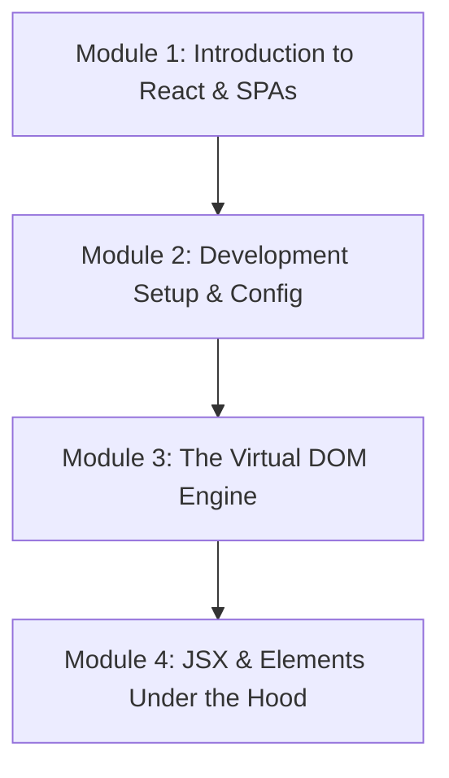

# Phase 1: React Fundamentals

Welcome to the **React Fundamentals** phase of the React Engineering Academy. This phase is designed to take you from zero prior knowledge of React to a solid understanding of how React behaves, runs, and renders interfaces under the hood.

## Why this topic exists

In the early days of web development, we built pages where the server rendered everything. When users interacted with a page, the browser had to request a brand-new page from the server, causing slow and jarring page reloads.

With the rise of JavaScript, developers started writing dynamic UIs by directly querying and mutating the browser DOM (Document Object Model) using libraries like jQuery. However, manual DOM manipulation is error-prone, hard to scale, and incredibly slow when the app grows.

React was created by Facebook to solve this exact problem. By introducing a **Declarative Programming Model** and the **Virtual DOM**, React allows developers to write code explaining *what* the UI should look like for a given state, leaving the complex, performance-heavy task of *how* to update the browser's DOM to React's internal reconciler.

---

## Learning Objectives

By the end of this phase, you will be able to:
- Explain the key differences between Single Page Applications (SPAs) and Multi-Page Applications (MPAs).
- Contrast Declarative UI rendering with traditional Imperative DOM manipulation.
- Install, configure, and optimize a modern React development environment using Vite.
- Describe the execution lifecycle of React Strict Mode and why it runs effects twice in development.
- Detail the layout reflow/repaint process of browser rendering and why direct DOM writes are slow.
- Diagram the reconciliation process and explain how React uses the Virtual DOM.
- Understand how JSX compiles to standard JavaScript function calls (`React.createElement` / JSX runtime).

---

## Prerequisites

Before starting this phase, you should have a solid foundation in:
1. **Modern JavaScript (ES6+)**: Variables (`const`, `let`), Arrow Functions, Destructuring, Spread Operators, Array methods (`map`, `filter`), and Promises.
2. **HTML5 & CSS3**: Semantic page structures, basic layout mechanics (Flexbox, Grid), and the browser DOM structure.

---

## Learning Roadmap & Topics Covered

This phase is broken down into four comprehensive modules:

1. **[Module 1: Introduction to React & SPAs](introduction-to-react)**  
   The philosophy of React, declarative vs imperative paradigms, libraries vs frameworks, and the SPA architectural design.
2. **[Module 2: Development Setup & Config](development-setup)**  
   Setting up a React project from scratch using Vite, structure guidelines, and understanding Strict Mode double rendering.
3. **[Module 3: The Virtual DOM Engine](virtual-dom)**  
   Understanding browser paint cycles, the lightweight JS objects of the Virtual DOM, and the reconciliation cycle.
4. **[Module 4: JSX & Elements Under the Hood](jsx-under-the-hood)**  
   JSX syntax compilation, rules, React elements, fragment logic, and why list keys are mandatory.

---

## Estimated Learning Time

- **Total Time**: 6 - 8 Hours
- **Module 1**: 1.5 Hours
- **Module 2**: 1.5 Hours
- **Module 3**: 2 Hours
- **Module 4**: 2 Hours
- **Exercises & Mini-Projects**: 1 Hour

---

## Real-World Applications

- **Dynamic Interactive Dashboards**: Building responsive dashboards that update data instantly in the background without refreshing the browser tab.
- **Fast SaaS Applications**: Enabling single-page transitions that feel instantaneous, improving conversion rates and user experience.
- **Collaborative Software (e.g., Slack, Figma)**: Real-time UI updates reflecting local state and remote changes smoothly.

---

## Practice Exercises

Each module includes specialized practical challenges:
- **Imperative to Declarative refactoring**: Rewriting a pure JS script into React syntax.
- **Build tool configuration**: Tweaking a Vite project to add path aliases and linting.
- **DOM diff simulator**: Writing a mini JavaScript function that compares two simple objects and updates a HTML node.

---

## Mini Projects

At the end of this phase, you will build:
- **A Dynamic State-Driven Dashboard**: A pure static setup demonstrating declarative state transitions, structural component layout, and dynamic list rendering with keys.

---

## Related Topics

- [Modern JavaScript Execution Context](../javascript/introduction)
- [DOM Manipulation APIs](../javascript/dom-apis)
- [Vite and Build Tools](../javascript/build-tools)

---

## Further Reading

- [React.dev: Describing the UI](https://react.dev/learn/describing-the-ui)
- [React.dev: How React Treats Your Code](https://react.dev/learn/rendering-and-committing)
