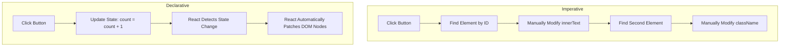
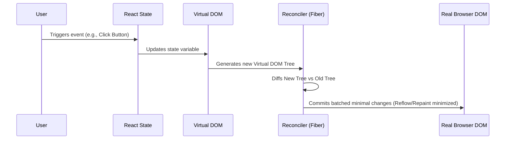
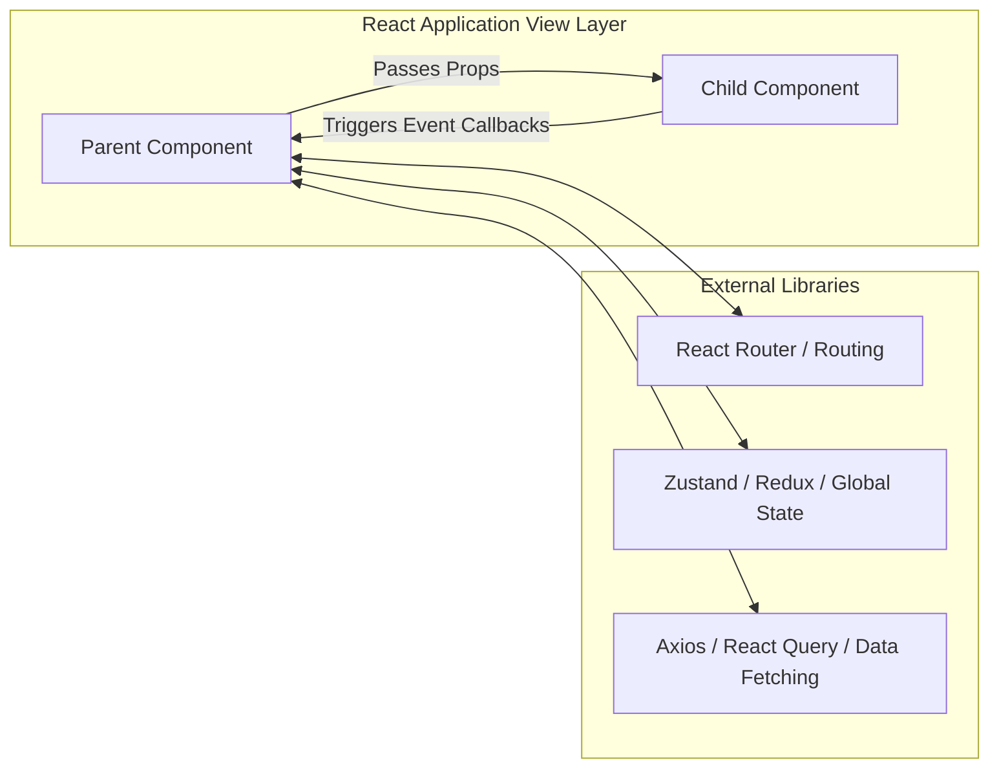
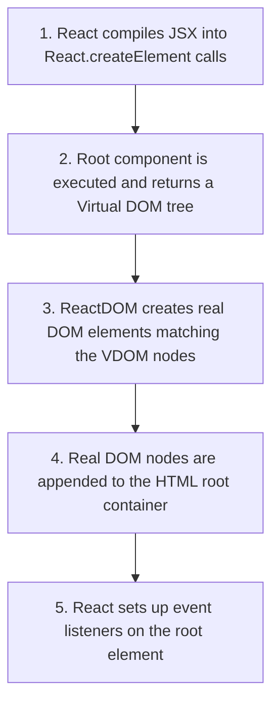

# Introduction to React & SPAs

## Introduction

React has completely transformed how web interfaces are designed and developed. Developed by Facebook in 2013, React is an open-source JavaScript library focused on building highly responsive, component-based user interfaces. Instead of manually traversing and editing browser DOM structures, React introduces a declarative paradigm where developers describe *what* the UI should look like for a given state, and the library handles the underlying complexities of rendering it.

---

## Why do we need this?

In traditional web development, state management and UI rendering were deeply coupled and managed manually. When a user interacted with an element, code had to query the document, locate the specific node, change its text or attributes, and ensure no other parts of the page were broken. This approach fails to scale, leading to spaghetti code and poor application performance.

### Problem Statement
Consider an e-commerce shopping cart where the cart's item count appears in the navigation bar, the checkout summary, and a floating side panel. Using traditional JavaScript, adding an item to the cart requires writing manual queries to locate all three elements in the DOM and modify their text content. If a new page section is introduced that also needs the item count, the developer must remember to modify the adding-to-cart handler to target this new element. This imperative code becomes fragile and error-prone as the application expands.

---

## Real World Story

In 2011, Facebook's ads system was growing rapidly. The engineering team was struggling to keep the user interface in sync with user interactions and database updates. A classic bug was the chat notification bubble: a user would read a message, but the notification count badge would remain active. 

Engineers wrote custom handlers to target notifications, but changes in one feature repeatedly broke other sections of the layout. The codebase grew increasingly complex and fragile. To resolve this, Facebook engineer Jordan Walke built a prototype called FaxJS, which later evolved into React. React solved the sync issue by discarding the manual mutation approach entirely and replacing it with a system that automatically re-rendered the UI whenever the underlying state changed.

---

## Real World Analogy

Think of the difference between an **Automated Restaurant Order Screen** and a **Manual Kitchen Coordinator**.

- **Imperative Approach (Manual Coordinator)**: You stand in the kitchen and shout instructions to the chefs: *"Cook a patty. Put it on the grill. Toast the bun. Assemble the burger. Now update the menu display board to show we have one less patty left."* If you forget a single step, the burger is ruined, or the inventory count is incorrect.
- **Declarative Approach (Automated Order Screen)**: The customer selects a burger on the touch screen. The screen changes the state to `Ordered: 1 Burger`. The system automatically updates the kitchen display board, triggers the inventory decrement, and outputs the receipt. You don't tell the system *how* to update each database table and UI label; you declare that a burger has been ordered, and the system handles the cascading updates.

---

## Visual Explanation

Below is a visualization showing the comparison of how events flow and update the UI in Imperative vs Declarative paradigms.

### Imperative Event Flow
```
[User Action] ──> [Event Handler] ──> [Query DOM Node A] ──> [Update Text]
                                  ──> [Query DOM Node B] ──> [Update CSS Class]
```

### Declarative Event Flow
```
[User Action] ──> [Update State] ──> [React Triggers Re-render] ──> [UI Auto-Updates]
```



---

## Internal Working

Under the hood, React implements a virtual representation of the DOM. When React evaluates your components, it produces a tree of React Elements. When state changes, a new tree of elements is generated. React then performs a comparison (diffing) between the new tree and the previous tree to compute the minimal set of changes needed to update the browser's DOM.



---

## Architecture

React applications operate on a unidirectional data flow. Data flows down from parent components to child components via props, and events flow up. Unlike full frameworks that control all aspects of an application (routing, HTTP requests, state management), React sits purely as the View layer.



---

## Step-by-Step Flow

When a React application mounts on a web page, the following cycle executes:



---

## Syntax

```jsx
// React component syntax uses declarative ES6 functions returning JSX
function ComponentName(props) {
  // 1. Declare state or logic
  // 2. Return JSX description
  return (
    <tag attribute={value}>
      {/* Expressions wrapped in curly braces */}
      {props.content}
    </tag>
  );
}
```

---

## Basic Example

Here is a simple toggle button demonstrating the declarative style. We declare state (`isToggled`) and bind it to the rendering logic.

```jsx
import React, { useState } from 'react';

// Basic Declarative Toggle Component
export default function LightSwitch() {
  // State hook determines if the switch is on (true) or off (false)
  const [isOn, setIsOn] = useState(false);

  return (
    <div style={{ textAlign: 'center', marginTop: '20px' }}>
      {/* The paragraph output dynamically reacts to the 'isOn' state */}
      <p>The light is <strong>{isOn ? 'ON' : 'OFF'}</strong></p>
      
      {/* Clicking the button toggles the boolean state value */}
      <button onClick={() => setIsOn(!isOn)}>
        {isOn ? 'Turn Off' : 'Turn On'}
      </button>
    </div>
  );
}
```

---

## Intermediate Example

An intermediate component showing list rendering and text filter binding. Notice there is no manual DOM insertion or filtering of list items; React computes the filtered output declaratively.

```jsx
import React, { useState } from 'react';

const FRUITS = ['Apple', 'Banana', 'Cherry', 'Date', 'Elderberry', 'Fig', 'Grape'];

export default function FruitSearch() {
  const [searchTerm, setSearchTerm] = useState('');

  // Computes the filtered list on every render based on search state
  const filteredFruits = FRUITS.filter(fruit =>
    fruit.toLowerCase().includes(searchTerm.toLowerCase())
  );

  return (
    <div style={{ padding: '20px', maxWidth: '400px', margin: '0 auto' }}>
      <h3>Declarative Search List</h3>
      <input
        type="text"
        placeholder="Filter fruits..."
        value={searchTerm}
        onChange={(e) => setSearchTerm(e.target.value)}
        style={{ width: '100%', padding: '8px', marginBottom: '12px' }}
      />
      <ul>
        {filteredFruits.map((fruit, index) => (
          // React uses the key prop to track list items across updates
          <li key={index}>{fruit}</li>
        ))}
      </ul>
      {filteredFruits.length === 0 && <p>No fruits match your search.</p>}
    </div>
  );
}
```

---

## Advanced Example

An advanced example illustrating component state management combined with simulated background server intervals, showing how asynchronous event updates flow into declarative render cycles.

```jsx
import React, { useState, useEffect } from 'react';

export default function LiveSystemMonitor() {
  const [metrics, setMetrics] = useState({ cpu: 0, ram: 0 });
  const [isMonitoring, setIsMonitoring] = useState(false);

  useEffect(() => {
    let intervalId;
    if (isMonitoring) {
      // Simulate socket or hardware API stream updates
      intervalId = setInterval(() => {
        setMetrics({
          cpu: Math.floor(Math.random() * 100),
          ram: Math.floor(40 + Math.random() * 40)
        });
      }, 1000);
    }
    // Cleanup interval when monitoring stops or component unmounts
    return () => clearInterval(intervalId);
  }, [isMonitoring]);

  return (
    <div style={{ border: '1px solid #ccc', padding: '20px', borderRadius: '8px' }}>
      <h2>System Status</h2>
      <p>CPU Usage: <strong>{metrics.cpu}%</strong></p>
      <p>RAM Usage: <strong>{metrics.ram}%</strong></p>
      
      <button onClick={() => setIsMonitoring(!isMonitoring)}>
        {isMonitoring ? 'Pause Monitor' : 'Start Monitor'}
      </button>
    </div>
  );
}
```

---

## Production Example

A production-grade component utilizing an AbortController for data fetching, proper loading/error boundaries, and descriptive accessibility tags.

```jsx
import React, { useState, useEffect } from 'react';

export default function ProductionUserList() {
  const [users, setUsers] = useState([]);
  const [loading, setLoading] = useState(false);
  const [error, setError] = useState(null);

  useEffect(() => {
    const controller = new AbortController();
    const { signal } = controller;

    async function fetchUsers() {
      setLoading(true);
      setError(null);
      try {
        const response = await fetch('https://jsonplaceholder.typicode.com/users', { signal });
        if (!response.ok) {
          throw new Error(`HTTP error! status: ${response.status}`);
        }
        const data = await response.json();
        setUsers(data);
      } catch (err) {
        if (err.name !== 'AbortError') {
          setError(err.message || 'An error occurred while fetching users.');
        }
      } finally {
        setLoading(false);
      }
    }

    fetchUsers();

    // Abort fetch if component unmounts before response finishes
    return () => controller.abort();
  }, []);

  if (loading) return <div aria-live="polite">Loading user profiles...</div>;
  if (error) return <div role="alert" style={{ color: 'red' }}>Error: {error}</div>;

  return (
    <div>
      <h2 id="users-title">Team Directory</h2>
      <ul aria-labelledby="users-title">
        {users.map(user => (
          <li key={user.id} style={{ margin: '8px 0' }}>
            <strong>{user.name}</strong> - {user.email}
          </li>
        ))}
      </ul>
    </div>
  );
}
```

---

## Folder Structure

```
my-react-app/
├── src/
│   ├── components/
│   │   └── ProductionUserList.jsx
│   ├── App.jsx
│   └── main.jsx
├── index.html
├── package.json
└── vite.config.js
```

---

## Best Practices

💡 **Did You Know?**  
React was named "React" because it reacts to state changes. The core idea is that the view is a projection of the application state.

🚀 **Best Practices**
- Keep your components small and single-purpose.
- Treat state as read-only (immutable). Never mutate state variables directly; always use the provided state setter function.
- Lift state up to the nearest common ancestor when multiple components need access to the same data.

---

## Common Mistakes

⚠ **Common Mistakes**

### Mutating State Directly
A common error is changing state properties without calling the state setter function. This bypasses React's scheduling engine, causing no re-render to occur.

```jsx
// ❌ WRONG
const [user, setUser] = useState({ name: 'Alice' });
user.name = 'Bob'; // Mutates state directly; React does not detect changes

//  RIGHT
const [user, setUser] = useState({ name: 'Alice' });
setUser({ ...user, name: 'Bob' }); // Creates a new object reference, triggering update
```

---

## Performance Notes

⚡ **Performance Tips**
React's rendering is highly optimized, but unnecessary execution can occur. When a parent component renders, all of its child components render by default. 

### Avoid In-line Object References in Props
Creating objects or defining inline functions inside props causes them to receive new memory references on every render, which can bypass child component memoization optimizations.

```jsx
// ❌ Performance Anti-pattern
<HeavyChildComponent options={{ theme: 'dark' }} />

//  Performance Optimization
const THEME_OPTIONS = { theme: 'dark' }; // Define static object reference outside component
// ...
<HeavyChildComponent options={THEME_OPTIONS} />
```

---

## Accessibility Notes

♿ **Accessibility Tips**
- Use semantic HTML tags (`<nav>`, `<main>`, `<button>`) instead of nested arrays of `<div>` tags.
- Bind labels using `htmlFor` instead of the standard browser `for` attribute, since `for` is a reserved keyword in JavaScript.
- Use properties like `aria-live="polite"` on elements that update dynamically (like lists or alerts) so screen readers notify users of changes.

```jsx
// Accessibility Example
export function AccessibleSearch() {
  return (
    <form role="search">
      <label htmlFor="search-input">Search Docs</label>
      <input id="search-input" type="search" />
    </form>
  );
}
```

---

## SEO Notes

To optimize single-page React applications for search engine scrapers, configure Server-Side Rendering (SSR) via frameworks like Next.js, or configure pre-rendering steps using static generators. Ensure that every page provides unique, structured metadata title and description attributes in the layout headers.

---

## Interview Questions

🎯 **Interview Tips**  
If asked about React's rendering model in an interview, remember this equation: `UI = f(State)`. It summarizes the declarative paradigm: the user interface is a pure function of the application state.

### Q1: What is the difference between a Library and a Framework?
**Answer**: The main difference is "Inversion of Control". In a library, you are in control of the application flow. You import the library elements and call them where you need. In a framework, the framework is in control. It provides structural templates and hooks into which you plug your code, and it calls your code when needed. React is a library because it only handles UI rendering; you choose your own routing, build configuration, and state packages.

### Q2: What does Declarative UI mean?
**Answer**: Declarative UI means you describe the target layout state of the user interface rather than writing the step-by-step procedures to build it. You tell React "the button should be disabled when `isLoading` is true," and React handles the DOM query, attribute setting, and element changes.

---

## MCQs

1. **Which company originally developed and maintains React?**
   - A) Google
   - B) Facebook (Meta)
   - C) Microsoft
   - D) Amazon
   - *Answer: B*

2. **In React, what paradigm is used to describe how the UI should look?**
   - A) Imperative Programming
   - B) Object-Oriented Programming
   - C) Declarative Programming
   - D) Functional Reactive Programming
   - *Answer: C*

3. **Why is React classified as a UI Library rather than a full MVC Framework?**
   - A) It doesn't support rendering on the server.
   - B) It lacks built-in features for routing, form validation, and HTTP agents.
   - C) It is only compatible with HTML5.
   - D) It cannot handle state variations.
   - *Answer: B*

4. **What happens if you mutate React state variables directly?**
   - A) The browser crashes immediately.
   - B) React throws a compilation error.
   - C) The state updates but React does not trigger a re-render to update the screen.
   - D) React automatically resets the page.
   - *Answer: C*

5. **Which HTML label attribute must be renamed in JSX due to JS keyword collisions?**
   - A) `class` (becomes `className`)
   - B) `for` (becomes `htmlFor`)
   - C) `onclick` (becomes `onClick`)
   - D) All of the above
   - *Answer: D*

---

## Practice Exercise

### Exercise 1: Imperative to Declarative Refactoring
Refactor the following imperative script into a declarative React component:
```javascript
// Imperative Source
const button = document.querySelector('button');
const paragraph = document.querySelector('p');
let clickCount = 0;
button.addEventListener('click', () => {
  clickCount++;
  paragraph.innerText = `You clicked ${clickCount} times`;
  if (clickCount >= 5) {
    button.style.backgroundColor = 'red';
  }
});
```

*Solution Hint*: Keep a single numeric state variable representing `clickCount` and render the button style dynamically based on its value.

### Exercise 2: Text Display Sync
Create a component with an input text box. As the user typing characters, render the reversed string output live on the screen underneath.

### Exercise 3: Dynamic Item List
Create a component representing a simple grocery list. Include an input box and an "Add" button. Appending items should update the state array, causing the list elements to update on screen.

---

## Debugging Exercise

### The Missing Render Bug
The following component is supposed to render a list of products, but the screen is completely blank. Identify and fix the error.

```jsx
import React, { useState } from 'react';

export default function ProductCatalog() {
  const [products] = useState(['Laptop', 'Phone', 'Tablet']);

  return (
    <div>
      <h2>Catalog</h2>
      <ul>
        {products.map((product) => {
          // BUG: Missing return statement inside map function
          <li>{product}</li>
        })}
      </ul>
    </div>
  );
}
```

#### Solution
The arrow function inside the `.map()` method uses curly braces `{}` but does not return a value. Change it to use implicit return parenthese `()` or add the `return` keyword:
```jsx
// Corrected
{products.map((product) => (
  <li key={product}>{product}</li>
))}
```

---

## Real-world Scenario

You are hired by a fintech startup to build an interactive dashboard tracking currency updates. The backend sends live feed updates every 500ms. Explain how you would design this in React vs. raw JavaScript to prevent DOM thrashing and layout lag.
- **Design Strategy**: In raw JS, editing elements 2 times a second requires querying nodes and rewriting values constantly, which forces browser reflow. In React, you save feed data in state. React's Virtual DOM compares data streams, batching changes so only elements with changed currency values are touched, optimizing page performance.

---

## Interview Coding Question

### Problem Statement
Write a React component that fetches a random joke from the public endpoint `https://official-joke-api.appspot.com/random_joke` on mount. Render the joke's setup and punchline. Provide a button to fetch a new joke. Ensure loading status is handled.

```jsx
import React, { useState, useEffect } from 'react';

export default function JokeFinder() {
  const [joke, setJoke] = useState(null);
  const [loading, setLoading] = useState(false);

  async function fetchJoke() {
    setLoading(true);
    try {
      const res = await fetch('https://official-joke-api.appspot.com/random_joke');
      const data = await res.json();
      setJoke(data);
    } catch (e) {
      console.error(e);
    } finally {
      setLoading(false);
    }
  }

  useEffect(() => {
    fetchJoke();
  }, []);

  return (
    <div style={{ padding: '16px', border: '1px dashed blue' }}>
      <h3>Joke of the Day</h3>
      {loading ? (
        <p>Loading punchline...</p>
      ) : joke ? (
        <div>
          <p><strong>Setup:</strong> {joke.setup}</p>
          <p><strong>Punchline:</strong> {joke.punchline}</p>
        </div>
      ) : (
        <p>No joke found.</p>
      )}
      <button onClick={fetchJoke} disabled={loading}>
        Get New Joke
      </button>
    </div>
  );
}
```

---

## Mini Project

### Dynamic State-Driven Dashboard
Create a static React dashboard container representing a personal health hub:
- Displays steps count, water intake, and active minutes.
- Provides interactive buttons to increment step counts and water glasses.
- Dynamically highlights metrics when goals are reached (e.g., green borders if steps > 10000).
- Renders historical records listing past logs with stable key properties.

---

## Summary

🧠 **Memory Tricks**  
`UI = f(S)` - "User Interface is a Function of State." If you change state, the UI updates. If you do not change state, the UI remains still.

📖 **Summary**  
React is a lightweight UI library that replaces manual DOM mutations with a declarative state-driven rendering model. By generating React Elements and reconciling them via diffing trees in memory, React ensures applications remain performant and easy to scale.

---

## Cheat Sheet

```javascript
// State declaration
const [state, setState] = useState(initialValue);

// Dynamic rendering
return (
  <div className="card">
    {isActive ? <p>Active</p> : <p>Inactive</p>}
  </div>
);
```

---

## Related Topics
- [Virtual DOM Rendering Mechanics](virtual-dom)
- [React JSX & Under the Hood](jsx-under-the-hood)
- [Managing Local Component State](../phase-3-state-management/local-state-basics)

---

## Further Reading
- [React.dev: Quick Start Guide](https://react.dev/learn)
- [Kent C. Dodds: React Fundamentals Tutorial](https://epicreact.dev/)
