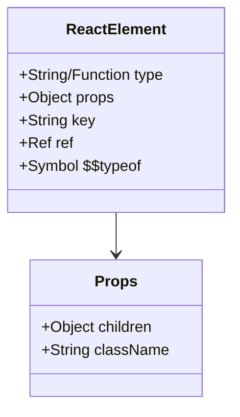
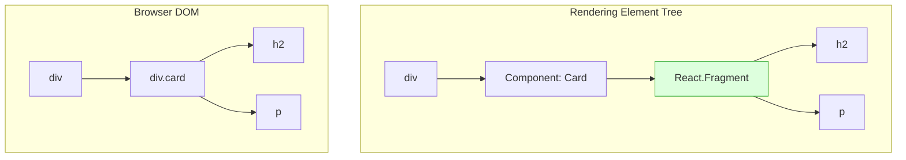
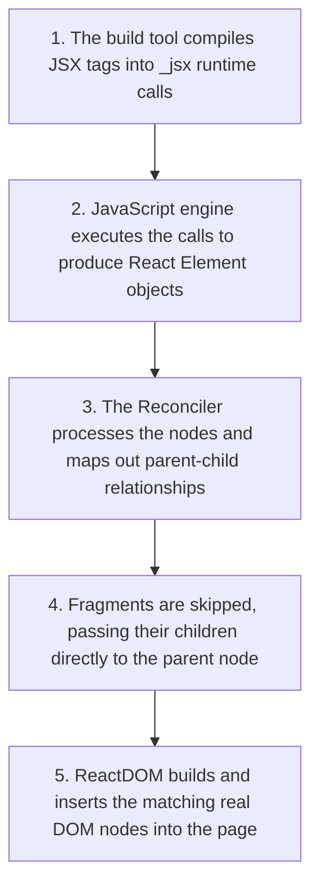

# JSX & React Elements Under the Hood

## Introduction

JSX is one of the most recognizable parts of React. It looks like HTML, but it is actually a syntax extension for JavaScript. It allows you to write UI markup directly alongside your component logic. This module goes deep under the hood to explain how JSX is compiled, how it transforms into standard JavaScript function calls, what a React Element actually contains in memory, and how React Fragments function.

---

## Why do we need this?

Writing raw JavaScript to describe complex nested layouts is tedious and hard to read. 

### Problem Statement
Consider creating a nested card structure containing an image, a header, a paragraph, and a button. Using raw JavaScript, you would have to write:

```javascript
// Raw JS DOM manipulation
const card = document.createElement('div');
card.className = 'card';
const title = document.createElement('h2');
title.textContent = 'Product Title';
card.appendChild(title);
// ... and so on
```

Writing and maintaining hundreds of lines of nested element creation in pure JavaScript is extremely difficult. We need a clean, visual template format that combines layout markup with programming logic.

---

## Real World Story

In 2013, when Facebook first introduced React and JSX at the JSConf US conference, the audience was highly skeptical. At the time, the gold standard of web design was **Separation of Concerns**: HTML belonged in `.html` files, CSS in `.css` files, and JS in `.js` files. 

React challenged this by combining markup and logic in the same file. The developers argued that separation of files is not the same as separation of concerns. Since UI layout is inherently coupled with display logic (e.g., hiding a button when loading), they created JSX. Over time, the industry realized that managing components as single, self-contained units was much more maintainable, and JSX became the standard format for modern frontend development.

---

## Real World Analogy

Think of JSX like a **Design Blueprint Template** compared to a **Brick-by-Brick Building Script**.

- **Without JSX (Writing raw JavaScript creation scripts)**: You call a brick factory and write instructions: *"Make a red brick of dimensions 10x5. Lay it at coordinates 0,0. Make another brick, paint it blue, and put it on top of the red one."*
- **With JSX (Drawing the template)**: You sketch the finished house on graph paper. The compiler reads your sketch and automatically translates it into the step-by-step brick factory instructions for the building crew. You get the speed of visual design with the precision of programmatic control.

---

## Visual Explanation

Below is a flow diagram showing the compilation path of JSX code as it passes through Babel/esbuild to become executable JavaScript elements.

### The Transpilation Pipeline
```
[JSX: <h1 className="title">Hello</h1>]
                │
                ▼ (Babel / esbuild Transpiler)
[JS: jsx('h1', { className: 'title', children: 'Hello' })]
                │
                ▼ (React Runtime executes code)
[React Element: { type: 'h1', props: { className: 'title', children: 'Hello' } }]
```

```mermaid
flowchart TD
    subgraph Source Code
        JSX[JSX Markup: &lt;div className='card'&gt;]
    end
    subgraph Compiler Phase
        Babel[Babel / esbuild transpiler] --> JS[JS Code: _jsx'div', { className: 'card' }]
    end
    subgraph React Engine Runtime
        JS --> Element[React Element: Plain JS Object]
        Element --> Reconciler[Fiber Reconciler]
    end
    JSX --> Babel
```

---

## Internal Working

JSX is not understood by browsers. Tools like Babel or esbuild compile JSX into standard JavaScript function calls.

Historically (React 16 and earlier), JSX compiled to `React.createElement`:
```jsx
// Before Compilation
<div id="root">Hello</div>

// After Compilation
React.createElement('div', { id: 'root' }, 'Hello');
```

In modern React (React 17+ and 19), a new compiler pipeline automatically imports a specialized entry point called the **JSX Runtime** (`react/jsx-runtime`):
```javascript
// Compiled using the modern JSX runtime
import { jsx as _jsx } from 'react/jsx-runtime';

_jsx('div', { id: 'root', children: 'Hello' });
```

This element generator returns a read-only object called a **React Element**. It represents a virtual snapshot of the UI:



The special `$$typeof: Symbol.for('react.element')` property is a security feature. It protects your application against Cross-Site Scripting (XSS) attacks by preventing malicious database JSON payloads from mimicking a React element node, as JSON cannot serialize Symbol values.

---

## Architecture

During the render cycle, React traverses the React Element tree. Element children are resolved recursively, creating a clean tree structure. When using React Fragments, React skips creating wrapping DOM nodes, optimizing performance and keeping layouts clean.



---

## Step-by-Step Flow

When React renders a JSX component tree, the following steps occur:



---

## Syntax

JSX follows strict syntax rules that differ from standard HTML:
1. **Single Root Element**: All JSX structures must be wrapped in a single parent tag or a Fragment (`<>...</>`).
2. **Close All Tags**: Self-closing tags (e.g., ``, `<input>`) must end with a forward slash (``).
3. **CamelCase Attributes**: Use `className` instead of `class`, and `htmlFor` instead of `for`.
4. **JavaScript Expressions**: Wrap JavaScript variables and logic in curly braces `{}`.

---

## Basic Example

Here is a basic component showing how JavaScript expressions are evaluated directly inside JSX.

```jsx
import React from 'react';

export default function UserGreeting() {
  const username = 'Devin';
  const isLoggedIn = true;

  return (
    <div>
      {/* Expressions inside curly braces are evaluated dynamically */}
      <h1>Welcome, {username}!</h1>
      <p>Status: {isLoggedIn ? 'Online' : 'Offline'}</p>
    </div>
  );
}
```

---

## Intermediate Example

An intermediate component showing list rendering and conditional layout branches. It highlights the use of Fragment wrappers to avoid creating unnecessary `div` elements in the final DOM output.

```jsx
import React from 'react';

const TASKS = [
  { id: 't1', name: 'Setup Vite', priority: 'High' },
  { id: 't2', name: 'Configure Aliases', priority: 'Medium' }
];

export default function TaskTable() {
  return (
    <table>
      <thead>
        <tr>
          <th>Task</th>
          <th>Priority</th>
        </tr>
      </thead>
      <tbody>
        {TASKS.map(task => (
          // Using a Fragment wrapper avoids adding unnecessary grouping elements in the table structure
          <React.Fragment key={task.id}>
            <tr>
              <td><strong>{task.name}</strong></td>
              <td>{task.priority}</td>
            </tr>
          </React.Fragment>
        ))}
      </tbody>
    </table>
  );
}
```

---

## Advanced Example

An advanced component illustrating direct usage of `React.createElement` to build a dynamic headline generator. This shows how React behaves when compiling JSX manually.

```jsx
import React from 'react';

// Manually creates elements based on passed heading level prop
function DynamicHeading({ level, children, ...props }) {
  // Level represents tags: 'h1', 'h2', 'h3', etc.
  return React.createElement(
    `h${level}`,
    { ...props, className: 'dynamic-heading' },
    children
  );
}

export default function CustomLayoutGenerator() {
  return (
    <div>
      <DynamicHeading level="1" style={{ color: 'purple' }}>
        Top Page Title (Manually Rendered)
      </DynamicHeading>
      <DynamicHeading level="3">
        Sub-section Title (Using createElement)
      </DynamicHeading>
    </div>
  );
}
```

---

## Production Example

A production-grade component demonstrating how to render dynamic rich text snippets safely. It sanitizes input using an external HTML processing reference to avoid Cross-Site Scripting (XSS) vulnerabilities.

```jsx
import React from 'react';

// Mock utility representing HTML sanitization
const sanitizeHTML = (dirty) => {
  // Real world implementation would use dompurify
  return dirty.replace(/<script.*?>.*?<\/script>/ig, '');
};

export default function SafeArticle({ title, richBody }) {
  const cleanBody = sanitizeHTML(richBody);

  return (
    <article className="safe-article" style={{ padding: '16px', border: '1px solid #ccc' }}>
      <header>
        {/* Dynamic header title rendered safely */}
        <h1>{title}</h1>
      </header>
      
      {/* Renders HTML content safely by checking keys and structures */}
      <section
        className="article-body"
        dangerouslySetInnerHTML={{ __html: cleanBody }}
        aria-live="polite"
      />
    </article>
  );
}
```

---

## Folder Structure

```
jsx-under-the-hood/
├── src/
│   ├── components/
│   │   └── SafeArticle.jsx
│   ├── App.jsx
│   └── main.jsx
├── package.json
└── vite.config.js
```

---

## Best Practices

💡 **Did You Know?**  
React elements are immutable. Once created, you cannot change their child elements or attributes. If you want to update the UI, you must trigger a state change to generate a new element tree.

🚀 **Best Practices**
- Use Fragments (`<>...</>`) to group elements without cluttering the DOM with unnecessary `div` wrappers.
- Keep JSX clean by moving complex logic out of inline expressions and into helper functions or variables.
- Wrap dynamic HTML content in sanitizers to protect your application from XSS vulnerabilities.

---

## Common Mistakes

⚠ **Common Mistakes**

### Returning Multiple Root Elements
JSX must compile to a single function call (`_jsx`). Returning multiple sibling root elements will throw a syntax compilation error.

```jsx
// ❌ WRONG
function PageHeader() {
  return (
    <h1>Site Header</h1>
    <p>Subtext</p> // Compilation Error: Adjacent JSX elements must be wrapped
  );
}

//  RIGHT
function PageHeader() {
  return (
    <>
      <h1>Site Header</h1>
      <p>Subtext</p>
    </> // Wrapped in a Fragment
  );
}
```

---

## Performance Notes

⚡ **Performance Tips**
Every time a component renders, React executes its JSX expressions and generates new element objects in memory. You can optimize performance by keeping static layout components outside the render function to avoid unnecessary allocations.

### Performance Example
Move static JSX variables outside the component to prevent them from being recreated on every render:

```jsx
// Define static configurations outside the component
const STATIC_CARD_HEADER = (
  <header className="card-header">
    <h3>Enterprise Console</h3>
    <hr />
  </header>
);

export function DashboardCard({ content }) {
  return (
    <div className="card">
      {STATIC_CARD_HEADER} {/* Reuses the same memory reference on every render */}
      <p>{content}</p>
    </div>
  );
}
```

---

## Accessibility Notes

♿ **Accessibility Tips**
- Remember to use `htmlFor` instead of `for` inside label tags so the label links correctly to its input.
- Use camelCase attributes like `tabIndex` instead of `tabindex` to ensure interactive elements are keyboard-navigable.

```jsx
// Accessible Form Control in JSX
export function AccessibleInput() {
  return (
    <div>
      <label htmlFor="user-email">Email Address</label>
      <input id="user-email" type="email" tabIndex={0} />
    </div>
  );
}
```

---

## SEO Notes

Ensure your JSX uses semantic markup tags. Avoid replacing paragraphs and headers with styled `div` tags, as search engine scrapers rely on semantic tags to index your page structure correctly.

---

## Interview Questions

🎯 **Interview Tips**  
If asked how JSX works under the hood, explain that JSX is compiled into standard JavaScript function calls (`_jsx` or `React.createElement`) by transpilers like Babel or esbuild.

### Q1: What is the purpose of a React Fragment?
**Answer**: React components must return a single root element. If you don't want to wrap sibling elements in an unnecessary `div` (which can break CSS Flexbox/Grid layouts and add bloat to the DOM tree), you wrap them in a Fragment (`<React.Fragment>` or the shorthand `<>...</>`). Fragments group sibling elements without adding a wrapping node to the actual DOM.

### Q2: What is the significance of the `$$typeof` property on a React Element object?
**Answer**: The `$$typeof` property is set to a unique JavaScript Symbol (`Symbol.for('react.element')`). This is a security feature that prevents Cross-Site Scripting (XSS) attacks. If an attacker tries to inject a mock React element object via a JSON API payload, the JSON cannot serialize Symbol values. React checks for the presence of this Symbol and will refuse to render the element if it is missing.

---

## MCQs

1. **Which tool is typically responsible for compiling JSX code into standard JavaScript?**
   - A) Node.js
   - B) Babel or esbuild
   - C) Prettier
   - D) ESLint
   - *Answer: B*

2. **In modern React versions (17+), what does JSX compile to?**
   - A) Native DOM API calls (`document.createElement`)
   - B) XML elements
   - C) `_jsx` runtime calls imported from `react/jsx-runtime`
   - D) Encoded binary formats
   - *Answer: C*

3. **Why must all JSX structures return a single root element?**
   - A) Because the browser DOM only allows one element per page.
   - B) Because JSX transpiles into a single function call, which can only return one value.
   - C) To enforce CSS encapsulation.
   - D) Because React elements are read-only.
   - *Answer: B*

4. **Which attribute is the correct JSX equivalent for the HTML label `for` attribute?**
   - A) `htmlFor`
   - B) `labelFor`
   - C) `link`
   - D) `className`
   - *Answer: A*

5. **How does the `$$typeof` Symbol property protect React applications?**
   - A) It speeds up the virtual DOM diffing process.
   - B) It prevents XSS attacks by ensuring objects cannot be faked via JSON payloads.
   - C) It resolves scope issues inside hooks.
   - D) It imports CSS variables into JavaScript.
   - *Answer: B*

---

## Practice Exercise

### Exercise 1: Manual Element Verification
Rewrite this JSX element into a manual `React.createElement` call:
```jsx
const element = <h1 id="title" className="main">Hello World</h1>;
```

*Solution*:
```javascript
const element = React.createElement('h1', { id: 'title', className: 'main' }, 'Hello World');
```

### Exercise 2: Dynamic CSS Classes
Create a component that changes its class name dynamically between `"active"` and `"inactive"` based on a boolean prop.

### Exercise 3: Sibling Element Rendering
Write a component that outputs three list items containing text, wrapped in a React Fragment, and mount it inside a `<ul>` tag in your root app.

---

## Debugging Exercise

### The Adjacent JSX Sibling Bug
A developer wants to render a list of description paragraphs, but the compiler throws a syntax error. Identify the bug and fix it.

```jsx
import React from 'react';

export default function Glossary() {
  return (
    // BUG: Missing wrapper for sibling elements
    <h3>Glossary</h3>
    <dt>Virtual DOM</dt>
    <dd>A copy of the actual browser DOM.</dd>
  );
}
```

#### Solution
Wrap the adjacent sibling elements in a Fragment wrapper to ensure the component returns a single compiled node:

```jsx
import React from 'react';

export default function Glossary() {
  return (
    <>
      <h3>Glossary</h3>
      <dt>Virtual DOM</dt>
      <dd>A copy of the actual browser DOM.</dd>
    </>
  );
}
```

---

## Real-world Scenario

You are building a dynamic form generator that renders form controls based on a JSON configuration schema received from a backend API. Explain how you would render these inputs dynamically without using conditional JSX loops.
- **Design Strategy**: Create a map of form components. Look up the appropriate component using the input field type from the schema, and instantiate it using `React.createElement(componentMap[field.type], { ...field.props })` to render the correct input field dynamically.

---

## Interview Coding Question

### Problem Statement
Write a React component that dynamically creates and renders an HTML tag based on a tag name passed as a prop (e.g., if tag name is `"h1"`, render `<h1>`). Include standard styling and aria attributes.

```jsx
import React from 'react';

export default function CustomElementTag({ tagName, content, cssClass }) {
  // Maps target tagName to local capitalize variable to let JSX parse it as a component tag
  const CustomTag = tagName || 'div';

  return (
    <CustomTag className={cssClass} aria-live="polite">
      {content}
    </CustomTag>
  );
}
```

---

## Mini Project

### JSX Runtime Inspector
Create a React playground dashboard:
- Provides a textarea input where users can type simple markup.
- Simulate and show on screen how this translates to a virtual JavaScript object tree (render the object properties live in a `<pre>` element).
- Provide options to toggle Fragment wraps and view how the node tree structure changes.

---

## Summary

🧠 **Memory Tricks**  
`JSX is a Mask` - JSX looks like HTML, but it's just a mask for JavaScript function calls. Under every `<tag>` is a function call returning a plain JavaScript object.

📖 **Summary**  
JSX is an expressive XML-like syntax extension compiled into React runtime calls (`_jsx` or `createElement`). These functions generate immutable React Element objects containing key security Symbols, which are then passed to the reconciler to build the browser DOM tree.

---

## Cheat Sheet

```javascript
// Old JSX Transpiler compilation
React.createElement(type, props, children);

// New JSX Transpiler compilation
import { jsx as _jsx } from 'react/jsx-runtime';
_jsx(type, props);
```

---

## Related Topics
- [The Virtual DOM Rendering Cycle](virtual-dom)
- [Props & Unidirectional Data Flow](../phase-2-components-jsx/props-data-flow)

---

## Further Reading
- [React Docs: Writing Markup with JSX](https://react.dev/learn/writing-markup-with-jsx)
- [Babel JS: Online Transpiler Tool](https://babeljs.io/repl)
