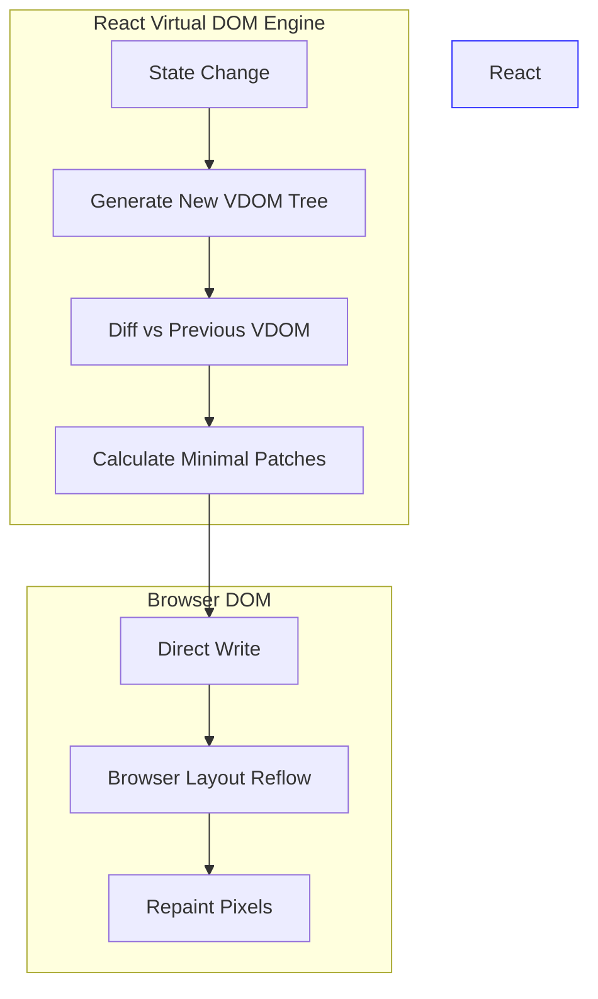
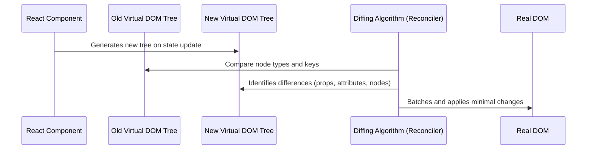
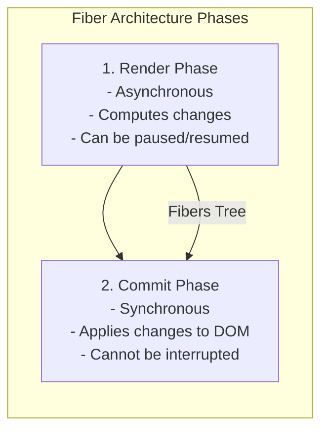
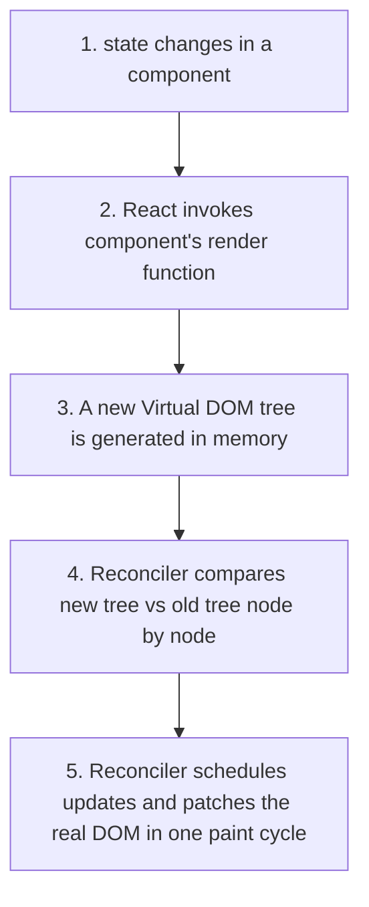

# The Virtual DOM & Reconciliation Engine

## Introduction

At the heart of React's high performance and developer-friendly declarative style lies the **Virtual DOM** and the **Reconciliation Engine**. Instead of directly mutating the browser's Document Object Model (DOM), React maintains a lightweight representation of the UI in memory. This module covers how the browser renders elements, why direct DOM edits are slow, and how React's diffing engine updates the page efficiently.

---

## Why do we need this?

Browser DOM nodes are heavy JavaScript objects with hundreds of properties. Modifying a DOM node triggers a series of layout operations that are computationally expensive. 

### Problem Statement
When a DOM node is added, removed, or has its styles updated, the browser must:
1. **Recalculate Styles**: Compute the CSS rules that apply to every element.
2. **Layout (Reflow)**: Calculate the exact geometry (width, height, position) of every element on the screen.
3. **Paint (Repaint)**: Fill in the pixels of the elements.
4. **Composite**: Layer the elements on the screen.

If an application performs dozens of separate DOM writes in a short period (e.g., in a loop), the browser is forced to run the reflow and repaint cycles repeatedly, causing stuttering animations, lag, and poor performance (DOM Thrashing).

---

## Real World Story

During the early 2010s, single-page frameworks like Backbone.js and AngularJS relied on two-way data binding. When data changed, the framework would immediately locate the corresponding HTML element and update it, or rebuild entire sections of the page. 

As apps grew larger, complex loops of updates occurred: updating data model A changed view B, which updated model C, forcing view D to redraw. This led to "dirty checking" cycles that ground browsers to a halt. React's creators decided to solve this by creating a virtual copy of the DOM. By diffing two virtual states in memory, React could batch updates and apply only the necessary changes to the real DOM.

---

## Real World Analogy

Think of the browser's DOM like a **Heavy Stone Castle** and the Virtual DOM like a **Architect's Blueprint**.

- **Imperative DOM Manipulation (Rebuilding the Castle)**: If you decide to add a window, move a door, and repaint a wall, you send stonemasons to immediately chisel the stone castle. If you make a mistake, you have to tear down the wall and start over, which is slow and exhausting.
- **Virtual DOM (Drafting on the Blueprint)**: You sit in an office with a blueprint of the castle. You erase the window location, draw a new door, and paint the sketch wall blue. You erase and redraw as many times as you like. When the blueprint is perfect, you compare it to the old blueprint, calculate the exact bricks that need to move, and hand the masons a single, optimal patch instruction: *"Move these three bricks and paint this single section."*

---

## Visual Explanation

Below is a flowchart comparing how updates flow through the standard DOM vs. the Virtual DOM pipeline.

### Direct DOM Update Pipeline (Slow)
```
[State Change] ──> [Direct DOM Write] ──> [Browser Style Re-calc] ──> [Reflow] ──> [Repaint]
```

### React Virtual DOM Pipeline (Fast)
```
[State Change] ──> [New VDOM Tree] ──> [Diff vs Old VDOM] ──> [Batched DOM Patch] ──> [Reflow & Repaint]
```



---

## Internal Working

The Virtual DOM is not a separate technology; it is a tree of plain JavaScript objects. Here is how a React Element is represented behind the scenes.

```javascript
// A JSX element: <div className="card"><h1>Hello</h1></div> compiles to:
{
  type: 'div',
  props: {
    className: 'card',
    children: [
      {
        type: 'h1',
        props: { children: 'Hello' }
      }
    ]
  }
}
```

When rendering, React uses an algorithm to compare the new virtual tree with the old virtual tree. Under the hood, comparing two trees has an algorithmic complexity of $O(n^3)$. To make this practical, React implements a heuristic $O(n)$ diffing algorithm based on two key assumptions:
1. **Different Types**: Two elements of different types (e.g., changing a `<div>` to a `<p>`) will produce different trees. React will tear down the old tree and build the new one from scratch.
2. **Stable Keys**: List elements can be marked with a unique, stable `key` prop, allowing React to match children across different renders.



---

## Architecture

React's reconciliation engine has evolved. React 16+ uses the **Fiber Reconciler**, which breaks the rendering work into small units called "fibers". Unlike the old Stack Reconciler which rendered recursively and could not be paused, Fiber works asynchronously.



---

## Step-by-Step Flow

When a state change occurs, the following engine phases are executed:



---

## Syntax

There is no custom syntax for the Virtual DOM, as React manages it automatically. However, developers interact with it indirectly via keys when rendering dynamic lists.

```jsx
// List keys help React reconcile child elements efficiently
{items.map((item) => (
  <ListItem key={item.id} value={item.value} />
))}
```

---

## Basic Example

Here is a component that triggers a re-render by changing state. Although the entire JSX structure is returned on every render, React will only modify the text content of the paragraph in the browser DOM.

```jsx
import React, { useState } from 'react';

export default function TextUpdater() {
  const [text, setText] = useState('Initial Text');

  return (
    <div className="container">
      <h2>Virtual DOM Matcher</h2>
      <p>{text}</p>
      {/* Typing only updates the paragraph DOM node, leaving the container intact */}
      <input type="text" value={text} onChange={(e) => setText(e.target.value)} />
    </div>
  );
}
```

---

## Intermediate Example

An intermediate example showing how element types affect reconciliation. Clicking the toggle changes the container element from a `div` to a `section`. According to React's diffing rules, changing the tag type destroys the subtree, dismantling the state of any child components.

```jsx
import React, { useState } from 'react';

// Child component that maintains local state
function StatefulCounter() {
  const [count, setCount] = useState(0);
  return (
    <button onClick={() => setCount(count + 1)}>
      Local Counter: {count}
    </button>
  );
}

export default function SubtreeRemounter() {
  const [useSection, setUseSection] = useState(false);

  // Switching wrapper type causes React to rebuild the entire subtree, resetting the counter state
  return useSection ? (
    <section style={{ border: '2px solid red', padding: '10px' }}>
      <h4>Wrapped in SEC</h4>
      <StatefulCounter />
      <button onClick={() => setUseSection(false)}>Change Wrapper</button>
    </section>
  ) : (
    <div style={{ border: '2px dashed blue', padding: '10px' }}>
      <h4>Wrapped in DIV</h4>
      <StatefulCounter />
      <button onClick={() => setUseSection(true)}>Change Wrapper</button>
    </div>
  );
}
```

---

## Advanced Example

An advanced example showing reconciliation behavior inside complex list structures. It highlights why stable keys are critical when items are dynamically re-ordered, added, or removed.

```jsx
import React, { useState } from 'react';

export default function TaskListReconciler() {
  const [tasks, setTasks] = useState([
    { id: '1', title: 'Code Reconciler' },
    { id: '2', title: 'Write Tests' },
    { id: '3', title: 'Deploy Sandbox' }
  ]);

  // Moves the last item to the top
  const rotateTasks = () => {
    setTasks(prev => {
      const copy = [...prev];
      const last = copy.pop();
      if (last) copy.unshift(last);
      return copy;
    });
  };

  return (
    <div style={{ padding: '16px', maxWidth: '400px' }}>
      <h3>Active Task Board</h3>
      <button onClick={rotateTasks} style={{ marginBottom: '12px' }}>
        Move Last Task to Top
      </button>
      <ul>
        {tasks.map(task => (
          // Using stable task.id instead of list index prevents React from re-rendering unchanged elements
          <li key={task.id} style={{ padding: '6px', margin: '4px 0', background: '#eaeaea' }}>
            {task.title} (ID: {task.id})
          </li>
        ))}
      </ul>
    </div>
  );
}
```

---

## Production Example

A production-grade grid system showing dynamic items rendering. It handles high-frequency updates, checks key integrity, and implements component visual boundary logging to monitor layout updates.

```jsx
import React, { useState, useEffect } from 'react';

// Memoized Grid Item to avoid unnecessary re-renders
const GridCell = React.memo(({ cell, onToggle }) => {
  // Log renders to track reconciliation performance
  console.log(`Rendering Cell ID: ${cell.id}`);
  return (
    <div
      onClick={() => onToggle(cell.id)}
      style={{
        width: '60px',
        height: '60px',
        display: 'flex',
        alignItems: 'center',
        justifyContent: 'center',
        backgroundColor: cell.active ? '#4caf50' : '#cfd8dc',
        cursor: 'pointer',
        userSelect: 'none',
        borderRadius: '4px'
      }}
    >
      {cell.value}
    </div>
  );
});

export default function PerformanceGrid() {
  const [grid, setGrid] = useState(() =>
    Array.from({ length: 9 }, (_, i) => ({
      id: `cell-${i}`,
      value: i + 1,
      active: false
    }))
  );

  const handleToggle = (id) => {
    setGrid(prevGrid =>
      prevGrid.map(cell =>
        cell.id === id ? { ...cell, active: !cell.active } : cell
      )
    );
  };

  return (
    <div style={{ padding: '20px' }}>
      <h2>Reconciliation Benchmarking</h2>
      <p>Only the toggled cell renders in the console.</p>
      <div style={{ display: 'grid', gridTemplateColumns: 'repeat(3, 70px)', gap: '10px' }}>
        {grid.map(cell => (
          <GridCell
            key={cell.id} // Stable ID key prevents grid-wide re-renders
            cell={cell}
            onToggle={handleToggle}
          />
        ))}
      </div>
    </div>
  );
}
```

---

## Folder Structure

```
virtual-dom-demo/
├── src/
│   ├── components/
│   │   └── PerformanceGrid.jsx
│   ├── App.jsx
│   └── main.jsx
├── index.html
└── package.json
```

---

## Best Practices

💡 **Did You Know?**  
The Virtual DOM is not faster than direct DOM manipulation. If you know the exact DOM node that needs to change, updating it manually is faster. The Virtual DOM is fast because it calculates the changes for you, ensuring your application remains performant without requiring you to write complex, manual DOM updates.

🚀 **Best Practices**
- Always use unique, stable keys (like IDs from your database) when rendering lists. Avoid using the array index as a key, as it can cause rendering bugs when list items are sorted or filtered.
- Keep components pure. Render functions should only compute JSX based on current props and state, without side effects.
- Match node nesting structures. Changing wrapper element types forces React to tear down and rebuild the entire subtree.

---

## Common Mistakes

⚠ **Common Mistakes**

### Index as List Keys
Using array index values as keys is a common anti-pattern. If list items are sorted or items are inserted at the beginning, React assumes the elements are unchanged because their indexes remain the same, leading to incorrect state binding in inputs.

```jsx
// ❌ WRONG
{items.map((item, index) => (
  <ListItem key={index} data={item} /> // State bugs on list sort
))}

//  RIGHT
{items.map((item) => (
  <ListItem key={item.uniqueId} data={item} /> // Safe and optimized
))}
```

---

## Performance Notes

⚡ **Performance Tips**
React reconciles elements in two main phases:
1. **Render Phase**: Compares virtual elements. This is fast and runs entirely in memory.
2. **Commit Phase**: Writes updates to the browser DOM. This is the slower phase because it triggers layout calculations.

### Performance Example
You can prevent render-phase evaluations by using `React.memo` on components that receive stable props:

```jsx
import React from 'react';

// Component will skip virtual diffing unless data prop changes
const StaticBanner = React.memo(({ data }) => {
  return <div className="banner">{data.title}</div>;
});
```

---

## Accessibility Notes

♿ **Accessibility Tips**
- When elements are dynamically added or removed from the DOM, screen reader focus can be lost. Use `tabIndex` controls and focus refs to guide screen readers when elements mount or disappear.
- Use `aria-expanded` and `aria-hidden` attributes to inform assistive devices about visibility state changes.

---

## SEO Notes

Search engines like Google index client-rendered React apps by executing JavaScript. However, they may delay rendering pages that require heavy Virtual DOM diffing. Pre-rendering ensures your site indexes quickly.

---

## Interview Questions

🎯 **Interview Tips**  
In interviews, don't just say "the Virtual DOM makes React fast." Be specific: explain that it minimizes reflow and repaint cycles by diffing virtual trees in memory and batching writes to the real DOM.

### Q1: What is Reconciliation in React?
**Answer**: Reconciliation is the process through which React updates the browser's DOM. When a component's state changes, React generates a new Virtual DOM tree. It then compares (diffs) this new tree with the previous one, calculates the differences, and applies only the necessary updates to the real DOM.

### Q2: Why is using index values as keys in lists discouraged?
**Answer**: React uses keys to identify which list items have changed, been added, or been removed. If you use the array index as the key and the list is re-ordered (e.g., sorted or items inserted at the top), the indexes change. This causes React to map state incorrectly to the wrong elements, resulting in visual bugs and unnecessary DOM updates.

---

## MCQs

1. **What is the primary performance drawback of direct browser DOM updates?**
   - A) Browsers do not support JavaScript modifications.
   - B) Direct writes trigger expensive style calculations, reflows, and repaints.
   - C) DOM nodes can only hold string formats.
   - D) Direct mutations delete event bindings.
   - *Answer: B*

2. **What is a React Virtual DOM node under the hood?**
   - A) A WebAssembly representation of the browser view.
   - B) A shadow document fragment hosted on a background thread.
   - C) A plain lightweight JavaScript object describing a UI element.
   - D) A standard HTML DOM node template.
   - *Answer: C*

3. **What is the algorithmic complexity of React's heuristic diffing algorithm?**
   - A) $O(n \log n)$
   - B) $O(n^3)$
   - C) $O(n)$
   - D) $O(1)$
   - *Answer: C*

4. **Which reconciler engine was introduced in React 16 to enable asynchronous rendering?**
   - A) Stack Reconciler
   - B) Shadow Reconciler
   - C) Fiber Reconciler
   - D) Flux Reconciler
   - *Answer: C*

5. **What happens during React's Commit Phase?**
   - A) React generates a new Virtual DOM tree.
   - B) React compares props and states.
   - C) React applies the computed changes to the actual browser DOM.
   - D) The component state is reset to its initial value.
   - *Answer: C*

---

## Practice Exercise

### Exercise 1: State Isolation Verification
Write a component that toggles a wrap container style but keeps the child input values intact by using the same tag type.

### Exercise 2: Key Tracker
Create a component that renders a list of items. Add a button that shuffles the list. Print a console message to verify if child components re-render when list items change index.

### Exercise 3: Type Mutation Test
Create a component that toggles between rendering `<input type="text" />` and `<textarea />`. Verify that the typed text is reset because React recreates the element from scratch when its type changes.

---

## Debugging Exercise

### The Jumping Input Cursor Bug
A developer is rendering a list of input fields, but every time they type a character, the input field loses focus and the cursor jumps to the end of the text. Identify the bug and write the fix.

```jsx
import React, { useState } from 'react';

export default function InputList() {
  const [fields, setFields] = useState(['First', 'Second']);

  return (
    <div>
      {fields.map((field, index) => (
        // BUG: Using array index as the key combined with text editing
        <input
          key={index}
          value={field}
          onChange={(e) => {
            const copy = [...fields];
            copy[index] = e.target.value;
            setFields(copy);
          }}
        />
      ))}
    </div>
  );
}
```

#### Solution
When the array index is used as a key and the list items change, React struggles to track the identity of each input node correctly. It rebuilds the input element on every character change, causing it to lose focus. To fix this, use unique stable keys:

```jsx
// Corrected
const [fields, setFields] = useState([
  { id: 'f1', text: 'First' },
  { id: 'f2', text: 'Second' }
]);
// ...
{fields.map((field) => (
  <input
    key={field.id} // Stable unique ID key
    value={field.text}
    onChange={(e) => {
      setFields(prev => prev.map(f => f.id === field.id ? { ...f, text: e.target.value } : f));
    }}
  />
))}
```

---

## Real-world Scenario

You are building a real-time trading dashboard displaying hundreds of transactions per second. The UI suffers from lag and high CPU usage. Explain how you would optimize this using your knowledge of React's reconciliation engine.
- **Optimization Strategy**: Use stable keys for transactions, implement `React.memo` to skip diffing unchanged rows, batch state updates, and use CSS transforms instead of layout-altering properties (like width/height) to avoid layout reflows.

---

## Interview Coding Question

### Problem Statement
Write a component that renders a list of 500 random metrics. Include a button to filter elements above a threshold. Ensure that:
- Metrics use stable keys.
- You print a message when items mount, demonstrating that only the filtered nodes remain in the DOM.

```jsx
import React, { useState, useEffect } from 'react';

function MetricItem({ metric }) {
  useEffect(() => {
    console.log(`Mounted: ${metric.id}`);
    return () => console.log(`Unmounted: ${metric.id}`);
  }, [metric.id]);

  return <li>Metric {metric.id}: {metric.value}</li>;
}

export default function MetricsMonitor() {
  const [metrics] = useState(() =>
    Array.from({ length: 10 }, (_, i) => ({
      id: `m-${i}`,
      value: Math.floor(Math.random() * 100)
    }))
  );
  const [filterActive, setFilterActive] = useState(false);

  const displayedMetrics = filterActive
    ? metrics.filter(m => m.value > 50)
    : metrics;

  return (
    <div>
      <button onClick={() => setFilterActive(!filterActive)}>
        {filterActive ? 'Show All' : 'Show > 50'}
      </button>
      <ul>
        {displayedMetrics.map(m => (
          <MetricItem key={m.id} metric={m} />
        ))}
      </ul>
    </div>
  );
}
```

---

## Mini Project

### Blueprint vs Castle Simulator
Create a visual dashboard that acts as a diff visualizer:
- Maintain an array of objects representing "Nodes" in state.
- Render these nodes as boxes on screen.
- Provide buttons to: Add a node, delete a node, change a node's color, or swap two nodes.
- Highlight the visual boxes that represent the nodes React actually modified by flashing their border green on update (using a CSS transition triggered by state updates).

---

## Summary

🧠 **Memory Tricks**  
`Blueprint vs Castle` - The Virtual DOM is a blueprint. The browser DOM is a stone castle. Building a blueprint is cheap and quick; rebuilding a castle is slow and expensive.

📖 **Summary**  
React's Virtual DOM in-memory representation allows components to declare their structure while the reconciler batches updates. By utilizing a heuristic $O(n)$ diffing algorithm and stable list keys, React minimizes reflow and repaint performance hits on the browser DOM.

---

## Cheat Sheet

```javascript
// Rule 1: Type change resets state
// <div><Counter /></div> -> <section><Counter /></section> (Counter resets)

// Rule 2: Keys must be stable
// Use item.id (Good) vs index (Avoid in dynamic lists)
```

---

## Related Topics
- [React JSX & Under the Hood](jsx-under-the-hood)
- [React Hook Lifecycle](../phase-4-hooks/useeffect-lifecycle)

---

## Further Reading
- [React Docs: Reconciliation Algorithm](https://react.dev/reference/react/dom)
- [Vytas Butkus: React Fiber Architecture Explained](https://github.com/acdlite/react-fiber-architecture)
