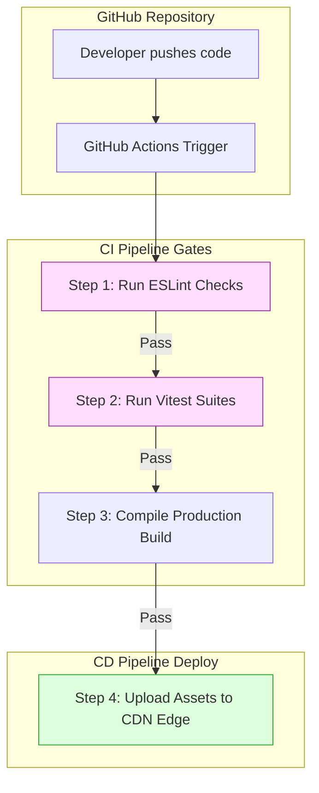
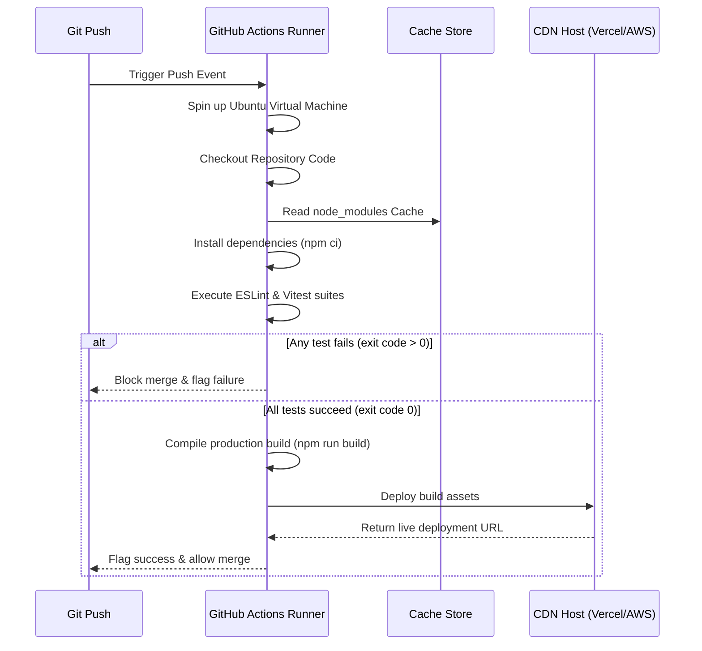
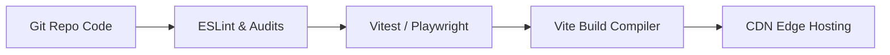
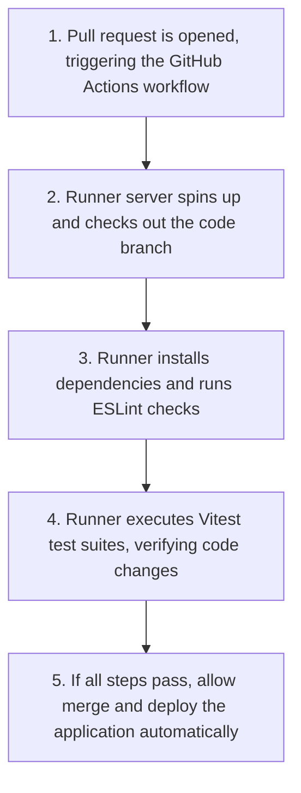

# CI/CD Pipelines & Automation

## Introduction

In team environments, manual testing, building, and deploying code leads to desynchronized environments, bugs, and deployment failures. To prevent this, professional engineering teams use **Continuous Integration & Continuous Delivery (CI/CD)** pipelines. CI/CD automates quality gates (linting, formatting, running tests) and deployments on every code change. This module covers writing automated pipeline scripts, configuring quality check gates, and setting up automated deployments using **GitHub Actions**.

---

## Why do we need this?

Relying on developers to run linters, tests, and build scripts manually before merging code is error-prone, leading to broken builds in production.

### Problem Statement
Consider a team of 5 developers working on a React application.
1. Developer Alice makes changes to a shared component and submits a pull request.
2. She forgets to run the test suite locally, missing a breaking change that breaks the app's billing form.
3. Developer Bob reviews the code and merges the pull request.
4. The deployment script is triggered manually from Bob's local terminal, which has different environment variables configured.
5. The application crashes in production, blocking users from checkout.

We need a CI/CD pipeline that runs automatically on every pull request to verify that the code compiles, linters pass, and all tests succeed before allowing changes to be merged or deployed.

---

## Real World Story

In the early days of web development, deploying applications required manual steps: uploading files over FTP, running shell build scripts on production servers, and database updates.

This made deployments risky and slow. In 2018, GitHub released **GitHub Actions**, integrating workflow automation directly into code repositories. This allowed teams to write pipeline configurations as simple YAML files inside their projects. When a developer pushed code, GitHub started runner servers in the cloud to test, build, and deploy the application automatically, turning deployments into a routine, automated process.

---

## Real World Analogy

Think of CI/CD pipelines like a **High-Security Quality Control Tunnel** compared to **Inspecting Cars manually**.

- **Manual Deployments (Manual Inspection)**: You build a car. A quality manager walks around, kicks the tires, and checks the oil (running tests manually). They get distracted, forget to check the brakes, and ship the car to the customer. If the brakes fail, you crash.
- **CI/CD Automation (Quality Control Tunnel)**: You build a car and drive it into a high-security quality control tunnel (automated pipeline). Laser scanners verify wheel alignments (ESLint), robotic arms stress-test the doors (Unit tests), and test tracks check the brakes (Integration tests). If any test fails, the tunnel exit gate remains locked (blocks merge). The car only leaves the factory if all quality checks pass.

---

## Visual Explanation

Below is a diagram showing the automated workflow path from code push to testing gates and deployment.

### Automated CI/CD Pipeline Flow
```
[Code Push] ──> [Run ESLint & Prettier] ──> [Run Vitest Suites] ──> [Run Build Compiler] ──> [Deploy to CDN]
```



---

## Internal Working

GitHub Actions reads workflow configurations defined in YAML files inside the `.github/workflows/` directory.

When a trigger event (such as pushing code or opening a pull request) occurs:
1. GitHub starts a clean virtual machine runner (e.g., Ubuntu Linux) in the cloud.
2. The runner checks out your code repository: `actions/checkout`.
3. It installs the project dependencies: `npm ci`.
4. It executes your defined quality checks: `npm run lint` and `npm run test`.
5. If any command returns a non-zero exit code (failure), the runner stops execution and flags the pull request as failed, blocking merges.
6. If all commands succeed, the runner builds and deploys the assets, updating the live site.



---

## Architecture

An automated CI/CD pipeline acts as a bridge, running security audits, code linters, test suites, and compiler checks before delivering updates to hosting platforms.



---

## Step-by-Step Flow

When a developer submits a pull request, the following pipeline steps execute automatically:



---

## Syntax

```yaml
# .github/workflows/ci.yml (GitHub Actions YAML Syntax)
name: Continuous Integration

on:
  push:
    branches: [main]
  pull_request:
    branches: [main]

jobs:
  quality-checks:
    runs-on: ubuntu-latest
    steps:
      - name: Checkout Code
        uses: actions/checkout@v4

      - name: Set up Node.js
        uses: actions/setup-node@v4
        with:
          node-version: 20

      - name: Install Dependencies
        run: npm ci

      - name: Run Linter
        run: npm run lint

      - name: Run Test Suites
        run: npm test
```

---

## Basic Example

Here is a basic YAML workflow script that runs linter checks on every pull request.

```yaml
# File Path: .github/workflows/lint.yml
name: Code Quality Check

on: [pull_request] # Run on all pull requests

jobs:
  linting:
    runs-on: ubuntu-latest
    steps:
      # 1. Download repository code
      - name: Checkout Code
        uses: actions/checkout@v4

      # 2. Configure Node.js environment
      - name: Setup Node
        uses: actions/setup-node@v4
        with:
          node-version: 18

      # 3. Clean install dependencies
      - name: Install dependencies
        run: npm ci

      # 4. Execute ESLint rules check
      - name: Run Linter
        run: npm run lint
```

---

## Intermediate Example

An intermediate workflow script that runs unit tests, caches `node_modules` to speed up pipeline runs, and compiles a production build to verify there are no compilation errors.

```yaml
# File Path: .github/workflows/test-build.yml
name: Verify Build & Test

on:
  push:
    branches: [main]
  pull_request:
    branches: [main]

jobs:
  verify:
    runs-on: ubuntu-latest
    steps:
      - name: Checkout Code
        uses: actions/checkout@v4

      - name: Setup Node
        uses: actions/setup-node@v4
        with:
          node-version: 20
          cache: 'npm' # Auto-cache node_modules dependencies

      - name: Install Dependencies
        run: npm ci

      - name: Run Vitest Suites
        run: npm run test -- --run # Run tests in non-watch mode once

      - name: Compile Production Build
        run: npm run build
```

---

## Advanced Example

An advanced pipeline workflow script that runs quality checks and deploys the compiled build assets to hosting platforms (like Vercel) on successful builds.

```yaml
# File Path: .github/workflows/deploy.yml
name: Deploy Production Portal

on:
  push:
    branches: [main]

jobs:
  deploy:
    runs-on: ubuntu-latest
    steps:
      - name: Checkout Code
        uses: actions/checkout@v4

      - name: Setup Node
        uses: actions/setup-node@v4
        with:
          node-version: 20

      - name: Install Dependencies
        run: npm ci

      - name: Run Test Suites
        run: npm test

      - name: Compile Production Build
        run: npm run build

      # Deploy assets using Vercel CLI Action integration
      - name: Deploy to Vercel
        uses: amondnet/vercel-action@v20
        with:
          vercel-token: ${{ secrets.VERCEL_TOKEN }} # Secure API token from repository secrets
          vercel-org-id: ${{ secrets.ORG_ID }}
          vercel-project-id: ${{ secrets.PROJECT_ID }}
          vercel-args: '--prod'
```

---

## Production Example

A production-grade CI/CD pipeline featuring security vulnerability scans, concurrent jobs configurations, deployment environment settings, and slack notification alerts on failure.

```yaml
# File Path: .github/workflows/production-pipeline.yml
name: Corporate Enterprise Pipeline

on:
  push:
    branches: [main, release/*]

jobs:
  security-audit:
    runs-on: ubuntu-latest
    steps:
      - uses: actions/checkout@v4
      - name: Audit NPM dependencies
        run: npm audit --audit-level=high # Scan dependencies for security vulnerabilities

  quality-gate:
    needs: security-audit # Wait for security audit to pass
    runs-on: ubuntu-latest
    steps:
      - uses: actions/checkout@v4
      - uses: actions/setup-node@v4
        with:
          node-version: 20
          cache: 'npm'
      - run: npm ci
      - run: npm run lint
      - run: npm run test

  deploy-production:
    needs: quality-gate # Wait for quality checks to pass
    runs-on: ubuntu-latest
    environment: production # Lock environment settings and secrets
    steps:
      - uses: actions/checkout@v4
      - uses: actions/setup-node@v4
        with:
          node-version: 20
      - run: npm ci
      - run: npm run build
      
      # Mock deploy action (e.g. AWS S3 Upload)
      - name: Deploy to CDN Storage
        run: echo "Uploading assets to global CDN..."
        
      # Send slack alert on pipeline failure
      - name: Notify Slack on failure
        if: failure()
        run: |
          echo "Sending Slack webhook alert: Production Pipeline failed."
```

---

## Folder Structure

```
cicd-automation/
├── .github/
│   └── workflows/
│       ├── ci.yml
│       └── deploy.yml
├── src/
│   ├── App.jsx
│   └── main.jsx
├── package.json
└── vite.config.js
```

---

## Best Practices

💡 **Did You Know?**  
GitHub Actions workflows run in isolated runner environments. You can secure sensitive credentials (like API keys or deployment tokens) by storing them in the repository's **GitHub Secrets** configuration, preventing them from being exposed in your public code.

🚀 **Best Practices**
- Cache dependencies (`node_modules`) inside your workflows to speed up pipeline runs.
- Run tests in non-watch mode (`vitest run` or Jest `--runInBand`) to ensure the test runner exits correctly on completion.
- Configure environment protection rules for production deployments to lock deploy actions behind team review approvals.

---

## Common Mistakes

⚠ **Common Mistakes**

### Running Test suites in Watch Mode
Running test suites in watch mode inside your workflows is a common mistake. Since watch mode keeps the process running, the GitHub Actions runner waits infinitely for updates, eventually timing out and failing the build.

```yaml
# ❌ WRONG (Pipeline hangs and times out)
- name: Run Tests
  run: npm run test # Keeps watch process active

#  RIGHT
- name: Run Tests
  run: npm run test -- --run # Run tests once and exit
```

---

## Performance Notes

⚡ **Performance Tips**
Configure concurrent build rules inside your workflows. Using the `concurrency` configuration allows you to cancel ongoing runs automatically if a developer pushes new commits, saving runner resources.

```yaml
# Cancel ongoing pipeline runs on new commits
concurrency:
  group: ${{ github.workflow }}-${{ github.ref }}
  cancel-in-progress: true
```

---

## Accessibility Notes

♿ **Accessibility Tips**
Integrate accessibility audit checks (like `lhci` Lighthouse CI audits) inside your workflows to scan pages for accessibility violations automatically on every build.

---

## SEO Notes

Automating quality checks and build validations prevents broken HTML templates and missing SEO tags from being deployed, keeping site indexations stable.

---

## Interview Questions

🎯 **Interview Tips**  
In an interview, define CI/CD as automated quality and deployment pipelines. Explain that GitHub Actions runs workflows inside virtual machines, validating linting, testing, and compilation rules on every code push.

### Q1: What is the difference between Continuous Integration (CI) and Continuous Delivery (CD)?
**Answer**: Continuous Integration (CI) is the practice of automatically building, linting, and testing code changes on every commit or pull request to verify code quality. Continuous Delivery (CD) is the practice of automatically deploying the compiled, validated build assets to staging or production hosting environments once all CI checks pass.

### Q2: Why should you run `npm ci` instead of `npm install` inside CI/CD workflows?
**Answer**: `npm ci` is designed specifically for automated testing and CI environments. Unlike `npm install` (which can update `package-lock.json` and install minor dependency updates), `npm ci` deletes the local `node_modules` folder, reads the lock file strictly, and installs the exact versions of dependencies configured, ensuring consistent builds.

---

## MCQs

1. **Which NPM command should be used to install dependencies in CI/CD pipelines?**
   - A) `npm install`
   - B) `npm ci`
   - C) `npm update`
   - D) `npm add`
   - *Answer: B*

2. **Why does running tests in watch mode inside workflows cause builds to fail?**
   - A) Watch mode is not supported by Node.js.
   - B) Watch mode keeps the process active, causing the runner virtual machine to wait infinitely and eventually time out.
   - C) Watch mode requires database access.
   - D) It violates security rules.
   - *Answer: B*

3. **Where should you store sensitive credentials (like API deployment tokens) for workflows?**
   - A) Hardcoded inside the workflow YAML file.
   - B) In the repository's GitHub Secrets settings.
   - C) In a public `.env` file.
   - D) In the browser cookie configuration.
   - *Answer: B*

4. **What does the `concurrency` setting do in GitHub Actions?**
   - A) It runs tests on multiple threads.
   - B) It cancels ongoing workflow runs on the same branch automatically when new commits are pushed, saving resources.
   - C) It connects database instances.
   - D) It minifies styling files.
   - *Answer: B*

5. **Which file format is used to configure GitHub Actions workflows?**
   - A) XML
   - B) YAML (`.yml` or `.yaml`)
   - C) JSON
   - D) Markdown
   - *Answer: B*

---

## Practice Exercise

### Exercise 1: Pipeline exit config
Configure a test step inside a YAML workflow to run tests once and exit:
```yaml
      - name: Test
        # TODO: Define test run command
        run:
```

*Solution*:
```yaml
      - name: Test
        run: npm run test -- --run
```

### Exercise 2: GitHub Secrets variable access
Write a workflow step that accesses a repository secret called `API_SECRET_KEY` and sets it as an environment variable.

### Exercise 3: Branch filter deploy
Create a deploy workflow YAML configuration that triggers only on pushes to the `release/` prefix branches (e.g., `release/v1`).

---

## Debugging Exercise

### The Hanging Pipeline Bug
A developer configures a CI workflow, but the workflow hangs on the test step and eventually times out. Identify the bug and write the fix.

```yaml
# .github/workflows/test.yml
name: Code Verification

on: [push]

jobs:
  test:
    runs-on: ubuntu-latest
    steps:
      - uses: actions/checkout@v4
      - uses: actions/setup-node@v4
        with:
          node-version: 18
      - run: npm install
      # BUG: Runs tests in watch mode by default. The test runner keeps wait process active,
      # hanging the workflow runner virtual machine.
      - run: npm test
```

#### Solution
The workflow runs `npm test` without flags, which starts the test runner in watch mode. Since the test runner keeps waiting for updates, the workflow hangs and times out. To fix this, change the command to run the tests once and exit:

```yaml
# Corrected test step
      - run: npm ci # Use npm ci for clean installs
      # Run tests in non-watch mode to exit on completion
      - run: npm run test -- --run
```

---

## Real-world Scenario

You are leading a software team building an online banking portal. If a bug escapes to production, it could block financial transfers. Explain your CI/CD pipeline automation plan.
- **Design Strategy**: Create a GitHub Actions workflow with three jobs: `security-scan` (scans dependencies), `lint-and-test` (runs ESLint and Vitest suites), and `e2e-validate` (runs Playwright tests inside headless browsers). Set branch protection rules on the `main` branch to require all three jobs to pass before pull requests can be merged or deployed, ensuring stability.

---

## Interview Coding Question

### Problem Statement
Write a GitHub Actions YAML workflow script that:
- Runs on pull requests to the `main` branch.
- Installs dependencies using `npm ci`.
- Runs ESLint lint checks.
- Runs Vitest test suites once and exits.
- Cancels ongoing runs on new commits using concurrency options.

```yaml
name: PR Verification Quality Gate

on:
  pull_request:
    branches: [main]

concurrency:
  group: pr-gate-${{ github.ref }}
  cancel-in-progress: true # Cancel active runs on new commits

jobs:
  check-quality:
    runs-on: ubuntu-latest
    steps:
      - name: Checkout Code
        uses: actions/checkout@v4

      - name: Setup Node Environment
        uses: actions/setup-node@v4
        with:
          node-version: 20
          cache: 'npm'

      - name: Install dependencies
        run: npm ci

      - name: Run Linter Checks
        run: npm run lint

      - name: Run Vitest Suites
        run: npm run test -- --run
```

---

## Mini Project

### CI/CD Deployment Sandbox
Build an automated pipeline sandbox:
- Set up a Git repository with a sample React application.
- Create a GitHub Actions workflow in `.github/workflows/ci.yml`.
- Configure the workflow to run linters, test suites, and build checks.
- Intentionally push a commit that breaks a test, verify that the pipeline fails and blocks merges, then push a fix to verify the pipeline passes.

---

## Summary

🧠 **Memory Tricks**  
`Test once, exit clean`  
- Always run tests in non-watch mode inside CI/CD workflows so the test runner exits on completion.
- Store sensitive credentials securely in GitHub Secrets.

📖 **Summary**  
CI/CD pipelines automate testing, linting, and deployment workflows. By writing YAML configuration scripts for GitHub Actions, running tests in non-watch mode, and deploying on success, teams keep applications stable and automatically updated.

---

## Cheat Sheet

```javascript
// Workflow trigger rules
// on: [push, pull_request]
```

---

## Related Topics
- [Testing Principles & Vitest](testing-principles)
- [Deployment Strategies & CDNs](deployment-strategies)

---

## Further Reading
- [GitHub Actions: Understanding GitHub Actions Guide](https://docs.github.com/en/actions/learn-github-actions/understanding-github-actions)
- [NPM: npm ci command](https://docs.npmjs.com/cli/v10/commands/npm-ci)
