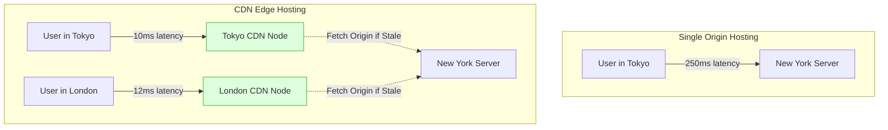
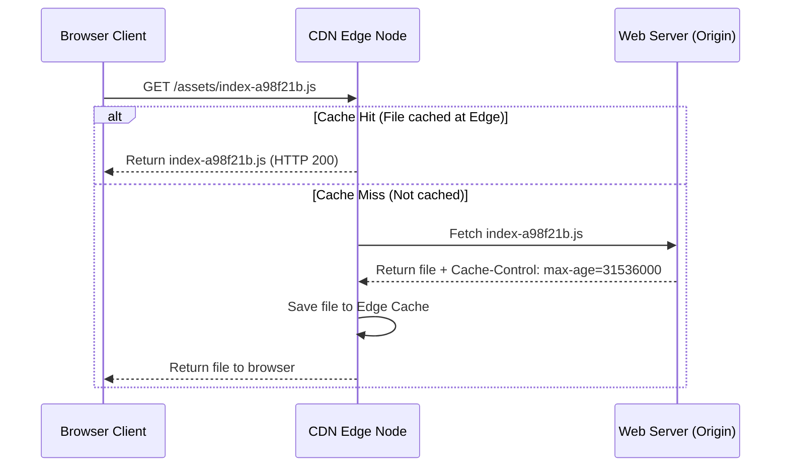
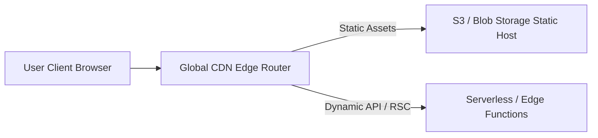
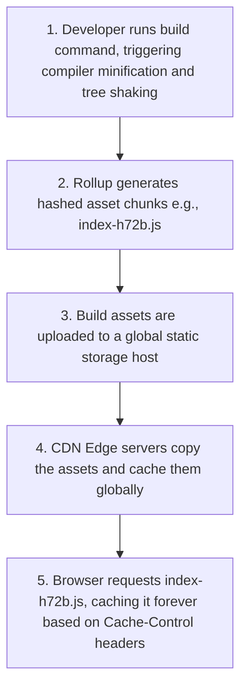

# Deployment Strategies & CDNs

## Introduction

Once your React application is built and tested, you must deploy it to web servers so users can access it. Shipping production code requires building optimized assets, caching static files, and distributing bundles globally. This module covers production bundle compilation, **Tree Shaking** (removing unused code), static asset hosting, configuring **Content Delivery Networks (CDNs)**, and Edge rendering pipelines.

---

## Why do we need this?

If you deploy unoptimized development bundles or host assets on a single remote server, pages will load slowly, especially for users far away from the server.

### Problem Statement
Consider an application hosted on a single server in New York.
1. A user in Tokyo attempts to load the page.
2. The browser must send network requests across the ocean to fetch the JavaScript files, taking hundreds of milliseconds due to network latency.
3. If the server is offline or overloaded, the user gets a timeout error, and the app is unavailable.
4. Without proper caching headers, the user's browser must re-download the entire JS bundle on every page visit, consuming bandwidth and slowing down repeat visits.

We need a deployment strategy that compiles optimized assets, caches static files, and distributes them globally using CDNs.

---

## Real World Story

In the early days of web development, deploying applications required manually uploading files to FTP servers.

This was slow and error-prone. If you forgot to upload an asset or updated files in the wrong order, the application broke. Additionally, hosting files on a single server limited scaling. As single-page applications grew, cloud platforms (like AWS, Netlify, and Vercel) introduced static hosting platforms. By integrating with Git platforms (like GitHub), these services automated build compilation, ran tree-shaking, and deployed assets globally to CDN Edge networks on every git push, making deployments fast and reliable.

---

## Real World Analogy

Think of global CDN deployment like a **Chain of Convenience Store Outlets** compared to **Forcing Everyone to Visit a Single Warehouse**.

- **Single Server Hosting (Single Warehouse)**: You open a soda factory with a single warehouse in New York. If a customer in Tokyo wants a soda, they must fly to New York to buy it. The journey takes hours, and the soda gets warm. If the warehouse is crowded, customers stand in line for hours.
- **Global CDN Hosting (Convenience Store Chain)**: You open convenience store outlets (CDN Edge nodes) in Tokyo, London, Sydney, and New York. You stock the shelves with sodas (cached static files). When a customer in Tokyo wants a soda, they walk to the local store and buy it instantly (low latency). You handle high traffic easily because customers are distributed across local outlets.

---

## Visual Explanation

Below is a diagram comparing single-origin hosting with distributed Content Delivery Network (CDN) edge hosting.

### Single-Origin Server Hosting (High Latency)
```
[User in Tokyo] ──(250ms network round-trip)──> [Server in New York] ──> [Returns JS Bundle]
```

### Content Delivery Network (CDN) Hosting (Low Latency)
```
[User in Tokyo] ──(10ms round-trip)──> [Tokyo Edge CDN Node (Cached)] ──> [Returns JS Bundle instantly]
```



---

## Internal Working

Build compilers (like Vite's Rollup configuration) run optimizations to compile your code for production.

The main compiler optimization steps are:
1. **Tree Shaking**: The compiler parses your ES Module imports (`import/export`) and removes unused code from the final bundle, reducing bundle size.
2. **Minification**: Compresses the code by removing whitespace, comments, and shortening variable names.
3. **Hashing**: Appends a unique hash to the generated file name: `main.a98f21b.js`. This allows you to configure browser caching headers safely.

When you request a hashed file, the CDN tells the browser to cache it forever (`Cache-Control: max-age=31536000`). If you deploy a new version, the file hash changes, forcing the browser to download the new file immediately without reading stale cache.



---

## Architecture

A production deployment architecture separates static assets (hosted on global CDNs) from dynamic API endpoints (hosted on serverless Edge functions).



---

## Step-by-Step Flow

When a developer compiles and deploys an application to a production CDN, the following steps occur:



---

## Syntax

```javascript
// vite.config.js Production Build Configuration Options
import { defineConfig } from 'vite';

export default defineConfig({
  build: {
    minify: 'esbuild', // Minify code using fast esbuild compiler
    sourcemap: false,  // Turn off sourcemaps in production to protect source code
    rollupOptions: {
      output: {
        // Configure chunk split rules for dependencies
        manualChunks(id) {
          if (id.includes('node_modules')) {
            return 'vendor'; // Split third-party libraries into a vendor chunk
          }
        },
      },
    },
  },
});
```

---

## Basic Example

Here is a basic example illustrating how **Tree Shaking** automatically removes unused code blocks from the compiled bundle.

```javascript
// 1. mathLib.js (Utility File)
export function add(a, b) {
  return a + b;
}

// This function is defined but never imported.
// The compiler detects this and shakes it out of the production bundle.
export function subtract(a, b) {
  return a - b;
}

// 2. App.jsx (Component)
import React from 'react';
import { add } from './mathLib.js'; // Import only add function

export default function App() {
  return <div>Result: {add(5, 10)}</div>;
}
```

---

## Intermediate Example

An intermediate example showing how to configure browser caching rules inside a production server configuration (e.g., `_headers` configuration for static platforms like Netlify or Cloudflare Pages).

```
# File: public/_headers (Custom Cache Rules Configuration)

# 1. Cache hashed assets forever (hash changes if file contents update)
/assets/*
  Cache-Control: public, max-age=31536000, immutable

# 2. Never cache index.html (ensure users download updated script links)
/index.html
  Cache-Control: public, max-age=0, must-revalidate
```

---

## Advanced Example

An advanced build script configuration displaying dynamic bundle metrics, running compile-time visual profiling using rollup plugins to identify heavy dependencies.

```javascript
// vite.config.js (Advanced Rollup Visualizer Setup)
import { defineConfig } from 'vite';
import react from '@vitejs/plugin-react';
import { visualizer } from 'rollup-plugin-visualizer'; // Analyzes bundle sizes

export default defineConfig({
  plugins: [
    react(),
    // Generate a stats.html report detailing bundle chunk sizes on build
    visualizer({
      filename: './dist/stats.html',
      open: false, // Set to true to open the report automatically in the browser
      gzipSize: true,
      brotliSize: true
    })
  ]
});
```

---

## Production Example

A production-grade environment variables configuration setup, handling secure production API switches, CDN proxy redirects, and build-time optimization gates.

```javascript
// 1. env.config.js (Production Environment Switch)
const API_URL = import.meta.env.VITE_API_URL || 'https://api.yoursite.com';

export function getProductionHeaders() {
  return {
    'Content-Type': 'application/json',
    'X-API-Environment': import.meta.env.MODE, // 'production' or 'development'
  };
}

// 2. netlify.toml (Production Proxy and Routing Configuration)
/*
[[redirects]]
  from = "/api/*"
  to = "https://api.yoursite.com/:splat"
  status = 200
  force = true

[[headers]]
  for = "/*"
  [headers.values]
    X-Frame-Options = "DENY"
    X-Content-Type-Options = "nosniff"
    Referrer-Policy = "strict-origin-when-cross-origin"
    Content-Security-Policy = "default-src 'self'; script-src 'self' 'unsafe-inline';"
*/
```

---

## Folder Structure

```
production-deployment/
├── public/
│   └── _headers
├── src/
│   ├── config/
│   │   └── env.config.js
│   ├── App.jsx
│   └── main.jsx
├── package.json
└── vite.config.js
```

---

## Best Practices

💡 **Did You Know?**  
The `immutable` directive inside `Cache-Control` headers tells the browser that the file contents will never change as long as the filename remains the same. Since files contain unique hashes (e.g. `index-a98f.js`), this avoids unnecessary refetches.

🚀 **Best Practices**
- Set up a Content Delivery Network (CDN) to host and distribute your static assets globally with low latency.
- Set `Cache-Control: public, max-age=31536000, immutable` headers for hashed assets (`/assets/*`) to cache them forever, and set `max-age=0, must-revalidate` for `index.html`.
- Use a bundle visualizer tool (like `rollup-plugin-visualizer`) to profile bundle sizes and optimize code splitting.

---

## Common Mistakes

⚠ **Common Mistakes**

### Caching index.html Forever
Caching `index.html` in browser memory is a common mistake. Since `index.html` references the script links for your application, caching it forever prevents users from loading updates when you deploy new versions. Always configure `index.html` to revalidate on every visit.

```
# ❌ WRONG (Users cannot download updates without manually clearing cache)
/index.html
  Cache-Control: public, max-age=31536000

#  RIGHT
/index.html
  Cache-Control: public, max-age=0, must-revalidate
```

---

## Performance Notes

⚡ **Performance Tips**
Tree shaking relies on ES Modules imports (`import/export`). Avoid using CommonJS modules (`require`), as they prevent build tools from running tree-shaking optimizations, leading to bundle bloat.

---

## Accessibility Notes

♿ **Accessibility Tips**
Deploy components with pre-rendered styles to prevent visual flashes during page loads, which can disorient users.

---

## SEO Notes

CDN routing edge networks serve layouts with low latency. Fast page load speeds directly improve search engine rankings.

---

## Interview Questions

🎯 **Interview Tips**  
In an interview, define Tree Shaking as removing unused code from the bundle using ES Module imports. Explain that CDNs distribute static files globally using Edge nodes, reducing network latency.

### Q1: What is Tree Shaking, and how does it work?
**Answer**: Tree Shaking is a build-time optimization that removes unused code from the compiled bundle. It analyzes the ES Module static import/export statements in your codebase, identifies functions or variables that are defined but never imported, and excludes them from the final production bundle to reduce file size.

### Q2: Why are filenames hashed in production builds?
**Answer**: Filenames are hashed (e.g. `main.a98f21b.js`) so you can configure browser caching headers safely. By using unique hashes, you can tell the browser to cache files forever. When you deploy a new version, the file hash changes, forcing the browser to download the updated file immediately without reading stale cache.

---

## MCQs

1. **Which compilation step removes unused code from production bundles?**
   - A) Minification
   - B) Tree Shaking
   - C) Hashing
   - D) Code splitting
   - *Answer: B*

2. **Why should you configure index.html with `max-age=0` caching headers?**
   - A) To prevent CSS compiling bugs.
   - B) To ensure the browser checks the server for script updates on every page visit, preventing users from loading stale bundles.
   - C) To disable cookie tracking.
   - D) To run scripts offline.
   - *Answer: B*

3. **What is a Content Delivery Network (CDN)?**
   - A) A database storage client.
   - B) A network of distributed servers that cache and serve static assets to users from the nearest Edge node, reducing latency.
   - C) A type of routing middleware.
   - D) An testing framework.
   - *Answer: B*

4. **Which module format is required to support Tree Shaking?**
   - A) CommonJS (`require/module.exports`)
   - B) ES Modules (`import/export`)
   - C) AMD (Asynchronous Module Definition)
   - D) UMD (Universal Module Definition)
   - *Answer: B*

5. **What does the rollup-plugin-visualizer plugin generate?**
   - A) A list of runtime console errors.
   - B) An HTML report visualizing compiled bundle chunk sizes.
   - C) A database migration script.
   - D) An animations dashboard.
   - *Answer: B*

---

## Practice Exercise

### Exercise 1: Cache Header Config
Configure cache control headers for static hashed assets:
```
# public/_headers
/assets/*
  # TODO: Define public cache rules
```

*Solution*:
```
# public/_headers
/assets/*
  Cache-Control: public, max-age=31536000, immutable
```

### Exercise 2: Rollup bundle chunking
Write a Vite configuration file that splits third-party dependencies (`node_modules`) into a separate `vendor` chunk.

### Exercise 3: Production API switch
Write a helper function that returns the API URL dynamically based on whether the application is running in production or development mode.

---

## Debugging Exercise

### The Stale Bundle deployment Bug
A developer deploys an update to their production site, but users report they still see the old version of the page. Identify the cause and explain how to fix it.

```html
<!-- index.html template file -->
<!DOCTYPE html>
<html>
<head>
  <title>Corporate Dashboard</title>
  <!-- BUG: Importing script filename directly without compilation hash signatures,
       meaning browser caches the file and will not fetch updates on deploy. -->
  <script src="/js/main.js"></script>
</head>
<body>
  <div id="root"></div>
</body>
</html>
```

#### Solution
The script import link does not contain a unique hash query or name. If the browser caches `main.js`, it will continue reading the cached file and will not fetch updates when you deploy new versions. To fix this, configure your build tool to append hashes to bundle filenames:

```html
<!-- Corrected (Compiled template filename updates dynamically on build) -->
<!DOCTYPE html>
<html>
<head>
  <title>Corporate Dashboard</title>
  <!-- Compiled name contains unique hash signature -->
  <script src="/assets/main-a98f21b.js"></script>
</head>
<body>
  <div id="root"></div>
</body>
</html>
```

---

## Real-world Scenario

You are deploying a global SaaS application. Users in Sydney complain that initial page loads are slow. The application is hosted on a static server in San Francisco. Explain your optimization plan.
- **Design Strategy**: Set up a global CDN (like Cloudflare, Vercel, or AWS CloudFront) to host and cache your static assets. The CDN will copy and distribute the files to Sydney Edge nodes, allowing local users to download the assets instantly and reducing latency.

---

## Interview Coding Question

### Problem Statement
Write a Vite build configuration script that:
- Optimizes bundle sizes by minifying code.
- Disables sourcemaps.
- Splits the React runtime library (`react`, `react-dom`) into a separate `react-core` chunk.

```javascript
import { defineConfig } from 'vite';
import react from '@vitejs/plugin-react';

export default defineConfig({
  plugins: [react()],
  build: {
    minify: 'esbuild', // Minify code using fast esbuild compiler
    sourcemap: false,  // Turn off sourcemaps in production to protect source code
    rollupOptions: {
      output: {
        manualChunks(id) {
          // Split React runtime library into a separate chunk
          if (id.includes('node_modules/react/') || id.includes('node_modules/react-dom/')) {
            return 'react-core';
          }
        }
      }
    }
  }
});
```

---

## Mini Project

### Production Build Studio
Build a production-optimized sandbox:
- Set up a sample workspace project with Vite.
- Configure path aliases, bundle chunk splitting, and tree-shaking rules.
- Run a production build (`npm run build`) and inspect the compiled assets size metrics using a visualizer report.

---

## Summary

🧠 **Memory Tricks**  
`Hashed assets public, index revalidates`  
- Cache hashed assets forever since their name changes on update.
- Always configure `index.html` to revalidate on every visit.

📖 **Summary**  
Shipping production code requires compiling optimized assets. By using build tools to run minification and tree shaking, and deploying assets to global CDN Edge nodes with proper caching headers, React applications remain fast and reliable.

---

## Cheat Sheet

```javascript
// Production build compilation output folder
// dist/assets/index-a98f21b.js
```

---

## Related Topics
- [Code Splitting & Lazy Loading](../phase-6-performance/code-splitting)
- [CI/CD Automation Pipelines (Next Module)](ci-cd-pipelines)

---

## Further Reading
- [Vite: Building for Production Guide](https://vite.dev/guide/build.html)
- [Cloudflare: What is a CDN?](https://www.cloudflare.com/learning/cdn/what-is-a-cdn/)
